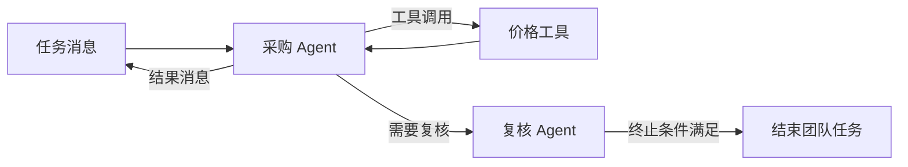

**AutoGen 适合研究消息驱动的多 Agent 协作。一个 Agent 已经能完成任务时，不要为了“看起来更智能”再拆成几个角色。**

它的基本工作方式不是画流程图，而是让 Agent 接收消息、调用工具、产生新消息。多个 Agent 可以组成团队，由团队策略决定谁接下一条消息。



## 单个 Agent 先跑通工具调用

下面按[官方 AgentChat Quickstart](https://microsoft.github.io/autogen/stable/user-guide/agentchat-user-guide/quickstart.html) 改成水果价格示例。代码没有在本站环境中运行。

```bash
pip install -U "autogen-agentchat" "autogen-ext[openai]"
export OPENAI_API_KEY="你的密钥"
```

```python
import asyncio
from autogen_agentchat.agents import AssistantAgent
from autogen_agentchat.ui import Console
from autogen_ext.models.openai import OpenAIChatCompletionClient

async def get_fruit_price(fruit: str) -> str:
    """Return a demo price for one fruit."""
    prices = {"蓝莓": 25, "苹果": 8}
    return f"{fruit} 每盒 {prices.get(fruit, 10)} 元"

async def main():
    model_client = OpenAIChatCompletionClient(model="gpt-4o")
    agent = AssistantAgent(
        name="fruit_buyer",
        model_client=model_client,
        tools=[get_fruit_price],
        system_message="你是水果采购助手。价格不确定时要说明。",
        reflect_on_tool_use=True,
        model_client_stream=True,
    )

    await Console(agent.run_stream(task="蓝莓多少钱？"))
    await model_client.close()

asyncio.run(main())
```

`AssistantAgent` 负责模型与工具循环。`Console` 把消息流打印出来，便于观察它何时调用工具、拿到什么结果、最后怎样回答。

`reflect_on_tool_use=True` 会让模型在工具结果之后再组织回答。它增加了一次模型处理，不是免费的“反思质量保证”。

## 团队需要两个额外规则：谁发言，什么时候结束

多 Agent 团队常用 `RoundRobinGroupChat` 让成员轮流处理，也可以用选择器决定下一位。无论哪种方式，都必须有终止条件。

例如：

```python
from autogen_agentchat.conditions import TextMentionTermination

termination = TextMentionTermination("采购清单已确认")
```

这段配置只表示“出现指定文本就停止”。如果模型始终不输出这句话，任务可能继续消耗额度。生产任务还要在应用层限制轮数、工具次数和执行时间。

团队设计最容易犯的错误是把“讨论更多”当成“结果更好”。多个 Agent 会重复读上下文、互相转述并增加 token。只有子任务确实需要不同工具、权限或专业提示词时，分工才有明确收益。

## 保存状态和长期记忆不是一回事

AutoGen 支持保存和加载 Agent、团队及终止条件的状态。状态可以包含消息历史和内部配置，用于恢复已有工作。

但它不会自动判断哪些信息值得长期保留，也不会自动解决偏好冲突。跨任务记忆仍需要独立存储、检索和权限边界。

还要区分两类恢复：

- **会话恢复**：继续原来的讨论。
- **任务恢复**：从中断的步骤继续执行，并确认工具是否重复执行。

后者必须检查外部副作用。恢复一条消息不代表可以安全地重复下单或付款。

## 什么时候选择 AutoGen

如果你要快速试验“采购 Agent + 复核 Agent”“研究者 + 写作者”这类消息协作，AgentChat 的预设组件能减少样板代码。

如果你需要固定执行顺序、严格状态迁移和精确恢复点，显式图或普通工作流更直接。如果任务只需要一个工具调用，AssistantAgent 已经足够，不必创建团队。

**AutoGen 的核心价值是组织消息与协作，不是用角色数量代替任务分解。先证明单 Agent 的瓶颈，再决定是否引入团队。**
