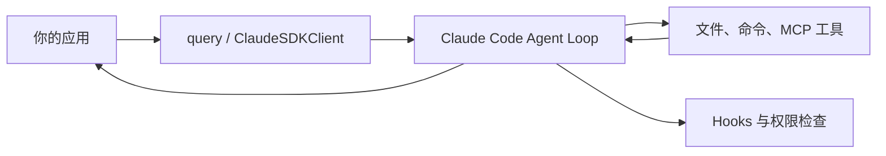

**Claude Agent SDK 适合把 Claude Code 的文件、命令、工具和上下文管理能力嵌入自己的应用。它不是简单调用 Claude API，而是直接复用一套成熟的 Agent 执行环境。**

如果你只需要模型生成文本，Client SDK 更合适。如果需要 Agent 自己读取文件、调用工具并完成多步任务，Agent SDK 才有价值。



## 一个只读的水果偏好 Agent

下面按[官方 Python SDK README](https://github.com/anthropics/claude-agent-sdk-python) 改写。示例没有在本站运行。

```bash
pip install claude-agent-sdk
export ANTHROPIC_API_KEY="你的密钥"
```

假设项目里有 `fruit_preferences.txt`：

```text
用户喜欢蓝莓。
不要推荐芒果。
```

让 Agent 只读这个文件并回答：

```python
import anyio
from claude_agent_sdk import query, ClaudeAgentOptions

async def main():
    options = ClaudeAgentOptions(
        system_prompt="读取水果偏好并简洁回答，不修改任何文件。",
        allowed_tools=["Read"],
        disallowed_tools=["Write", "Edit", "Bash"],
        max_turns=4,
    )

    async for message in query(
        prompt="读取 fruit_preferences.txt，回答用户喜欢什么水果。",
        options=options,
    ):
        print(message)

anyio.run(main)
```

`query()` 返回异步消息流。SDK 会运行 Agent 循环，读取文件并生成回答，不需要你自己实现工具调用协议。

`max_turns=4` 给执行轮数设上限。它不能代替超时和业务校验，但可以防止任务无限继续。

## 权限配置最容易读错

官方 README 特别强调：`allowed_tools` 是**自动批准列表**，不是“只暴露这些工具”的完整工具清单。未列出的工具仍可能进入权限流程。

要阻止特定工具，使用 `disallowed_tools`；需要更细的控制，则结合 `permission_mode`、`can_use_tool` 和 Hooks。

这个区别很重要。把 `allowed_tools=["Read"]` 当成绝对沙盒，可能让其他工具进入审批或配置允许的流程，而不是彻底消失。

## query 和 ClaudeSDKClient 怎么选

`query()` 适合一次性任务：给输入，读取消息流，等待结束。

`ClaudeSDKClient` 支持双向、多轮交互，还能使用 Python 函数定义的自定义工具和 Hooks。需要持续会话、审批回调或动态工具时，它更合适。

SDK 的 Session 可以维持上下文，也支持以后恢复或分叉。项目中的 `.claude/` 和用户目录下的 Skills、命令与记忆会按 Claude Code 的规则加载。部署到共享环境时，要检查这些本地文件是否带入意外指令或数据。

## Agent SDK、Client SDK、Managed Agents 的区别

| 需求 | 选择 |
| --- | --- |
| 自己运行 Agent 循环，复用 Claude Code 工具和上下文 | Agent SDK |
| 直接调用模型 API，自己实现工具循环 | Client SDK |
| 让 Anthropic 托管长时间运行、异步 Agent 和沙盒 | Managed Agents |
| 在终端交互开发或执行一次性任务 | Claude Code CLI |

Agent SDK 不等于 Managed Agents。前者在你的运行环境中执行，后者由 Anthropic 托管。两者的数据、权限和运维责任不同。

**选择 Claude Agent SDK 的理由不是“调用 Claude 更方便”，而是你需要 Claude Code 的执行循环、工具与上下文管理。接入后最先检查的是工具权限和本地配置加载，而不是只看最终回答。**
