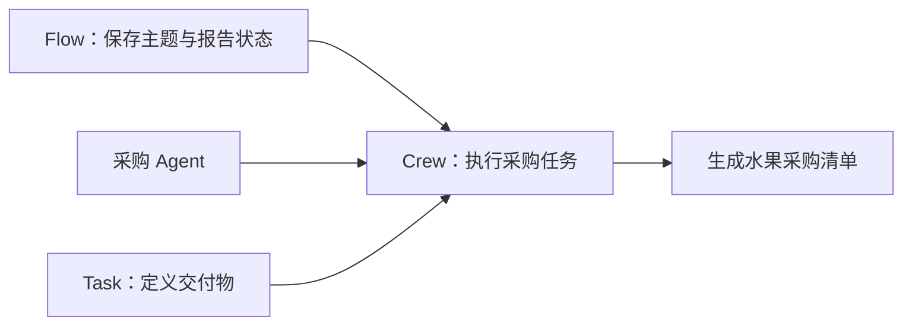

**CrewAI 适合把任务写成“谁负责什么、交付什么、按什么顺序执行”。它的优势是业务结构清晰，不是多 Agent 讨论得越热闹越好。**

如果任务只有一个输入和一次工具调用，直接用 Agent 就可以。需要多个角色协作时用 Crew；需要显式状态、路由和长期业务流程时，再让 Flow 管理 Crew。



## 三个层次分别负责什么

**Agent** 是执行者，有角色、目标和可用工具。

**Task** 是工作说明，必须写清输入、预期输出和执行者。`expected_output` 很重要，它决定结果是一份清单、一段分析还是一个文件。

**Crew** 把 Agent 和 Task 组织成一次协作。顺序执行（sequential）适合“先调研再写作”；需要管理 Agent 动态分派时才考虑更复杂的流程。

**Flow** 是更外层的业务状态机。它保存主题、报告、审批状态等数据，并决定何时运行哪个 Crew。官方当前 Quickstart 也推荐用 Flow 组织生产应用，而不是把所有状态塞进 Agent 提示词。

## 一个最小采购任务

下面使用 CrewAI 常见的 Agent/Task/Crew API 展示核心关系。模型与工具需要按你的环境配置；示例没有在本站运行。

```python
from crewai import Agent, Task, Crew, Process

buyer = Agent(
    role="水果采购助手",
    goal="根据预算和忌口生成可执行的采购清单",
    backstory="你会检查价格、数量和用户明确限制。",
)

task = Task(
    description=(
        "为用户生成一份水果采购清单。预算 50 元，不要推荐芒果。"
        "列出水果、数量和预计价格；价格未知时明确标注。"
    ),
    expected_output="一份包含水果、数量、预计价格和总价的 Markdown 表格。",
    agent=buyer,
)

crew = Crew(
    agents=[buyer],
    tasks=[task],
    process=Process.sequential,
)

result = crew.kickoff()
print(result.raw)
```

这个例子没有工具，因此价格只能来自模型已有知识，不能当成实时报价。真正的采购应用应提供价格查询工具，并在下单前重新验证库存、金额和用户授权。

官方 Quickstart 还展示了另一种生产结构：Flow 保存 `topic` 和 `report`，Crew 负责搜索与写作，任务通过 `output_file` 把报告写入磁盘。**交付物写文件，比只把长文本留在对话里更容易验收。**

## 角色和提示词不能代替业务约束

“你是严谨的采购专家”不会让价格自动准确，也不会阻止Agent买错东西。预算、库存、忌口和权限需要结构化输入与程序检查。

多 Agent 分工也应该有实际边界。例如：

- 查询 Agent 只读价格，不能下单。
- 清单 Agent 只组织结果，不写支付工具。
- 审批由业务代码或用户完成，不由“审批 Agent”口头确认。

如果只给多个 Agent 同一套工具和同一个目标，通常只是增加转述与 token，并没有形成权限或能力分工。

## 什么时候选择 CrewAI

需要快速把业务任务写成角色、交付物和协作顺序时，CrewAI 很直观。研究报告、内容生产、资料整理和多步骤交付都适合这种表达。

如果需要精确控制每一次状态变化，显式图会更透明。如果任务只是一个函数调用，直接代码最简单。如果团队中的每个 Agent 都没有独立工具或权限，先合并它们。

**CrewAI 最值得用的是任务结构和交付物，不是角色扮演。先把一个 Task 的输出写清楚，再决定是否需要 Crew 和 Flow。**
