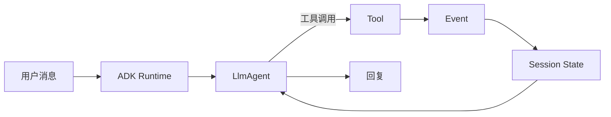

**Google ADK 适合需要完整 Agent 工程结构的应用：Agent 定义、会话状态、工具、事件和调试界面都有明确位置。只想调用一次模型时，它显得偏重。**

ADK 的核心不是只提供一个 `run()`。它用项目目录管理 Agent，用 Session 保存对话状态，用事件把模型、工具和回调产生的变化传给运行时。



## 先创建标准项目

下面按[官方 Python Quickstart](https://adk.dev/get-started/python/) 改写成水果价格 Agent。示例没有在本站运行。

```bash
pip install google-adk
adk create fruit_agent
```

项目结构如下：

```text
fruit_agent/
├── agent.py
├── __init__.py
└── .env
```

`agent.py` 中的 `root_agent` 是 ADK 识别项目的入口。加入一个价格工具：

```python
from google.adk.agents.llm_agent import Agent

def get_fruit_price(fruit: str) -> dict:
    """Return a demo price for one fruit."""
    prices = {"蓝莓": 25, "苹果": 8}
    return {
        "status": "success",
        "fruit": fruit,
        "price": prices.get(fruit, 10),
    }

root_agent = Agent(
    model="gemini-flash-latest",
    name="fruit_agent",
    description="查询水果价格。",
    instruction="使用 get_fruit_price 查询价格；结果未知时明确说明。",
    tools=[get_fruit_price],
)
```

`.env` 中配置模型服务密钥。不要提交这个文件。开发时可以用 CLI 或 Web 界面：

```bash
adk run fruit_agent
adk web --port 8000
```

`adk web` 提供调试界面，但官方明确说明它不是生产部署界面。

## Session State 保存的是会话状态

ADK 的 Session 表示一段持续交互。State 保存这段交互里的数据，例如用户当前选择的水果、预算和订单步骤。

在指令中可以使用状态模板，让 Agent 读取当前值。它适合“本轮订单进行到哪一步”，不适合无条件积累所有历史事实。

需要区分：

- **Session State**：当前会话或流程的状态。
- **长期记忆**：跨会话、需要提取和检索的知识。
- **业务数据库**：订单、库存和支付的真实记录。

ADK 给事件和状态提供了工程框架，但不会因为存了 State 就自动理解哪些偏好应该长期保留。

## Agent 不一定只有一个

ADK 提供 LLM Agent，也提供顺序、并行和循环等工作流 Agent。工作流 Agent 用明确规则组织子 Agent，适合步骤固定的任务。

例如“先查价格，再生成清单”可以显式写成顺序流程。只有在下一步需要模型判断时，才需要让 LLM Agent动态选择工具或子 Agent。

回调（callback）和插件可以在 Agent、模型与工具调用前后执行逻辑。它们适合审计、状态校验和横切处理，但业务权限仍应在真正执行操作的服务中验证。

## 什么时候选择 ADK

如果你已经使用 Gemini，或者需要标准化的项目结构、会话、事件和调试工具，ADK 的完整性有价值。

如果只是写一个函数工具加一次模型调用，直接使用模型 SDK 更少概念。如果需要完全自定义状态图，显式图框架更透明。生产环境还要单独设计认证、数据持久化、并发和部署，不能把开发 Web UI 当成产品后端。

**ADK 的价值是把 Agent 应用拆成可管理的工程部件。先区分 Session、长期记忆和业务数据，再使用这些部件，才能避免把所有状态都塞进同一个会话。**
