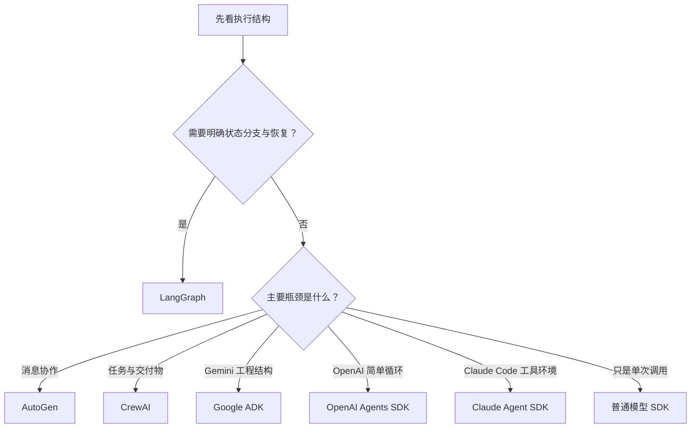

**选框架先看执行结构，不要先看模型供应商和角色数量。** 一次工具调用用普通 SDK 足够；需要可见的状态分支和恢复点用 LangGraph；需要消息驱动的团队协作用 AutoGen；需要把业务任务和交付物写清楚用 CrewAI；Gemini 项目的完整工程结构选 Google ADK；OpenAI 生态的简单循环选 Agents SDK；要复用 Claude Code 的文件、命令和上下文能力才选 Claude Agent SDK。

本文统一用“仓库巡检 Agent”比较：读取指定项目文件，生成巡检报告；需要修改文件时必须先审批。这个任务同时暴露执行循环、状态、权限和交付物，比只比较谁能调用一个函数更有区分度。

## 1. 六种框架的第一选择

| 框架 | 核心抽象 | 什么时候值得选 | 什么时候反而偏重 |
| --- | --- | --- | --- |
| LangGraph | State、Node、Edge、Checkpointer | 条件分支、暂停审批、精确恢复点都要可见 | 只有一次工具调用，没有分支和恢复需求 |
| AutoGen | AssistantAgent、消息、Team、Termination | 快速试验消息驱动的多 Agent 协作 | 执行顺序固定，或单 Agent 已能完成 |
| CrewAI | Agent、Task、Crew、Flow | 角色、任务、交付物和协作顺序需要清晰表达 | 只需一个函数；不需要角色分工 |
| Google ADK | LlmAgent、Session、Event、Workflow Agent | 已使用 Gemini，需要标准项目结构、会话、事件和调试工具 | 只需模型 SDK 的一次调用 |
| OpenAI Agents SDK | Agent、Runner、Session、Handoff | 函数工具、多轮对话和少量转交需要简单实现 | 复杂状态机和精确恢复点 |
| Claude Agent SDK | query、ClaudeSDKClient、Hooks、Sessions | 要嵌入 Claude Code 的执行循环、文件和命令工具 | 只需要 Claude 模型生成文本 |



**框架能减少样板代码，但不会替业务完成权限、幂等、状态恢复和结果验收。** 这些工作仍需在具体工具和执行层实现。

## 2. 同一个任务，六种实现重点有什么不同

<a id="langgraph"></a>

### LangGraph：把继续、审批和恢复写成明确路径

LangGraph 把巡检任务画成图：模型节点决定是否需要工具，工具节点读取文件，条件边决定继续、结束还是进入审批。

```python
def route(state):
    if state["approval_required"]:
        return "approval"
    if state["messages"][-1].tool_calls:
        return "tools"
    return END
```

这段 `route` 比工具本身更重要：它把“下一步去哪”变成可单测的普通函数。State 保存消息、重试次数和审批结果，节点返回状态更新，边决定执行路径。

需要恢复时，在编译时接入 checkpointer，并用 `thread_id` 标识同一条执行线程：

```python
from langgraph.checkpoint.memory import InMemorySaver

agent = builder.compile(checkpointer=InMemorySaver())
config = {"configurable": {"thread_id": "repo-review-001"}}
```

内存实现只适合开发。生产环境要换成满足持久化和多实例要求的 checkpointer。它保存的是“执行到哪里”，不会自动提炼长期偏好。

**选择理由：你是否需要把 Agent 当成一张可检查、可恢复的状态图。** 如果不需要，简单循环更少概念。[LangGraph Quickstart](https://docs.langchain.com/oss/python/langgraph/quickstart)

<a id="autogen"></a>

### AutoGen：围绕消息和团队协作，而不是围绕状态图

AutoGen 的 `AssistantAgent` 接收任务消息、调用工具、产生新消息。单个 Agent 先跑通巡检，再考虑是否增加复核角色。

```python
agent = AssistantAgent(
    name="repo_reviewer",
    model_client=model_client,
    tools=[get_repository_file],
    system_message="只读取指定文件并生成巡检报告，不修改仓库。",
    reflect_on_tool_use=True,
    model_client_stream=True,
)
```

`reflect_on_tool_use=True` 让模型在工具结果后再组织回答，会增加模型处理，不是免费的质量保证。

团队还需要两条额外规则：谁接下一条消息，什么时候终止。`TextMentionTermination("巡检报告已确认")` 只表示出现指定文本就停止；模型始终不写这句话时，应用层仍要限制轮数、工具次数和总时间。

**选择理由：需要快速试验“巡检 Agent + 复核 Agent”的消息协作。** 需要严格状态迁移时，显式图更直接。[AutoGen AgentChat Quickstart](https://microsoft.github.io/autogen/stable/user-guide/agentchat-user-guide/quickstart.html)

<a id="crewai"></a>

### CrewAI：把执行者、交付物和业务流程分开

CrewAI 最适合表达“谁负责什么、交付什么、按什么顺序执行”。Task 的 `expected_output` 决定结果是一段文字还是一份可验收文件。

```python
reviewer = Agent(
    role="仓库巡检助手",
    goal="根据指定文件生成可核验的巡检报告",
    backstory="只引用实际读到的内容，不修改文件。",
)

task = Task(
    description="检查指定项目的配置与说明文件，列出证据位置和未解决问题。",
    expected_output="一份包含问题、证据位置、影响和建议的 Markdown 报告。",
    agent=reviewer,
)
```

Crew 组织 Agent 和 Task，顺序执行适合“先调查再写作”。Flow 在更外层保存主题、报告和审批状态，并决定何时运行哪个 Crew。报告通过 `output_file` 写入磁盘，比只留在对话里更容易验收。

角色提示词不会自动带来权限分工。查询 Agent 只读文件，修改 Agent 也不能绕过审批；所谓“审批 Agent”口头同意不等于真实审批。

**选择理由：业务任务和交付物比状态图更重要。**[CrewAI 文档](https://docs.crewai.com/)

<a id="google-adk"></a>

### Google ADK：把 Agent 应用拆成标准工程部件

ADK 用项目目录管理 Agent，`root_agent` 是识别入口。巡检工具可以返回结构化结果：

```python
from google.adk.agents.llm_agent import Agent

def get_repository_file(path: str) -> dict:
    """Read one allow-listed text file."""
    return {"status": "success", "path": path, "content": "demo"}

root_agent = Agent(
    model="gemini-flash-latest",
    name="repo_reviewer",
    description="读取指定文件并生成巡检报告。",
    instruction="只读取允许的文本文件，不执行修改操作。",
    tools=[get_repository_file],
)
```

`adk run` 用于命令行调试，`adk web` 提供开发界面，但官方明确说明 Web UI 不是生产部署界面。

ADK 的 Session State 保存当前会话或流程数据，事件把模型、工具和回调产生的变化传给运行时。顺序、并行和循环等 Workflow Agent 可以显式组织固定步骤，不必所有分派都交给 LLM。

**选择理由：已经使用 Gemini，或者需要 Agent、Session、事件、回调和调试工具的完整工程结构。**[Google ADK Python Quickstart](https://adk.dev/get-started/python/)

<a id="openai-agents-sdk"></a>

### OpenAI Agents SDK：用 Runner 覆盖常见执行循环

`Agent` 定义名字、指令和工具，`Runner.run` 处理“模型请求工具—执行—继续请求”的循环：

```python
from agents import Agent, Runner

agent = Agent(
    name="仓库巡检助手",
    instructions="读取允许的仓库文件，生成有证据位置的报告。",
    tools=[get_repository_file],
)

result = await Runner.run(agent, "巡检这个项目，不修改文件。")
print(result.final_output)
```

多轮历史有三种处理：

- `result.to_input_list()` 由应用自己保存和传递，边界最清楚。
- 给 Runner 传 `session`，由 SDK 加载和保存历史。
- 用 `previous_response_id` 或 `conversation_id` 连接 OpenAI 管理的状态。

这三种方式解决对话延续，不自动完成长期记忆、删除和权限隔离。

多 Agent 还要区分 Handoff 和 Agent as Tool：前者由另一个 Agent 接管当前任务和最终回答，后者只把专业 Agent 的结果交给仍掌握任务的主 Agent。选择标准是**谁拥有当前状态和最终责任**。

**选择理由：需要少量抽象覆盖提示词、函数工具和多轮对话。**[OpenAI Agents SDK Quickstart](https://openai.github.io/openai-agents-python/quickstart/)

<a id="claude-agent-sdk"></a>

### Claude Agent SDK：复用 Claude Code 的执行环境

Claude Agent SDK 适合让 Agent 自己读取文件、执行命令并完成多步任务。只读巡检可以这样限制：

```python
from claude_agent_sdk import query, ClaudeAgentOptions

options = ClaudeAgentOptions(
    system_prompt="只读取指定项目文件并生成报告，不修改任何内容。",
    allowed_tools=["Read"],
    disallowed_tools=["Write", "Edit", "Bash"],
    max_turns=4,
)

async for message in query(prompt="巡检指定文件", options=options):
    print(message)
```

这里最容易读错权限：`allowed_tools` 是**自动批准列表**，不是“只暴露这些工具”的完整清单。要阻止工具，使用 `disallowed_tools`；更细的控制再结合 `permission_mode`、`can_use_tool` 和 Hooks。只写 `allowed_tools=["Read"]` 不能当作绝对沙箱。

`query()` 适合一次性任务；`ClaudeSDKClient` 支持双向多轮交互、自定义工具和 Hooks。SDK 还会按 Claude Code 规则加载项目 `.claude/` 和用户目录中的 Skills、命令与记忆，共享环境必须检查这些本地文件是否带入意外指令或数据。

它与其他入口的边界是：Client SDK 只调用模型；Agent SDK 在你的环境运行 Agent 循环；Managed Agents 由 Anthropic 托管长时间任务和沙箱。

**选择理由：你需要的是 Claude Code 的执行循环和上下文管理，而不只是 Claude 模型。**[Claude Agent SDK Python](https://github.com/anthropics/claude-agent-sdk-python)

## 3. 四种“状态”不要混为一谈

| 状态 | 例子 | 应该怎样保存 |
| --- | --- | --- |
| 当前对话 | 最近消息、用户刚才指定的目录 | 应用历史、SDK Session 或服务端对话状态 |
| 执行进度 | 已读哪些文件、下一步、审批状态、重试次数 | checkpointer、Flow、任务数据库或明确状态机 |
| 长期记忆 | 用户长期偏好、过往决定、可复用经验 | 独立写入、检索、冲突和删除规则 |
| 业务事实 | 文件当前内容、订单、库存、权限 | 业务系统与版本化存储，执行时重新核对 |

框架保存 Session 或 Checkpoint，不等于后两类已经解决。恢复一条消息，也不代表可以安全地重复下单、修改文件或执行命令。

## 4. 框架之外的验收顺序

1. 先用一个只读工具跑通，保存工具输入、结果和最终输出。
2. 加入文件白名单、轮次和超时限制，再测试越权路径与错误输入。
3. 需要恢复时，明确保存的是对话、执行进度还是业务结果，并测试进程重启。
4. 需要写操作时，把审批绑定真实文件和参数；不能用角色名或输出 Guardrail 代替业务校验。
5. 只有单 Agent 出现明确瓶颈，才增加团队，并写清最终责任、终止条件和总预算。
6. 用同一任务比较框架，记录执行路径是否清楚、恢复是否可靠、额外调用和维护成本是否值得。

## 主要资料

- [LangGraph Quickstart](https://docs.langchain.com/oss/python/langgraph/quickstart)、[Graph API](https://docs.langchain.com/oss/python/langgraph/graph-api)
- [AutoGen AgentChat Quickstart](https://microsoft.github.io/autogen/stable/user-guide/agentchat-user-guide/quickstart.html)、[Teams](https://microsoft.github.io/autogen/stable/user-guide/agentchat-user-guide/tutorial/teams.html)
- [CrewAI Agents](https://docs.crewai.com/concepts/agents)、[Crews](https://docs.crewai.com/concepts/crews)、[Flows](https://docs.crewai.com/concepts/flows)
- [Google ADK Python Quickstart](https://adk.dev/get-started/python/)、[State](https://adk.dev/sessions/state/)
- [OpenAI Agents SDK Quickstart](https://openai.github.io/openai-agents-python/quickstart/)、[Running agents](https://openai.github.io/openai-agents-python/running_agents/)
- [Claude Agent SDK Overview](https://docs.anthropic.com/en/api/agent-sdk/overview)、[Python SDK README](https://github.com/anthropics/claude-agent-sdk-python)

本文只按 2026-11-14 核对的官方文档比较抽象和边界，示例代码未在本站环境运行；具体安装版本、API 字段和模型名以项目实际使用版本为准。
