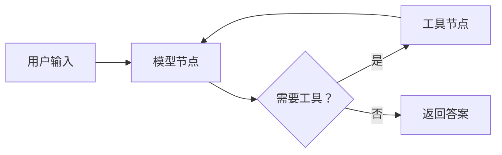

**如果 Agent 需要明确状态、条件分支、暂停审批和故障恢复，LangGraph 很合适。只有一次“提问—调用工具—回答”时，直接写执行循环通常更简单。**

LangGraph 不把 Agent 当成一个黑盒。它把执行过程画成图：节点负责工作，状态在节点之间传递，边决定下一步去哪。



## 图里的三个核心概念

**状态（State）**是当前任务的数据，例如消息列表、已重试次数和审批结果。节点返回状态更新，而不是把全部控制权藏在框架里。

**节点（Node）**是一个函数。它可以调用模型、执行工具、读写数据库，也可以只做普通业务校验。

**边（Edge）**决定执行顺序。条件边可以根据状态选择下一个节点，因此“价格查询失败后重试”和“高风险操作先审批”都能写成明确路径。

LangGraph 的价值不在于让模型更聪明，而在于让这些路径可见、可测试、可恢复。

## 用 Graph API 写一个水果价格 Agent

下面按[官方 Quickstart](https://docs.langchain.com/oss/python/langgraph/quickstart) 的 Graph API 改写。示例使用 Anthropic 模型；代码没有在本站环境中运行。

```bash
pip install -U langgraph langchain langchain-anthropic
export ANTHROPIC_API_KEY="你的密钥"
```

```python
import operator
from typing import Annotated, Literal
from typing_extensions import TypedDict

from langchain.tools import tool
from langchain.chat_models import init_chat_model
from langchain.messages import AnyMessage, HumanMessage, ToolMessage
from langgraph.graph import StateGraph, START, END
from langgraph.prebuilt import ToolNode

@tool
def get_fruit_price(fruit: str) -> str:
    """Return a demo price for one fruit."""
    prices = {"蓝莓": 25, "苹果": 8}
    return f"{fruit} 每盒 {prices.get(fruit, 10)} 元"

class State(TypedDict):
    messages: Annotated[list[AnyMessage], operator.add]

model = init_chat_model("claude-sonnet-4-6", temperature=0)
tools = [get_fruit_price]
model_with_tools = model.bind_tools(tools)

def call_model(state: State):
    return {"messages": [model_with_tools.invoke(state["messages"])]}

def route(state: State) -> Literal["tools", END]:
    return "tools" if state["messages"][-1].tool_calls else END

builder = StateGraph(State)
builder.add_node("model", call_model)
builder.add_node("tools", ToolNode(tools))
builder.add_edge(START, "model")
builder.add_conditional_edges("model", route, ["tools", END])
builder.add_edge("tools", "model")

agent = builder.compile()
result = agent.invoke({
    "messages": [HumanMessage(content="蓝莓多少钱？")]
})
print(result["messages"][-1].content)
```

模型先收到问题。需要价格时进入工具节点，工具结果再回到模型节点。循环持续到模型不再请求工具。

这里最重要的代码不是 `get_fruit_price`，而是 `route`：它把“继续还是结束”变成了可以单测的普通函数。

## 持久化保存的是执行状态，不等于长期知识

LangGraph 的 checkpointer 会在执行节点之间保存状态，用来暂停、恢复和继续同一线程。开发环境可以使用内存实现：

```python
from langgraph.checkpoint.memory import InMemorySaver

agent = builder.compile(checkpointer=InMemorySaver())
config = {"configurable": {"thread_id": "fruit-order-001"}}

result = agent.invoke({
    "messages": [HumanMessage(content="蓝莓多少钱？")]
}, config=config)
```

`thread_id` 标识同一条执行线程。生产环境应换成满足持久化和多实例要求的 checkpointer，不能用进程内存代替数据库。

这种机制保存的是“任务执行到哪里”。它不会自动提炼用户偏好，也不会替你建立跨任务知识库。需要长期记忆时，还应设计独立的写入和检索流程。

## 什么时候不要用它

只有一个模型节点、没有分支和恢复需求时，图结构会增加概念和代码量。角色扮演聊天也不需要把每句回复拆成多个节点。

LangGraph 也不能保证业务安全。模型仍可能选错工具，节点仍可能写坏数据。权限校验、输入验证、重试上限和超时都要由具体节点执行。

**选择 LangGraph 的判断标准很直接：你是否需要把 Agent 的执行过程当成一张可以检查和恢复的状态图。如果需要，它的复杂度有收益；如果不需要，简单循环更好。**
