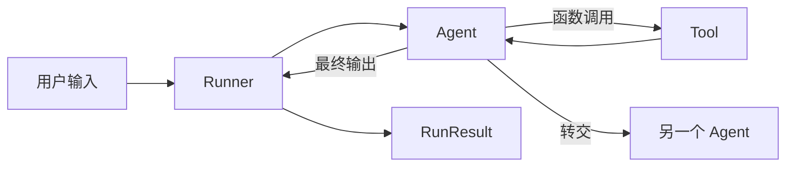

**如果你的任务主要是提示词、函数工具和多轮对话，OpenAI Agents SDK 的 Agent + Runner 足够直接。需要复杂状态机时，再考虑显式图。**

它把执行循环收进 `Runner`：模型决定是否调用工具，SDK 执行工具并把结果交给模型，直到返回最终输出或发生转交。



## 一个带工具的水果 Agent

下面按[官方 Quickstart](https://openai.github.io/openai-agents-python/quickstart/) 改写。示例没有在本站运行，需要 OpenAI API 密钥。

```bash
pip install openai-agents
export OPENAI_API_KEY="你的密钥"
```

```python
import asyncio
from agents import Agent, Runner
from agents.decorators import tool

@tool
def get_fruit_price(fruit: str) -> str:
    """Return a demo price for one fruit."""
    prices = {"蓝莓": 25, "苹果": 8}
    return f"{fruit} 每盒 {prices.get(fruit, 10)} 元"

agent = Agent(
    name="水果采购助手",
    instructions="回答水果价格。需要价格时调用工具，不知道就说不知道。",
    tools=[get_fruit_price],
)

async def main():
    result = await Runner.run(agent, "蓝莓多少钱？")
    print(result.final_output)

asyncio.run(main())
```

`Agent` 定义名字、指令和工具，`Runner.run` 执行循环，`RunResult.final_output` 是最终回答。你不需要自己实现“模型返回工具调用—执行—继续请求”的循环。

## 多轮历史有三种选择

**手动管理输入**：把 `result.to_input_list()` 传给下一轮。历史完全由应用控制，也方便接自己的数据库。

**使用 Session**：给 Runner 传 `session`，由 SDK 加载和保存历史。适合希望框架处理会话存储的应用。

**使用服务端延续**：通过 `previous_response_id` 或 `conversation_id` 连接 OpenAI 管理的状态。它能减少本地历史管理，但也把状态边界放到了服务端。

这三种方式解决的是对话延续，不等于已经建立长期记忆。偏好提取、跨任务检索、删除和权限仍需单独设计。

## 多 Agent 有两种不同模式

**Handoff（转交）**意味着另一个 Agent 接管当前任务。例如“采购 Agent”把营养问题转给“营养 Agent”。最终回答由接手者负责。

**Agent as Tool（把 Agent 当工具）**意味着主 Agent 仍然控制任务，只调用专业 Agent 获取结果。例如采购助手调用价格分析 Agent，但清单仍由采购助手完成。

选择标准是：**谁应该拥有最终回答和当前状态？**需要接管就 Handoff，只需要子任务结果就 Agent as Tool。

## Guardrail 与业务校验不要混为一谈

Guardrail 用来检查输入或输出，例如拦截包含密钥的请求、拒绝不符合格式的回答。它不能保证工具没有副作用。

采购任务中的预算、库存和下单权限必须在工具与业务服务中校验。一个输出格式检查器无法阻止已经发生的错误购买。

执行时还要设置轮次、工具次数和超时边界。SDK 能运行循环，但不会替业务决定什么时候应该停止。

**OpenAI Agents SDK 的核心优势是用少量抽象覆盖常见 Agent 循环。先用 Agent + Runner 跑通，再根据最终状态归属选择 Handoff 或 Agent as Tool，不要一开始就设计多 Agent 架构。**
