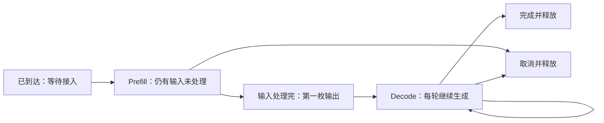
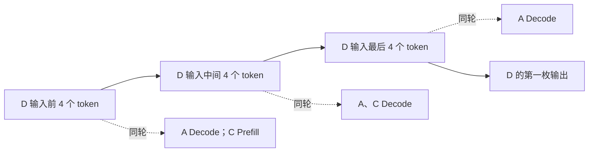

import { Code } from '@astrojs/starlight/components';
import schedulerSource from '../../../../public/ai-infra-labs/scheduler.py?raw';

推理调度器决定一轮 GPU 执行包含哪些请求、多少新 token。**连续批处理允许在生成轮次之间接入新请求；分块 Prefill 把长输入拆开，限制它一次占用的工作量。** 两者可以减少等待或输出停顿，但也会改变其他请求的首 token 时间，不能仅凭批处理形式判断性能优劣。

下面用四条请求逐轮计算。模拟器将一个 Prefill token 的成本设为 1、一个 Decode token 的成本设为 2，时间由本轮成本相加得到。这是公开的教学假设，不是 GPU 毫秒数；它刻意不模拟并行加速，让请求选择和延迟取舍可以单独核对。

## 调度一轮要先看哪些状态

请求首先等待接入。需要处理输入的请求处于 Prefill，输入处理完后产生第一枚输出；若还要继续输出，就进入 Decode。请求完成或取消后，其资源才可供其他请求使用。



请求数预算限制活跃请求数量，token 预算限制本轮新计算的位置数。Decode 请求本轮通常需要一个新位置；一次完整 Prefill 可能需要几千个。两条请求不一定是相同工作量。

教学模拟最多同时接纳 4 条请求，每轮 token 预算为 16。优先给可 Decode 的请求各分配一个 token，再按到达顺序安排 Prefill。分块模式额外规定每条请求本轮最多 Prefill 4 个 token。这项单请求上限是模拟规则，不能当成 vLLM 的同名配置。

## 四条请求与三个调度规则

| 请求 | 到达时间 | 输入长度 | 输出长度 |
| --- | --- | --- | --- |
| A | 0 | 4 | 4 |
| B | 0 | 4 | 1 |
| C | 2 | 4 | 2 |
| D | 2 | 12 | 2 |

时间 0 只有 A、B 可以接入。第一轮 Prefill 一共处理 8 个输入 token，成本为 8；到时间 8，两条请求都产生第一枚输出，B 已完成。

三种模式之后的区别是：

| 模式 | 何时接纳 C、D | 怎样处理 D 的 12 个输入 |
| --- | --- | --- |
| 静态批 | 当前批的 A、B 都完成后 | 一次处理完整输入 |
| 连续批 | 轮次之间允许补入 | 输入必须整段放入本轮预算，否则等待 |
| 分块连续批 | 轮次之间允许补入 | 分几轮处理，每轮最多 4 个输入 token |

静态批在 B 完成后仍不补入 C、D，但模拟器不会继续为 B 计算无效 Decode。固定形状实现还可能有 padding 浪费，那是这里没有建模的另一种成本。

## 连续批怎样改变排队和输出间隔

静态批先完成 A 的三个 Decode：时间 10、12、14 依次输出。然后 C、D 一起 Prefill 16 个 token，时间 30 才给出首枚输出，时间 34 结束。

连续批在时间 8 接纳 C、D，但本轮先为 A 的 Decode 留一个 token。再安排 C 的 4 个 Prefill token，预算剩 11，放不下 D 的完整 12 个，因此 D 等下一轮。

| 轮次 | 起止时间 | 选中的工作 | 本轮成本 | 输出事件 |
| --- | --- | --- | --- | --- |
| 1 | 0 → 8 | A Prefill 4，B Prefill 4 | 8 | A、B 首 token；B 完成 |
| 2 | 8 → 14 | A Decode 1，C Prefill 4 | `2+4=6` | A 第二枚；C 首 token |
| 3 | 14 → 30 | A、C 各 Decode 1，D Prefill 12 | `2+2+12=16` | A 第三枚；C 完成；D 首 token |
| 4 | 30 → 34 | A、D 各 Decode 1 | 4 | A、D 完成 |

C 的首 token 等待从静态批的 28 降到 12，但 A 的输出时间变成 `[8,14,30,34]`，最大相邻间隔为 16。新请求更早接入，不代表已有流式请求的体验同步改善。

注意第三轮：调度器优先选择 Decode 仍不足以避免停顿。Decode 与长 Prefill 在同一轮执行，轮次完成时间会受到这批工作的影响。真实 GPU 内核的成本不是简单相加，但共享执行预算造成的竞争仍需观察。

## 分块 Prefill 怎样限制长输入占用

把 D 的 12 个输入分成三份，每轮只处理 4 个。中间两轮已经完成的 Decode 可以继续获得机会，而 D 的首输出必须等全部输入处理完。

| 轮次 | 起止时间 | 选中的工作 | D 剩余输入 | 输出事件 |
| --- | --- | --- | --- | --- |
| 1 | 0 → 8 | A、B 各 Prefill 4 | 尚未接入 | A、B 首 token |
| 2 | 8 → 18 | A Decode；C Prefill 4；D Prefill 4 | 8 | A 第二枚；C 首 token |
| 3 | 18 → 26 | A、C Decode；D Prefill 4 | 4 | A 第三枚；C 完成 |
| 4 | 26 → 32 | A Decode；D Prefill 4 | 0 | A 完成；D 首 token |
| 5 | 32 → 34 | D Decode | 0 | D 完成 |



A 的最大输出间隔从 16 降到 10；D 的 TTFT 从 28 增到 30。C 首输出也从连续批的 12 增到 16，因为第二轮同时做了 D 的一个输入块。分块限制了长输入一次带来的停顿，却没有让所有指标同时变好。

## 运行模拟器，对照完整时间线

下载[完整调度代码](/ai-infra-labs/scheduler.py)，执行：

```bash
python3 scheduler.py --mode all --token-budget 16 --chunk-size 4
```

程序输出每轮选择、起止时间和每条请求的输出时间。默认结果如下，单位均为模拟成本单位。

| 指标 | 静态批 | 连续批 | 分块连续批 |
| --- | --- | --- | --- |
| A 的最大 ITL | 2 | 16 | 10 |
| C 的 TTFT | 28 | 12 | 16 |
| D 的 TTFT | 28 | 28 | 30 |
| 全部完成时间 | 34 | 34 | 34 |

完成时间相同，因为固定工作量的成本被简单相加，模拟器没有加入批量执行的并行效率。它只能说明这个规则下请求何时获服务，不能用来宣称连续批或分块 Prefill 的真实吞吐收益。

<details>
<summary>完整源码：到达、状态、Decode 优先与 token 预算</summary>
<Code code={schedulerSource} lang="python" title="scheduler.py" />
</details>

把块大小分别改为 2、4、8，观察 A 的最大 ITL、C 和 D 的 TTFT。再改变 D 的到达时间或输入长度。每次只改一个条件，先根据时间线推断影响，再核对输出。

非分块模式必须能把最大输入放入单轮预算，因此把预算降到 8 时，D 的 12 个输入无法前进，代码会明确拒绝这组配置。分块模式则可以分轮完成；真实系统同样需要处理超出单轮或总上下文限制的请求。

## 对照 vLLM 的实际调度

vLLM V1 的分块 Prefill 策略在可用时优先调度 Decode，再用剩余 `max_num_batched_tokens` 预算处理 Prefill；放不下的输入可以被分块。预算如何影响延迟和吞吐需按负载测量，不能套用教学模拟中的成本或单请求块上限。[vLLM 分块 Prefill 与调优](https://docs.vllm.ai/en/latest/configuration/optimization/#chunked-prefill)

实际调度还受 `max_num_seqs`、KV 块容量、模型长度、抢占和其他功能约束。待处理 token 没超过预算，也可能因缓存空间不足而不能接入。请求已接入，也不代表本轮一定生成一个输出。

## 在 GPU 环境中做控制变量实验

先用已安装版本的 `vllm serve --help` 核对参数。固定模型、精度、上下文与活跃序列上限，只改变批 token 预算，例如先比较 1024 和 2048。两项数值是实验档位，不是推荐的通用最优值。

```bash
vllm serve Qwen/Qwen2.5-1.5B-Instruct \
  --host 127.0.0.1 --port 8000 \
  --max-model-len 4096 \
  --max-num-seqs 16 \
  --max-num-batched-tokens 1024
```

先测短输入，再测长输入，最后测两类请求混合到达。分别记录 TTFT、ITL 分布、成功吞吐、等待数、KV 占用与抢占。第二档改为 2048 时，其余配置与负载不变；冷启动与预热阶段单列。

| 观察 | 下一步分析 |
| --- | --- |
| ITL 下降、长输入 TTFT 上升 | Prefill 被拆得更细，检查是否符合交互目标 |
| 吞吐上升、P95 TTFT 恶化 | 检查更大批次的等待和长 Prefill 对小请求的影响 |
| 两档都大量排队且缓存接近满 | 先看缓存容量和输入分布，不能只继续增大批预算 |
| 重复前缀使结果突然改善 | 单列前缀缓存条件，避免把命中变化归因于批预算 |

这里没有 GPU 实测数据。下一节给出[指标计算、压测与 Profiler 的完整方法](/ai-infra/performance-analysis/)。
