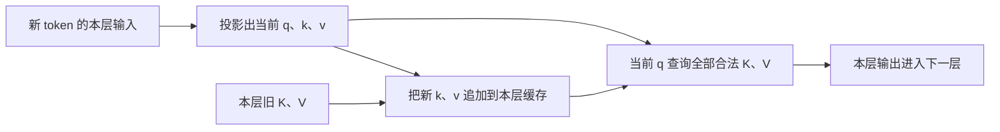
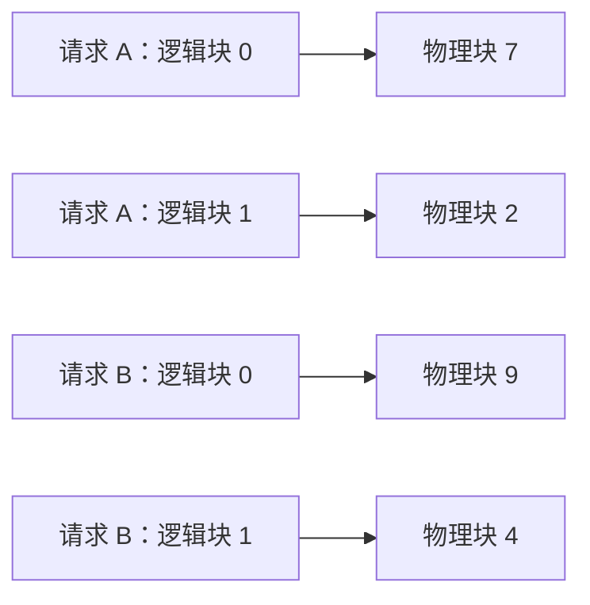
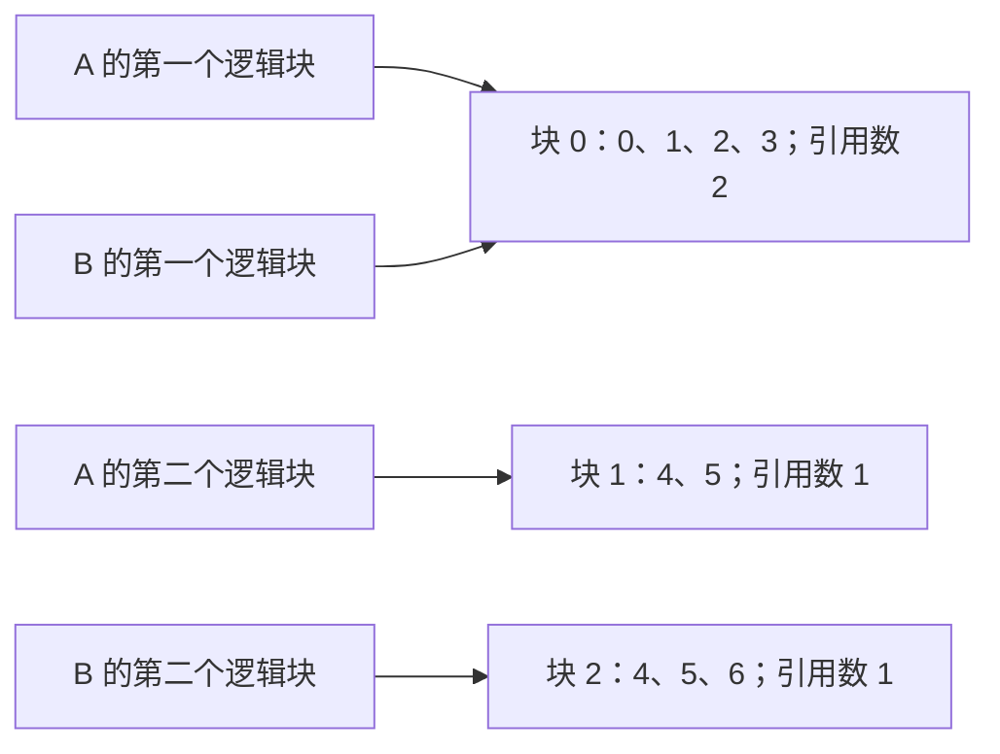

import { Code } from '@astrojs/starlight/components';
import cacheSource from '../../../../public/ai-infra-labs/kv_cache.py?raw';

KV cache 保存每层旧 token 的 Key、Value，让后续 Decode 只计算新位置，再读取旧状态做 Attention。**它用持续占用的内存换取重复计算的减少；上下文增长、并发增加都会扩大需求。** 分页管理改变缓存怎样存放和共享，不会消除模型所需的 K、V 数据。

容量要分三层看：有效 token 的理论字节数、分页后实际需要的块数、引擎预留的整个缓存池。下面先算清前两层，再用可运行的块表代码展示共享与回收。算例与分配器使用 Python 标准库；GPU 实验单独列出，不能把 Python 对象的内存当成 FP16 缓存大小。

## 缓存的是每层的 K、V

上一节的 Decoder 每层都把自身输入投影成 K、V。第二层的输入已包含第一层的计算，所以不能只存第一层的缓存，也不能让所有层共用同一组值。



每层两个缓存张量的逻辑形状都是 `[B,Hkv,T,d]`：批量 B、KV heads 数 Hkv、已保存 token 数 T、每头维度 d。这里只给等长批量的形状；实际服务的请求往往不同长度，分页引擎可以分别记录每条请求的有效长度。[Transformers 缓存结构](https://huggingface.co/docs/transformers/cache_explanation#cache-storage-implementation)

旧 Query 不需要作为下一轮 Attention 的输入保留下来：新 Query 查询历史 K、V，得到新位置的输出。缓存也不是“保存完整聊天记录”；文本和 token ID 属于其他状态。

## 从张量元素数推导容量

假设所有层使用传统全注意力、相同 KV 精度，没有压缩和跨请求共享。一个请求的缓存为：

```text
每层 K 元素数 = Hkv × T × d
每层 V 元素数 = Hkv × T × d
L 层、每元素 b 字节：
M = 2 × L × Hkv × T × d × b

不同长度的 N 个请求：
总 M = 2 × L × Hkv × d × b × ΣTi
```

`2` 来自 K 和 V 两份数据，`L` 来自每层单独保存。这里使用 KV heads 数，而非 Query heads 数。

完整算例：`L=32`，`Hkv=8`，`d=128`，`T=4096`，FP16 每元素 `b=2` 字节。

```text
每 token = 2 × 32 × 8 × 128 × 2
          = 131072 字节 = 128 KiB

4096 个 token = 4096 × 128 KiB = 512 MiB
8 个同长请求 = 8 × 512 MiB = 4 GiB
```

固定层数、头维度和 token 数，只改变 KV heads：

| 结构 | Query heads | KV heads | 单请求缓存 | 相对 MHA |
| --- | --- | --- | --- | --- |
| MHA | 32 | 32 | 2048 MiB | 1 |
| GQA | 32 | 8 | 512 MiB | 1/4 |
| MQA | 32 | 1 | 64 MiB | 1/32 |

减少 KV heads 改变了模型结构，不能通过服务参数把任意 MHA 权重直接变成等价 GQA 权重。这里的比例只说明相同条件下缓存的数量差异。[GQA 论文](https://arxiv.org/abs/2305.13245)

## 输入放得下，输出还要留空间

假设缓存可使用的预算为 8 GiB，仍采用上面的每 token 128 KiB。若每条请求保存 4096 个 token，理论上能放 `8192/512=16` 条。若每条还要再保存 128 个新 token，就变为 `4224×128 KiB=528 MiB`，容量降为 `floor(8192/528)=15` 条。

这个预算已经扣除了权重、工作区和余量。它仍是理想上界，还未计算分页尾部空位、缓存类型和引擎策略。下一 token 的缓存也需要位置：仅按输入长度接纳请求，可能在生成途中才遇到容量不足。

混合注意力、滑动窗口、MLA、量化缓存和多 GPU 分片需要按各层实际结构重新计算。尤其不能把全注意力公式直接套到只保留固定窗口的层，也不能无条件将总大小除以 GPU 数。

## 分页怎样减少预留浪费

设块大小为 16 个 token。一个逻辑块不要求紧邻前一个物理块，块表负责建立映射。请求变长时申请新块，结束后回收，不必事先为每条请求分配最大上下文的连续区域。



对 T 个 token，所需块数是 `ceil(T/16)`。以 `T=4100` 为例：

```text
逻辑有效数据：4100 × 128 KiB = 512.5 MiB
块数：ceil(4100/16) = 257
分配槽位：257 × 16 = 4112 个 token
分配字节：4112 × 128 KiB = 514 MiB
尾部空位：12 × 128 KiB = 1.5 MiB
```

分页减小了连续最大容量预留造成的浪费，但仍有末块空位、块表和管理成本。块太小会增加管理与寻址开销；块太大可能增加尾部浪费。PagedAttention 的缓存块也不是 CUDA 的 thread block，两者分别属于缓存布局与线程执行组织。[PagedAttention 论文](https://arxiv.org/abs/2309.06180)、[vLLM 内核中的块布局](https://docs.vllm.ai/en/latest/design/paged_attention/)

## 共享前缀后为什么需要引用计数

以下小分配器每块只装 4 个整数，用 token 标签代替真实 KV 向量。A 保存 `[0,1,2,3,4,5]`，块表为 `[0,1]`。将 A 分叉为 B 后，两条序列指向相同块，引用数都变为 2。

B 追加 token `6` 时，第二块只有两个有效项。如果直接写共享块，会影响 A。写时复制先复制第二块，再向 B 的副本追加。结果如下：

| 操作 | A 块表 | B 块表 | 活跃物理块 | 引用数 |
| --- | --- | --- | --- | --- |
| 建立 A 并分叉 B | `[0,1]` | `[0,1]` | 2 | 块 0：2；块 1：2 |
| B 追加 `6` | `[0,1]` | `[0,2]` | 3 | 块 0：2；块 1：1；块 2：1 |
| 释放 A | 无 | `[0,2]` | 2 | 块 0：1；块 2：1 |
| 释放 B | 无 | 无 | 0 | 无 |



这个实现展示序列分叉和部分尾块的写时复制。跨独立请求的自动前缀缓存还涉及匹配、缓存命中与淘汰；真实引擎可能只缓存完整块，并在请求结束后继续保留可复用块。因此示例的“引用数归零立即释放”不等于所有前缀缓存的回收策略。

相同文本还不足以保证可复用：token 序列、模型及影响计算的配置必须匹配。缓存复用主要减少重复 Prefill 工作，不会消除后续 Decode 对 K、V 的查询。[vLLM 自动前缀缓存](https://docs.vllm.ai/en/latest/features/automatic_prefix_caching/)

## 运行分配器，检查共享和回收

下载[完整代码](/ai-infra-labs/kv_cache.py)，运行：

```bash
python3 kv_cache.py
```

输出包含 MHA/GQA/MQA 的 `2048/512/64 MiB`，8 条 GQA 请求的 `4 GiB`，两次块表快照，以及最后的 `blocks_after_release: 0`。代码检查 A 未被 B 的追加改变。若移除写时复制分支，这条检查会发现共享可变数据的问题。

<details>
<summary>完整源码：大小推导、块表、引用计数和写时复制</summary>
<Code code={cacheSource} lang="python" title="kv_cache.py" />
</details>

修改实验时，先改变 `Pool(4)` 的块大小，再分别给 A、B 追加多个 token。观察何时共享尾块必须复制、何时直接分配新块，以及释放一条序列后另一条是否仍可读取。追加刚好跨块边界的 token 时，需要新块，不需要复制已经填满的共享旧块。

## 在真实 GPU 服务上怎样核对

在已有兼容 vLLM 的 GPU 环境上固定模型 revision、精度、最大上下文和引擎版本。依次测无请求、单个短输入、单个长输入、多个同长请求，以及请求结束后的状态。记录实际有效 token 数，而非仅记录请求参数中的最大长度。

```bash
curl -fsS http://127.0.0.1:8000/metrics > metrics.txt
```

在对应版本的指标中查看 `vllm:kv_cache_usage_perc`、运行与等待请求数、前缀缓存命中和抢占次数。该缓存占用指标以 `1` 表示 100%，不要把它当成字节数。[vLLM Production Metrics](https://docs.vllm.ai/en/latest/usage/metrics/)

| 观察 | 需要怎样解释 |
| --- | --- |
| 请求变长，缓存占用上升 | 对照有效 token 数、块数和是否命中共享前缀 |
| `nvidia-smi` 占用基本不变，缓存占用变化 | 引擎可能已预留缓存池；进程分配与池内使用不是同一指标 |
| 请求结束，缓存占用未完全降回原值 | 检查前缀保留、异步回收与观测时刻；再区分仍在引用的块和可淘汰的块 |
| 排队或抢占增加 | 检查缓存容量、上下文、并发及调度策略，不能只看权重大小 |

这里给出了 GPU 核对步骤，没有 GPU 测量结果。理论容量、CPU 分配器结果和设备显存是三种不同数据。

下一节：[批处理调度：从静态批到分块 Prefill](/ai-infra/batching-scheduling/)。
