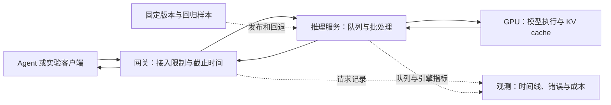

**这条路线以 LLM 推理服务为主线：先让模型稳定提供服务，再测量延迟、吞吐与显存，最后学习多 GPU、发布和故障恢复。** Agent 开发经验可以提供真实调用场景。主线之后可以继续学习 CUDA 算子、分布式训练与 MLOps。

先学单机推理，再对照负载分析性能，最后扩展到多 GPU。没有 NVIDIA GPU 时，可以先完成张量、异步请求、流式解析和网关实验；GPU 性能、显存与多卡通信需要在相应硬件上测量。

[进入 AI Infra 学习地图：6 个领域、24 个知识点，每个点含解释、练习与自测](/ai-infra-knowledge/)

## AI Infra 的学习范围

| 方向 | 主要问题 | 这条路线中的位置 |
| --- | --- | --- |
| Agent Infra | 任务怎样恢复、工具怎样隔离、权限和轨迹怎样管理 | 用现有 Agent 经验衔接，已有[运行环境](/ai/agent-runtime-environments/)与[任务恢复](/ai/agent-context-persistence-recovery/)材料 |
| 推理服务与 AI Infra | 模型怎样运行，算力怎样分配，延迟、吞吐与成本怎样改善 | 主线：模型执行、vLLM、压测、GPU 与部署 |
| GPU 性能与推理引擎 | 算子、内存访问、调度和通信怎样更高效 | 进阶：Profiler、CUDA、Triton 与引擎源码 |
| MLOps 与训练平台 | 数据、实验、模型版本、训练和发布怎样形成可靠流程 | 先学版本与回归，再扩展到训练流水线 |

这些名称没有统一的职责边界。Jerry Fang 的[原帖](https://x.com/jerry_fsy/status/2108912685220069739)主要列出 Agent Runtime、任务恢复、队列、沙箱和评测，适合作为 Agent Infra 的参考，不能代替推理性能路线。MLOps 的完整范围可参考 [Google Cloud 的流程说明](https://docs.cloud.google.com/architecture/mlops-continuous-delivery-and-automation-pipelines-in-machine-learning)。

## 学习顺序与实验

| 顺序 | 学习重点 | 实验 | 要理解的问题 |
| --- | --- | --- | --- |
| 1 | Python 异步、Linux 进程与资源、PyTorch 张量 | 请求路径图、受限并发客户端、小型张量实验 | 能解释 CPU、GPU、网络和队列分别在哪里耗时 |
| 2 | Prefill、Decode、KV cache、精度、CUDA 计时 | 权重与缓存估算、设备计时、显存记录 | 能解释权重可容纳为何仍可能 OOM，区分估算与实测 |
| 3 | vLLM 模型加载、流式响应、取消和容量限制 | 一个单模型服务与请求生命周期记录 | 实际生成成功；取消与超载能从服务端观察 |
| 4 | TTFT、ITL、成功吞吐、固定负载、Profiler | 原始压测数据、性能曲线、一次优化对照 | 同硬件同负载比较，说明质量、错误和尾延迟的代价 |
| 5 | 模型分片、副本、通信、GPU 调度、冷启动 | 部署说明、容量边界、故障与恢复记录 | 分清单卡、多卡与模拟结果；未做的实验标注未实测 |
| 6 | 模型版本、质量回归、请求追踪与成本 | 两个模型版本的回归对照、请求时间线与成本计算 | 怎样定位慢请求，怎样比较满足质量和延迟要求的服务成本 |

第五阶段需要多卡或集群时，可先学习分片和通信机制，再安排实际实验。区分单机与跨节点的性能数据，避免把不同环境的结果直接比较。

## 第一份实验从哪里开始

在匹配 vLLM 版本要求的 Linux GPU 环境上，选一个显存可容纳的模型。以下使用官方 Quickstart 中的示例模型；模型选择还要核对许可和硬件支持。[vLLM Quickstart](https://docs.vllm.ai/en/latest/getting_started/quickstart/)

```bash
vllm serve Qwen/Qwen2.5-1.5B-Instruct --host 127.0.0.1 --port 8000
```

模型就绪后，在同一实验环境发起真实生成请求。模型列表接口成功不能代替这个步骤。

```bash
curl http://127.0.0.1:8000/v1/chat/completions \
  -H 'Content-Type: application/json' \
  -d '{"model":"Qwen/Qwen2.5-1.5B-Instruct","messages":[{"role":"user","content":"用一句话解释 KV cache。"}],"max_tokens":128,"temperature":0}'
```

记录模型 revision、引擎版本、驱动、GPU 型号、精度、上下文限制与启动参数。固定版本后再做性能对照，避免把升级或默认采样参数变化误认为调度优化。

## 用一组负载建立性能基线

以下压测模板用随机输入测系统表现，不能评价回答质量。输入 256、输出 128 和每秒 2 个请求只是起始实验参数，不是服务承诺；容量变化后再调档位。具体参数以所用版本的 `vllm bench serve --help` 为准。[vLLM Benchmark CLI](https://docs.vllm.ai/en/latest/cli/bench/serve/)

```bash
vllm bench serve \
  --backend vllm \
  --base-url http://127.0.0.1:8000 \
  --endpoint /v1/completions \
  --model Qwen/Qwen2.5-1.5B-Instruct \
  --dataset-name random \
  --random-input-len 256 \
  --random-output-len 128 \
  --num-prompts 100 \
  --num-warmups 5 \
  --request-rate 2 \
  --percentile-metrics ttft,tpot,itl,e2el \
  --metric-percentiles 50,95 \
  --save-result \
  --save-detailed
```

先预热，再按不同到达速率重复测量。每组保存首 token 延迟、后续 token 间隔、端到端延迟、成功请求与 token 吞吐、错误率、队列和显存。客户端与服务端指标要说明各自的计时边界。[vLLM Metrics](https://docs.vllm.ai/en/latest/usage/metrics/)

优化时一次只改一个变量，例如批处理预算、上下文限制或前缀缓存。前缀缓存要分别报告冷缓存和可命中条件；量化或算子修改还要运行质量回归。[vLLM 优化说明](https://docs.vllm.ai/en/latest/configuration/optimization/)

## 用一个项目串起整条路线

实践项目做成一个**可观测、可限流、可回退的单模型推理服务**。先复用成熟引擎，再接入现有 Agent。定位到计算热点后，再研究相应的引擎源码和算子。



图中展示实验项目的目标结构。验收至少覆盖实际生成、取消、过载、重启和模型回退。接入 Agent 后再测工具调用和任务质量，接口格式兼容不等于模型行为完全一致。

性能对照需要固定模型、环境和负载。使用下面的模板记录配置与结果，方便解释差异和重复实验。

```yaml
# 实验记录模板：替换为实际环境与结果
experiment: baseline-001
status: planned # 完成后改为 measured；模拟实验写 simulated
environment:
  hardware: 待填写
  driver_and_cuda: 待填写
  engine_version: 待填写
  model_revision: 待填写
workload:
  input_output_distribution: 待填写
  arrival_rate_or_concurrency: 待填写
  warmup_and_cache: 待填写
results:
  latency_and_success_throughput: 待填写
  errors_and_memory: 待填写
  raw_result_path: 待填写
decision:
  change_and_tradeoff: 待填写
  unverified_limits: 待填写
```
