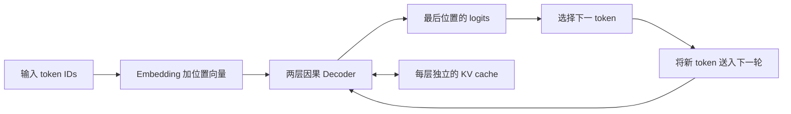
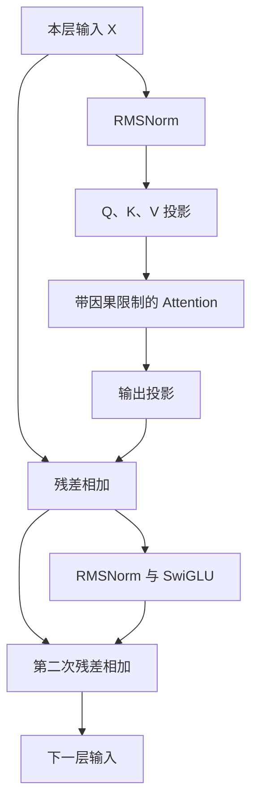

import { Code } from '@astrojs/starlight/components';
import decoderSource from '../../../../public/ai-infra-labs/decoder.py?raw';

LLM 推理把输入 token 转成向量，逐层经过 Attention 和前馈网络，再把最后一个位置的向量映射成下一 token 的分数。**Prefill 一次处理已有输入；此后每轮 Decode 只处理新输入的 token，复用此前各层保存的 K、V。** 复用成立的前提是因果 Attention：旧位置不能看到未来位置，因此新 token 不会改变已经保存的旧状态。

下面使用固定随机权重的两层 Decoder，把生成循环和缓存前后的结果逐项对照。它包含 GQA、RMSNorm、残差、SwiGLU 和输出投影，但没有训练，也不使用生产模型的 RoPE；位置由一张固定向量表提供。代码用 Python 标准库运行，适合核对机制，不能代表 GPU 的速度或语言能力。

## 从一个完整输入开始

输入是 `[0, 1, 2, 3]`，词表有 6 个 token。固定种子下，贪心生成四个 token 得到 `[3, 2, 0, 4]`。这里的数字是 token ID，不是文字或词义。



真实文本先由 tokenizer 编码；聊天消息还会经过 chat template。模型输出的是对词表各项的分数 `logits`。贪心解码取最大项；采样解码按温度等规则选择。分词、模板、模型执行、选择 token 和文本解码是不同步骤。

示例模型的配置是：`D=8`，两个 Query heads，一个 KV head，每头 `d=4`，两层，前馈宽度 `F=16`。以下省略批量维度，处理 `S=4` 个位置。

| 步骤 | 权重或操作 | 输出形状 |
| --- | --- | --- |
| Embedding 与位置 | 按 token ID 和位置取向量 | `[4,8]` |
| Q 投影 | `[4,8] × [8,8]` | `[4,8]`，分成两个 `[4,4]` Query heads |
| K、V 投影 | 各为 `[4,8] × [8,4]` | 各 `[4,4]`，只有一个 KV head |
| Attention | 每个 Query head 查询同一组 K、V | 合并为 `[4,8]` |
| 输出投影与残差 | `[4,8] × [8,8]`，再加输入 | `[4,8]` |
| SwiGLU 与残差 | 两条 `[8,16]` 投影，再用 `[16,8]` 投影回去 | `[4,8]` |
| 最终归一化与 LM head | `[4,8] × [8,6]` | `[4,6]` logits |

生成下一 token 只取最后一行的 6 个分数。前面的位置仍参与构建状态，但不需要再次向用户输出它们的预测。

## 一层 Decoder 内部怎样计算

这个实现采用归一化在前的结构。设一层输入为 `X`：

```text
U = RMSNorm(X)
Q = U Wq，K = U Wk，V = U Wv
Y = X + Attention(Q,K,V) Wo
Z = RMSNorm(Y)
H = SiLU(Z Wgate) ⊙ (Z Wup)
下一层输入 = Y + H Wdown
```

RMSNorm 用一行元素平方的平均值计算尺度；示例省略可学习的缩放参数。残差把输入加回输出，保留此前信息。SwiGLU 的两条投影先逐元素相乘，再投影回模型宽度；它不把序列位置混在一起。



GQA 让一组 Query heads 共享一个 KV head。共享的是 K、V，不是 Q；两个 Query heads 仍用各自的 Query 计算分数，所以输出可以不同。示例中 Query head 0 和 1 都使用 KV head 0。[GQA 论文](https://arxiv.org/abs/2305.13245)

## 手算一次 Attention

Attention 先计算相关分数，再用 softmax 变成权重，最后加权求和 V。单头的形式是：

```text
分数 = Q Kᵀ / √d
未来位置的分数设为负无穷
权重 = softmax(分数)
输出 = 权重 V
```

用一个独立的二维算例：当前 `q=(1,0)`，过去与当前位置的 `k₁=(1,0)`、`k₂=(0,1)`，`v₁=(10,0)`、`v₂=(0,20)`。当前是第二个位置，因此可以访问两项。

```text
q·k₁ / √2 = 0.707107
q·k₂ / √2 = 0

p₁ = exp(0.707107) / (exp(0.707107)+1) ≈ 0.669762
p₂ ≈ 0.330238

输出 = p₁(10,0) + p₂(0,20) ≈ (6.69762,6.60477)
```

若当前是第一个位置，就只能访问 `k₁,v₁`，输出为 `(10,0)`。这里不能让第二个位置进入 softmax 的分母；仅在加权求和时忽略未来 V，仍会改变归一化后的权重。

```python
import math
p = math.exp(1 / math.sqrt(2)) / (math.exp(1 / math.sqrt(2)) + 1)
print(round(10 * p, 5), round(20 * (1 - p), 5))
# 6.69762 6.60477
```

## Prefill 和 Decode 的形状为什么不同

Prefill 已经知道所有输入 token，可以在每层一起投影多个位置。因果限制仍然存在，只是不同位置的计算能在矩阵运算中组织起来。Decode 的下一个 token 还没选出来，因此同一请求的生成步骤存在先后依赖。

| 运算 | Prefill，输入 S 个位置 | Decode，已有 T−1 个缓存位置 |
| --- | --- | --- |
| 本轮 Q | `[B,Hq,S,d]` | `[B,Hq,1,d]` |
| 新 K、V | `[B,Hkv,S,d]` | `[B,Hkv,1,d]` |
| 可查询的 K、V | 当前输入中的合法前缀 | 旧缓存加本轮新项，共 T 项 |
| 逻辑 Attention 分数 | `[B,Hq,S,S]` | `[B,Hq,1,T]` |

常规完整矩阵 Attention 的 QK 与 PV 两次乘法合计约 `4 B Hq S² d` FLOPs；单位置 Decode 合计约 `4 B Hq T d`。这是相应矩阵乘法的计数，不包含投影、归一化、前馈和输出层。因果内核可跳过无效区域，具体执行量取决于实现。

FlashAttention 通过分块和在线归一化避免把完整的分数矩阵反复写入高带宽显存；它没有把 Attention 的计算关系变成线性算法，也不同于保存跨生成步骤状态的 KV cache。[FlashAttention 论文](https://arxiv.org/abs/2205.14135)

Prefill 的大矩阵更容易复用权重，Decode 的小批量更容易受权重和缓存读取限制。这个倾向会随批量、上下文、模型和硬件改变；具体瓶颈在[性能分析笔记](/ai-infra/performance-analysis/)中用算术强度和时间线判断。

## 第一枚输出来自 Prefill

四个输入生成四个输出的循环如下。缓存长度表示已经送进模型的位置数，不包括刚选出、尚未送入下一轮的 token。

| 轮次 | 本轮输入 | 保存后的缓存长度 | 从本轮 logits 选出的 token |
| --- | --- | --- | --- |
| 1，Prefill | `[0,1,2,3]` | 4 | `3` |
| 2，Decode | `[3]` | 5 | `2` |
| 3，Decode | `[2]` | 6 | `0` |
| 4，Decode | `[0]` | 7 | `4` |

因此这个循环是一轮 Prefill 加三轮单 token Decode。最后输出 `4` 后停止，缓存里还没有它的 K、V。若继续生成，下一轮才会把它送入模型。[Transformers 缓存与生成循环](https://huggingface.co/docs/transformers/cache_explanation#attention-matrices)

## 运行完整实现并解释结果

下载[完整 Decoder 代码](/ai-infra-labs/decoder.py)。只需要 Python 3.10 或更新版本，不下载模型、不安装第三方包。

```bash
python3 decoder.py
```

程序同时运行两条路径：每轮重算完整上下文，以及复用缓存。缓存路径每一轮都与完整路径对照最后位置的 logits，而不只比较最终 token ID。

| 项目 | 完整上下文重算 | 使用缓存 |
| --- | --- | --- |
| 生成结果 | `[3,2,0,4]` | `[3,2,0,4]` |
| 两层合计投影的位置数 | `2×(4+5+6+7)=44` | `2×(4+1+1+1)=14` |
| 两层、两 Query heads 合计分数对 | `4×(10+15+21+28)=296` | `4×(10+5+6+7)=112` |

这些是该参考实现的工作计数，不是 FLOPs 或加速倍数。Python 循环、KV 读取、内存分配和 GPU 并行都会影响真实耗时。结果相同说明缓存保留了这里所需的状态；减少的工作说明它省掉了重复计算。

<details>
<summary>完整源码：张量形状对应上面的配置</summary>
<Code code={decoderSource} lang="python" title="decoder.py" />
</details>

读代码时按三个位置走：`forward()` 中的 `past+i+1` 限制可见前缀；每层 `keys,values` 拼接自己的历史状态；`generate()` 在首轮之后只传最后一个新 token。

## 改变输入后怎样检查

先把生成数量从 4 改成 5。投影位置数应变为完整路径 `2×(4+5+6+7+8)=60`，缓存路径 `2×(4+1+1+1+1)=16`。在代码所在目录运行：

```python
from decoder import Decoder, generate
model = Decoder()
for cached in [False, True]:
    result = generate(model, [0, 1, 2, 3], 5, cached)
    print(cached, result["projected_rows"], result["tokens"])
```

再验证因果限制：同一前缀单独执行与后面追加其他 token 后执行，前缀位置的 logits 应一致。若把 `visible=past+i+1` 改成所有 K 的长度，Prefill 中旧位置会看到未来，缓存与完整重算就失去了等价的前提。

生成不一致时依次检查权重与推理模式、位置偏移、因果限制、每层缓存长度、GQA 的 head 映射。真实 FP16/BF16 与不同内核还会有数值误差，不能把这里的 `1e-12` 容差直接用于生产模型。

下一节：[KV cache：容量推导、分页与回收](/ai-infra/kv-cache/)。
