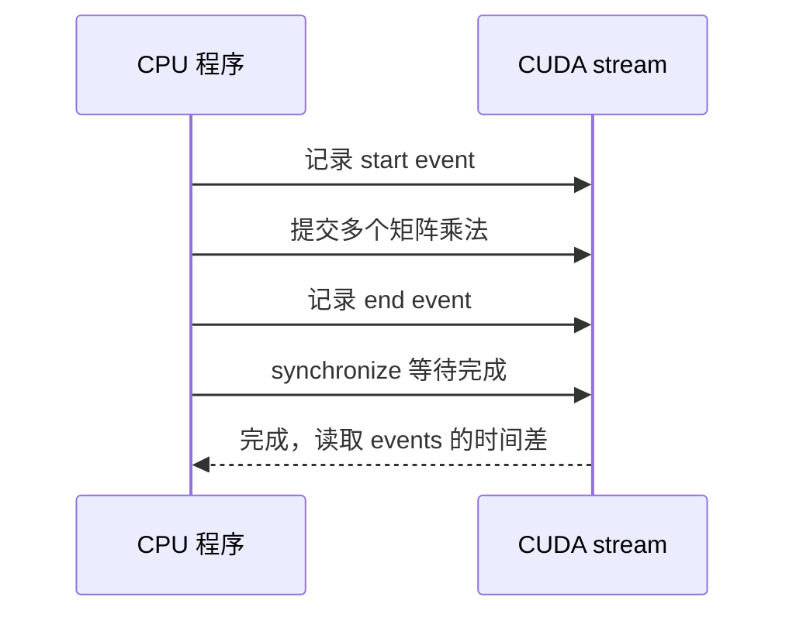

import { Code } from '@astrojs/starlight/components';
import metricsSource from '../../../../public/ai-infra-labs/metrics.py?raw';
import profileSource from '../../../../public/ai-infra-labs/profile_gpu.py?raw';

推理性能要从一次请求的时间线出发：先区分排队、输入处理和生成，再比较成功吞吐、尾延迟与显存。**优化应有相同负载的基线，并能指出哪段工作减少了。** GPU 利用率或总 token/s 只能提供线索，无法单独解释用户等待和失败。

下面先用固定示例数据手算指标，再用一个线性层推导计算与读写的理论下界，最后给出 vLLM 压测和 PyTorch Profiler 的完整步骤。指标与容量代码可在 CPU 上运行；硬件峰值是假设值，GPU 脚本和压测步骤尚无这里的设备实测结果。

## 一条时间线怎样拆成指标


设客户端发出请求的时间为 `t₀`，第一枚输出 token 为 `t₁`，最后一枚为 `tₙ`。客户端口径的定义是：

```text
TTFT = t₁ − t₀
E2E = tₙ − t₀                   （本例以最后 token 为结束）
第 i 个 ITL = tᵢ − tᵢ₋₁
TPOT = (tₙ − t₁) / (n−1)       （n 大于 1 时）
```

真实服务的 E2E 可能以响应完成事件为结束，因此还包含最后 token 后的协议收尾。只有一枚输出的请求没有“后续 token 平均间隔”，不能把 TPOT 自动记成零混进统计。

第一段 SSE 数据可能是角色、元数据或心跳，网络块也不等于 token。计时前要明确能否观察真正的 token 时间；若只能记录首段非空内容，应标明这个口径。服务器记录的排队与 Prefill 时间，也不包含所有客户端网络等待。[vLLM 指标定义](https://docs.vllm.ai/en/latest/usage/metrics/)

## 手算四条请求的完整结果

以下是固定示例事件，单位 ms，统一观察窗口为 0 到 500 ms。`ok` 表示该例中请求成功；第四条在窗口末端超时。

| 请求 | 发出时间 | 输出 token 时间 | 状态 | TTFT | E2E | TPOT |
| --- | --- | --- | --- | --- | --- | --- |
| A | 0 | `[100,140,180,220]` | ok | 100 | 220 | 40 |
| B | 10 | `[160]` | ok | 150 | 150 | 无定义 |
| C | 20 | `[200,300,400]` | ok | 180 | 380 | 100 |
| D | 30 | 无 | timeout | 无成功样本 | 无成功样本 | 无 |

A 的 TPOT 是 `(220−100)/(4−1)=40`，而不是 `220/4=55`；后一个数把首输出前的等待也摊进去了。

TTFT 的成功样本为 `[100,150,180]`。本例采用排序后线性插值：`索引=(N−1)×p`，p 在 0 到 1 之间。P95 的索引为 `2×0.95=1.9`，所以 `150+0.9×(180−150)=177 ms`。只有三条成功样本，这个数用于演示计算，不能代表生产尾延迟；其他工具的分位数算法也可能不同。

请求 TPOT 的样本是 `[40,100]`，P50 为 70 ms。把所有 token 间隔放在一起则是 `[40,40,40,100,100]`，P50 为 40 ms。前者每条请求权重相同，后者输出间隔更多的请求权重更大；两种聚合不能混用。

统一观察窗口是 0.5 秒，因此：

```text
错误率 = 1/4 = 25%
成功请求吞吐 = 3/0.5 = 6 请求/秒
成功请求的输出吞吐 = (4+1+3)/0.5 = 16 token/秒

假设延迟目标：TTFT ≤ 150 ms 且 E2E ≤ 300 ms
符合目标的请求只有 A、B
Goodput = 2/0.5 = 4 请求/秒
```

失败仍进入错误率分母，不进入成功延迟样本。报表应同时显示两者，否则服务大量失败时，少数成功请求的延迟可能看起来很好。上面的输出吞吐只计成功请求；引擎总生成计数、计费 token 和成功输出数量可能不同。

下载[指标与 Roofline 代码](/ai-infra-labs/metrics.py)，执行 `python3 metrics.py`。输出包括 TTFT P50/P95 `150/177`，请求 TPOT `70/97`，错误率 `0.25`，Goodput `4`。这些值来自表中的固定输入。

<details>
<summary>完整源码：分位数、请求与 token 两种聚合、Goodput 和 Roofline</summary>
<Code code={metricsSource} lang="python" title="metrics.py" />
</details>

## 用计算量和数据量提出瓶颈假设

考虑线性层 `X[M,K] × W[K,N] = Y[M,N]`。把一次乘和一次加分别计作一个 FLOP，计算量约为 `F=2MKN`。若输入、权重只读一次，输出只写一次，每元素 b 字节，乐观的数据量下界为 `Q=b(MK+KN+MN)`。

算术强度 `I=F/Q`，单位 FLOP/byte。假设硬件峰值为 100 TFLOP/s、显存带宽为 1 TB/s，则计算与带宽的分界为 `100 FLOP/byte`。理论下界是：

```text
耗时 ≥ max(F / 计算峰值，Q / 显存带宽)
```

以 `K=4096`，`N=16384`，FP16 为例：

| 本轮行数 M | FLOPs | 数据量下界 | 算术强度 | 假设硬件下的耗时下界 |
| --- | --- | --- | --- | --- |
| 1 | 134,217,728 | 134,258,688 byte | 约 1 FLOP/byte | 约 0.1343 ms，带宽下界更大 |
| 128 | 17,179,869,184 | 139,460,608 byte | 约 123.19 FLOP/byte | 约 0.1718 ms，计算下界更大 |

从 1 行变到 128 行，权重数量没有增加，每个读入的权重参与更多输入行的计算，所以算术强度上升。这解释了增大有效批量为何可能提高小批量 Decode 的设备效率，但批量等待又可能增加请求延迟。

这是单个线性层、假设硬件和理想单次读取条件下的下界，不是测量结果。实际还包括 Attention 读取 KV、其他层、缓存命中、重复搬运、同步与 kernel 启动；硬件的有效峰值也取决于精度和矩阵形状。GPU 利用率不能直接替代这些判断。[Nsight Compute Roofline 分析](https://docs.nvidia.com/nsight-compute/ProfilingGuide/index.html)

## 先建立固定负载的 vLLM 基线

在已有兼容的 Linux GPU 环境运行实验。先记录 `vllm --version`、GPU、驱动、模型 revision、dtype、启动参数和是否启用前缀缓存。参数说明按 2026-10-12 官方文档核对；执行前再检查已安装版本的 help。

在引擎启动并完成真实生成检查后，测一个固定长度的完成接口负载：

```bash
vllm bench serve \
  --backend vllm \
  --base-url http://127.0.0.1:8000 \
  --endpoint /v1/completions \
  --model Qwen/Qwen2.5-1.5B-Instruct \
  --dataset-name random \
  --random-input-len 256 \
  --random-output-len 128 \
  --random-range-ratio 0 \
  --ignore-eos \
  --seed 7 \
  --num-prompts 100 \
  --num-warmups 5 \
  --request-rate 2 \
  --percentile-metrics ttft,tpot,itl,e2el \
  --metric-percentiles 50,95,99 \
  --save-result --save-detailed \
  --result-filename short-rate2.json
```

`random-range-ratio=0` 固定所请求的长度；`ignore-eos` 避免模型提前停止，用于控制系统工作量。这组随机输入不评估回答质量，强制忽略 EOS 的结果也不能当成实际产品生成行为。保存结果后仍要核对实际输出长度和错误。[vLLM Benchmark CLI](https://docs.vllm.ai/en/latest/cli/bench/serve/)

先固定输入输出长度，分别用 1、2、4 请求/秒重复运行，改好结果文件名。再只把输入改为 2048，最后回到同一负载比较一个引擎参数。100 条请求是起始实验规模，研究尾延迟时需增加样本并观察多次重复的一致性。

固定到达速率与固定并发回答不同问题。到达速率控制请求何时开始发出；并发上限可能在客户端继续排队，使实际到达服务器的速率下降。报告必须保留实际速率、客户端队列、超时与未完成请求，避免服务越慢、客户端发得越少，反而看起来越稳定。

## 用 CUDA Events 和 Profiler 看真实执行

CUDA 通常异步提交：CPU 发起一个算子后可能先返回，GPU 还在工作。直接用 CPU 时钟包住 `x @ weight`，可能主要测到提交时间。下面的 GPU 脚本先预热，再用 CUDA Events 覆盖重复执行，最后等待设备完成。



下载[GPU 实验代码](/ai-infra-labs/profile_gpu.py)，在已有 CUDA-compatible PyTorch 的环境执行：

```bash
python3 profile_gpu.py --batch 8 --sequence 128 --width 1024 \
  --iterations 50 --output-dir gpu-traces
```

它分别执行 `M=B×S=1024` 的 Prefill 型线性层，和 `M=B=8` 的 Decode 型线性层。两者的权重相同。这只是用于比较形状的线性层实验，不包括真实模型的 Attention、KV cache、调度与网络。

脚本输出 GPU 型号、PyTorch/CUDA 版本、配置、Events 平均耗时与张量显存峰值，并产生 `prefill_linear.json`、`decode_linear.json` 两份 Chrome Trace。没有 CUDA 时会明确停止，不会静默改用 CPU 后继续输出“GPU 结果”。

<details>
<summary>完整源码：预热、设备计时、显存与 Chrome Trace</summary>
<Code code={profileSource} lang="python" title="profile_gpu.py" />
</details>

这里没有填入 GPU 耗时表。运行后的结果才可用于比较；Events 测量与开启 Profiler 的采样分开，后者会增加观测开销。[PyTorch Profiler：设备时间、内存与 Trace](https://docs.pytorch.org/tutorials/recipes/recipes/profiler_recipe.html)

## 时间线和表格应当怎样读

用 Chrome Trace 格式的查看器加载两份 JSON，先找 `prefill_linear` 或 `decode_linear` 标记，再对应 CPU 操作、CUDA runtime 调用与 GPU kernel。不要把嵌套的父操作总时间全部相加，它们可能重复包含同一段工作；重叠执行的 kernel 时长之和也不等于墙钟时间。

| 观察 | 假设 | 下一项检查 |
| --- | --- | --- |
| CPU 有很长的输入处理，GPU 中间有空档 | 输入准备没有及时供给设备 | 分词、序列化、数据搬运和线程占用 |
| 很多短 kernel，中间有空档 | 提交或同步开销可能显著 | CPU runtime、同步点、批量大小 |
| 大部分设备时间在 GEMM | 线性计算是主要部分 | 矩阵形状、精度、有效批量与带宽/计算指标 |
| 长上下文后 Attention 时间增加 | KV 访问和 Attention 工作量增加 | 实际上下文长度、缓存命中、Attention backend |
| GPU 稳定执行，但客户端 TTFT 很大 | 排队或上游等待可能占主导 | 服务器队列和跨服务请求时间线 |

Profiler 帮助定位“时间在哪”；要进一步区分某个 kernel 的计算利用率、显存吞吐和访存行为，可对少量代表性 kernel 使用 Nsight Compute。其观测可能改变执行方式，不能直接拿 profiling 运行的总耗时替代正常服务基线。

`peak_tensor_bytes` 是 PyTorch 张量分配口径，不包含进程的全部设备内存；模型服务预留的缓存池也需要单独观察。性能报告应保留失败率、质量、冷/热缓存和实际输出长度，再判断优化是否改善了目标场景。

返回[学习路线](/ai-infra/learning-path/)或继续核对[批处理与 token 预算](/ai-infra/batching-scheduling/)。
