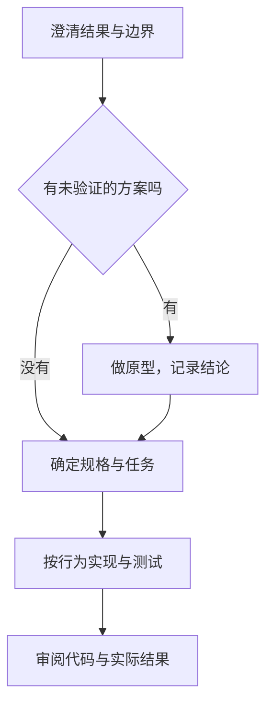

Matt Pocock Skills 把需求澄清、原型、测试、审阅和设计维护拆成可组合流程。需求不清时先澄清，有技术疑问时做原型，行为和范围明确后再实现；不必每个任务都跑完整套流程。

例如做订单导出，先确定同步还是异步、输出格式、数据规模和验收标准，再验证生成性能。Skill 帮助组织这些步骤，**不能保证质量，也不能替代执行权限和实际验收。** 以下按 [v1.2.3](https://github.com/mattpocock/skills/releases/tag/v1.2.3)（2026-08-06）说明，当前安装版本以 [仓库](https://github.com/mattpocock/skills) 和 [CHANGELOG](https://github.com/mattpocock/skills/blob/main/CHANGELOG.md) 为准。

## 一个订单导出例子

这是任务设计示例，数字是要求，不是测试结果。

| 步骤 | 输入或产物 | 对应 Skill |
| --- | --- | --- |
| 澄清 | CSV / Excel，最多 50 万行；异步导出，点击后 100ms 内响应；文件存 S3，24h 过期；检查已有库 | `/grill-with-docs` |
| 定义术语 | `ExportJob`：异步生成订单文件的后台任务；统一命名 | `/domain-modeling` |
| 验证疑问 | 比较生成时间、内存和交互方案，留下结果 | `/prototype` |
| 形成计划 | 规格写清问题、方案、用户故事、模块与测试边界、范围外事项 | `/to-spec` |
| 拆分任务 | 按垂直切片拆成可交付功能，标明阻塞关系 | `/to-tickets` |
| 实现与审阅 | 逐个行为实现、运行检查、对照规格审阅 | `/implement`、`/tdd`、`/code-review` |

<div class="article-note-diagram">



</div>

小任务可以直接实现，不必先生成 spec 和 tickets。需要多会话完成时，再用正式规格和任务依赖保存进度。原型代码放在独立的 `prototype/<name>` 分支并留下引用，正式实现保留验证后的决定。

## 按当前问题选 Skill

| 遇到的问题 | 选择 | 主要产物 |
| --- | --- | --- |
| 不知道下一步 | `/ask-matt` | 推荐流程入口 |
| 无代码库，先梳理想法 | `/grill-me` | 关键决定与待确认问题 |
| 有代码库，需求仍含糊 | `/grill-with-docs`、`/grilling` | 检查事实，按依赖关系成组提问，维护术语与必要 ADR |
| 技术或 UI 方案不确定 | `/prototype` | 逻辑原型或同路由 UI 变体 |
| 需求大、还有关键决定 | `/wayfinder`、`/research` | 决策地图、一手资料与引用；调研结果可留在 `research/<name>` 分支 |
| 已确定方案，需要计划 | `/to-spec`、`/to-tickets` | 规格、垂直切片与 blocking edges |
| 要实现或修 bug | `/implement`、`/tdd`、`/diagnosing-bugs` | 代码、行为测试、复现与修复证据 |
| 需要审阅或整理问题 | `/code-review`、`/triage` | 审阅结果、分类与优先级 |
| 术语或模块边界不清 | `/domain-modeling`、`/codebase-design` | 共享语言、接口与职责设计 |
| 结构已经妨碍修改 | `/improve-codebase-architecture` | 候选改动、前后对比和证据等级 |
| 决定依赖其他人的信息 | `/to-questionnaire` | 可异步填写的问卷，不替对方编答案 |
| 必须由人完成控制台步骤 | `/wizard` | 逐阶段操作指引，隐蔽输入秘密；Agent 能完成的步骤继续交给 Agent |
| 换环境或交接 | `/handoff` | 可移植上下文与未完成事项 |
| 沟通不清或需要教学 | `/wait-what`、`/teach` | 清楚解释，或有状态的学习流程 |
| Agent 文档难用 | `/writing-for-agents` | 触发、流程、资源引用与完成条件 |
| 正在 merge / rebase 冲突 | `/resolving-merge-conflicts` | 回到两边来源按意图解决，不机械选 ours / theirs |

这些是该版本的流程约定。显式触发与模型自动选用分开：User-invoked 负责流程入口，Model-invoked 提供可复用做法。`agents/openai.yaml` 用 `allow_implicit_invocation: false` 控制部分 Skill 的隐式调用；在 Codex 用 `$skill-name`，其他 Harness 按自己的命令语法调用。触发不等于获得外部操作授权。

## 安装与升级速查

下面的安装命令获取上游当前版本，不会固定在 v1.2.3；安装后核对实际版本和名称。

| 管理方式 | 特点 |
| --- | --- |
| skills.sh | 复制可编辑文件，自己决定何时更新 |
| Claude Code plugin | 管理整个 bundle，按上游更新；避免与复制版重复安装 |

```bash
# Codex 等环境：选择需要的 skills 和目标 agent
npx skills@latest add mattpocock/skills
npx skills update

# Claude Code：另一种安装方式，按当前 marketplace 支持核对
claude plugins install mattpocock-skills
```

选择 `setup-matt-pocock-skills`，每个仓库运行一次。它配置 issue tracker（GitHub / Linear / 本地文件）、triage 标签和领域文档位置；普通仓库与 monorepo 的上下文布局按实际项目确定。

```text
AGENTS.md 或 CLAUDE.md
└── Agent skills：Issue tracker、Triage labels、Domain docs

docs/agents/
├── issue-tracker.md
├── triage-labels.md
└── domain.md
```

| 从 v1.1 升级到 v1.2.x | 要检查的变化 |
| --- | --- |
| Codex 元数据 | 每个安装的 Skill 有对应 `agents/openai.yaml` |
| 名称变更 | `/writing-great-skills` 改为 `/writing-for-agents`，没有旧名称 alias |
| 本地 tracker | 合并的 `tickets.md` 改为 `.scratch/<feature>/spec.md` 和 `issues/<NN>-<slug>.md` |
| 重复来源 | plugin 与 skills.sh 复制版只保留合适的一种 |
| 退出的旧 Skill | `ubiquitous-language`、`design-an-interface`、`qa`、`request-refactor-plan`；按问题使用 domain-modeling、codebase-design、triage、to-tickets、to-spec 或 architecture 流程 |

## 实现、排障与审阅怎样验收

### 实现：一次验证一个行为

```text
测试一个行为 → 最小实现 → 测试通过 → 重构
再处理下一个行为
```

`/tdd` 先确定公开接口与行为，通过接口写测试；不把全部测试和全部实现分成两个大批次。`/implement` 读取规格、驱动实现和检查，再做审阅与提交，具体执行仍受仓库规则和已有授权约束。

### 排障：先有复现，再检验假设

| 阶段 | 验收依据 |
| --- | --- |
| 建立反馈环 | 能自动执行的 repro、回放或必要的人机检查 |
| 确认复现 | 输出确实对应用户报告的问题 |
| 提出假设 | 少量可证伪假设，各有预期观察 |
| 收集证据 | 一次改变一个主要变量，使用 debugger 或必要日志 |
| 修复与回归 | 在合适边界复现失败，修复后验证行为 |
| 清理与复盘 | 删除临时 DEBUG 标记，保留预防措施 |

v1.2.3 特别要求命令、日志、HAR 等产物先脱敏为 `<REDACTED>`，反馈循环通过环境变量读凭证。捕获生产问题不等于允许把原始日志和秘密传进上下文。

### 审阅：标准与需求分别检查

| 轴 | 要回答的问题 |
| --- | --- |
| Standards | 是否遵守仓库规范，命名、重复和职责是否有问题 |
| Spec | 是否实现原始需求，边界与验收是否完整 |

该 Skill 用独立的审阅上下文检查两个轴，再合并发现。审阅通过也不能代替运行结果和发布验收。

## 术语和设计维护什么

`CONTEXT.md` 只保留项目特有术语，每项是一句定义和 `_Avoid_` 同义词。例如 `Customer` 表示购买者，`User` 表示系统账号，先确定搜索针对谁，再决定模型、接口与命名。共享语言可以减少歧义，不能承诺新 Agent “30 秒上手”或固定 Token 收益。

ADR 适合难逆转、有真实取舍、缺少上下文就难理解的决定，保存原因而不记流水账。模块设计可用 deletion test：删除模块后，复杂度若分散到多个调用方，说明它承担了实际职责；若复杂度消失，可能只是转发层。

架构维护按修改困难和风险安排，不必固定每两三天运行。该流程会参考领域文档、近期提交与目标模块，给候选改动标注 `Strong` / `Worth exploring` / `Speculative`；这些评级表示证据强弱，不是性能验证。

## 长对话进入新阶段时

| 情况 | 做法 |
| --- | --- |
| 上下文准确且仍有用 | 直接继续 |
| 下一阶段不需要旧对话 | 按当前工具能力清理上下文 |
| 有独立、范围清楚的任务 | 在允许委派时交给子任务 |
| 上下文需要跨工具、目录或人员移动 | `/handoff` 保存可移植交接信息 |
| 仍需保留但已过长 | 压缩，保留约束、进度、未解问题和来源 |

不要按“超过 20 行代码”统一启动追问，也不要因为对话长就立即交接。能查明的事实先查，缺少且会改变实现的决定再确认。

更新订阅：[Skills Newsletter](https://www.aihero.dev/s/skills-newsletter)。
