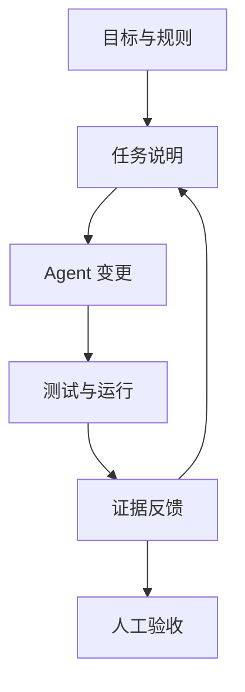

AI 接走代码执行以后，人并没有下班。目标、规则、权限和验收仍然由人负责：agent 读项目、改文件、跑测试，但方向偏没偏、结果能不能交付，要人来判断。

把 AI 看成一门更高级的编程语言，这个类比只在一点上成立：像编译器接走机器指令一样，agent 接走了实现细节，人操作的对象从代码语句抬到了意图和约束。区别在于，自然语言容许省略和歧义，模型会顺着合理猜测继续干活，而不是像编译器那样在错误处停下来。抽象层升高以后，需求、设计、测试和交付都还在，只是更多工作发生在写代码之前和生成代码之后。

## Vibe Coding 和 AI Coding 是两件事

Vibe Coding 常被用来泛指 AI 写代码，它最初的意思更窄。两个公开定义可以分开看：

| 工作方式 | 公开定义 | 适用边界 |
| --- | --- | --- |
| Vibe Coding | [Andrej Karpathy 提出、Simon Willison 沿用的解释](https://simonwillison.net/2025/Mar/19/vibe-coding/)：不再阅读模型生成的代码，只看运行效果，报错继续交给模型 | 一次性脚本、周末原型、低风险试验 |
| AI Coding（agentic programming） | [Martin Fowler 的描述](https://martinfowler.com/bliki/AgenticProgramming.html)：人可能不再逐行敲代码，仍然要对软件的行为和实现负责 | 需要长期维护的生产代码 |

[Kent Beck 用 AI 编写 B+ Tree 的实践](https://newsletter.kentbeck.com/p/augmented-coding-beyond-the-vibes)属于后一种。他保留了 TDD、复杂度控制和设计判断；前两次尝试积累了太多复杂度，agent 最后无法继续，后续尝试缩小了目标范围，他也更早介入设计。

本文标题沿用大家熟悉的 Vibe Coding，但涉及需要长期维护的项目时，说的是认真交付软件的 AI Coding。

## 一个退款任务走完整流程

一句“给订单加个退款功能”足够让 agent 开始工作，也足够让它走错方向：它不知道退款由谁发起，不知道支付渠道能否部分退款，也不知道重复回调会不会重复记账。下面是一个假设示例，用来串起任务说明、agent 动作和验收方式，不是某个真实项目的记录。

先把任务说明写成六个问题的答案：

| 问题 | 这个例子里写清楚的内容 |
| --- | --- |
| 目标 | 已支付订单的用户可申请全额或部分退款，退款原路退回 |
| 现状 | 订单状态机在 `orders` 表，支付记录在 `payment_records`，渠道回调入口在 `/webhooks/refund` |
| 约束 | 不改订单状态机现有枚举，不动对账任务，接口保持向后兼容 |
| 领域规则 | 仅 `PAID`、`DELIVERED` 状态可退款；累计退款不超过实付金额；渠道只支持原路退回 |
| 验收 | 同一笔回调重复投递只记账一次；渠道失败时本地状态回滚；日志可按 `refund_id` 追踪 |
| 变更范围 | 只允许改 billing 模块；库存补偿明确留到下一期 |

拿到这份说明，agent 的动作才有边界：先读 `orders` 状态机和现有回调处理，给出改动方案，再改 billing 模块、补测试、跑测试。验收也不靠“看起来能跑”，而是对着说明里的验收列逐条核对：用重复投递的回调测试幂等键，用模拟渠道失败测试回滚，最后人读一遍 diff，确认变更范围没有越界。

任务说明不靠长度取胜，关键是减少猜测，并且每条关键约束都能被代码、测试或运行结果验证。[OpenAI 介绍 Codex 工程实践](https://openai.com/index/harness-engineering/)时提到，团队的主要工作逐渐变成设计环境、描述意图和建立反馈循环：早期进展慢是因为环境没有说清，后来把设计、实现、审查和测试拆成可执行的环节，agent 才能承担更完整的任务。

## 术语是给 agent 的压缩指令

一个准确术语可以同时带出定义、边界和一组成熟方案。“重复消息不能重复扣款”已经说明了业务目标，再补上 at-least-once delivery、幂等键和事务边界，agent 才知道重复从哪里来、应该在哪一层消除；只说“做一下防重”，它可能在内存里放一个布尔值，也可能随手加一把分布式锁，两种实现看起来都像完成了需求。

领域里的术语更重要。同一个项目里，“客户”“账户”“订单”“任务”分别指什么必须保持稳定，领域驱动设计把这叫作通用语言。人和 agent 共用同一套词，数据库字段、类名、接口和文档才不容易各说各话。

从需求到宣发的常见工程术语，我整理成了[术语速查](/ai-workflow/ai-engineering-glossary/)，不确定一个词时回查即可，不要一次塞进 prompt。

## 反馈循环让错误尽早暴露

描述给出方向，术语减少歧义，测试提供硬反馈。[Addy Osmani 总结自己的 AI Coding 工作流](https://addyosmani.com/blog/ai-coding-workflow/)时仍然坚持设计、测试、版本控制和代码审查，模型看到测试失败或 lint 结果后会主动修正实现。Kent Beck 也把死循环、擅自增加功能、删除测试当作 agent 偏航的信号。缺少这些条件，agent 很可能快速产出一大批需要返工的代码。

## 代码之外还有一整条交付链

代码写完只是交付过程的中段。前面有人判断问题值不值得解决，后面还有测试、部署和运行，上线后还要让目标用户看见并愿意尝试。agent 可以生成页面、接口、测试、部署脚本和宣传文案，却不知道产品面对谁，也不会替人决定一个版本什么时候值得发布。

交付链上有两组词容易混用，分开之后任务边界会清楚很多：

| 词 | 实际含义 |
| --- | --- |
| 验收标准 | 需求完成后能观察到什么 |
| 测试用例 | 怎样操作、怎样检查 |
| 完成定义 | 工作项达到什么状态才可以结束 |

| 词 | 实际含义 |
| --- | --- |
| 部署 | 把代码放进某个环境 |
| 发布 | 让某项能力对用户可用 |
| 上线 | 连着公告、渠道和运营动作的正式推出 |

[把 Prompt 写成可执行任务的实践](/ai-workflow/16-prompt-task-contract-practice/)讲任务怎样写得更具体，[Matt Pocock Skills 拆解](/ai-workflow/11-mattpocock-skills-deep-dive/)讲怎样把术语、规格、TDD 和诊断流程固化成可执行的 Skills。我们少写了很多语法，仍然要理解自己正在建什么。
