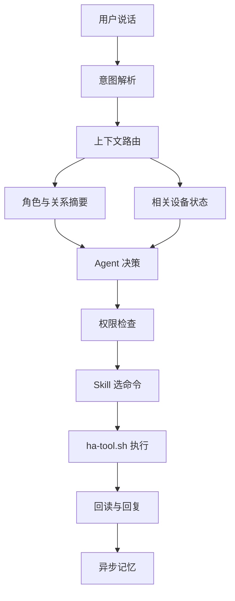

用户昨晚说过“睡觉前去客厅看书”，今天说“把灯调暗一点”，助手如果只看旧上下文，可能去调客厅的灯，而用户此刻其实在卧室。更隐蔽的情况是环境变了：上下文快照里那盏灯还在线，设备实际已经离线。上下文工程要处理的就是这类问题——旧上下文会误导，缺失的上下文会让模型猜。我在家庭助手项目里的做法是：每一轮只组装完成当前任务所需的家庭状态、角色状态、关系状态和安全规则，执行后再用外部状态证明结果。上下文少了会猜错，多了会变慢，也会把稳定人格淹没在设备列表和聊天记录里。

先把项目的真实边界说清楚，后面提到的能力哪些已经能用、哪些还在计划里，都以此为准：

- 已落地：家庭助手和 Home Assistant 运行在同一台设备上。专用 Skill 只告诉 AI 什么时候查询设备、怎样选择命令、参数怎么传、缺失设备和控制失败时怎样回复；真正的调用交给固定脚本 `ha-tool.sh`，它负责读取 token、拼鉴权头、构造 REST 请求、重试和写日志，AI 不临时写 `curl`，也不能自己生成控制脚本。角色资料（MBTI、背景、语气）由服务端拼成 `SOUL.md`，插件按角色版本同步。
- 未上线：好感度已有事件表、分数和关系记录结构，服务端也有增减分能力，但对外上下文里的旧好感度字段已废弃并固定为 0，旧覆盖逻辑曾临时关闭，还没有形成稳定的在线流程。下面写的实体索引、类型化工具、MBTI 参数编译和好感度接入都是准备做的方案，不当作已完成。

## 四类上下文用不同生命周期

家庭助手每轮需要的信息，变化速度差得很大：

| 上下文 | 典型内容 | 更新方式 |
| --- | --- | --- |
| 家庭状态 | 设备、房间、温度、开关状态、在线情况 | 秒级变化，按场景读取或订阅 |
| 角色状态 | 名字、MBTI、背景、说话习惯、边界 | 很少变化，按版本缓存 |
| 关系状态 | 好感度等级、近期关系事件、称呼偏好 | 缓慢变化，事件驱动 |
| 本轮状态 | 用户原话、当前意图、候选设备、执行结果 | 只服务当前请求 |

如果每轮都把完整 `SOUL.md`、全部设备、几十轮聊天和好感度历史塞给模型，成本会很快上去，注意力还会互相争抢——模型可能记住用户喜欢被温柔回应，却漏掉目标灯已经离线。所以稳定角色放在可缓存的固定前缀，家庭状态留在本地快照里只取相关部分，关系状态只提供当前等级和少量近期变化，本轮执行结果用完就结束，值得长期保留的内容再异步进入记忆。

## 家庭状态：从全量列表到相关状态

现在的 Skill 会先调用一次 `list` 发现全部实体，同一轮不再重复读取，作为原型够用。设备增加以后，这个方法会把大量无关状态送进模型。我准备在 Agent 与 Home Assistant 之间增加一个轻量索引，只保存设备识别需要的信息：

```json
{
  "entity_id": "light.living_room_main",
  "domain": "light",
  "area": "living_room",
  "name": "客厅主灯",
  "aliases": ["客厅灯", "主灯"],
  "capabilities": ["turn_on", "turn_off", "brightness"],
  "risk": "low"
}
```

Home Assistant 的 WebSocket API 可以订阅状态变化，本地维护实体快照，设备上下线或状态变化时增量更新。用户说“把客厅灯调暗一点”，系统先在索引里解析房间、设备类型和动作，只给模型候选实体与当前亮度；没有候选项时再扩大搜索范围。这比反复请求 `/api/states` 更省调用，也更容易评测实体解析是否正确。设备状态仍以 Home Assistant 为准，本地快照保留更新时间，过期或断线后主动回源。

## 工具层：Skill 约束调用，脚本封装执行

这一层已经在用。Skill 保存调用知识，脚本保存执行细节，AI 只在 `list`、`state` 和 `call` 之间选择，再填写 domain、service、entity ID 与可选参数。token、配置路径、API 地址和日志路径都不进入对话上下文。相比让 AI 现场拼命令，这种做法更稳也更省：脚本可以单独写测试，接口失败时有固定错误，调用日志能回放；Home Assistant 的鉴权方式或配置路径变化时只改脚本，Skill 的使用方式保持稳定。

通用 `call` 仍要求模型理解 Home Assistant 的 domain、service 与 payload，可以继续收窄。我更倾向于在插件里做一层类型明确的工具（方案，未落地）：

```text
home.get_state
home.light_set
home.climate_set_temperature
home.cover_move
home.scene_activate
home.wait_for_state
```

`home.light_set` 只接受灯、开关状态和合法亮度，`home.climate_set_temperature` 检查设备能力与温度范围，工具内部再翻译成 Home Assistant 的服务调用。这套 Skill 加脚本的方案只服务当前家庭助手时已经够直接；等手机端、云端 Agent 或其他运行时都需要同一套能力，再考虑抽成 MCP Server。MCP 解决多个调用方复用同一批工具的问题，不能替代脚本内部的参数校验、权限检查和执行日志。

“控制成功”也需要重新定义。Home Assistant 官方文档说明，修改 `/api/states` 只会改变 Home Assistant 内的状态表示，不会控制真实设备；真实控制要调用 `/api/services/<domain>/<service>`。服务调用返回成功后，还要读取目标实体或等待对应的 `state_changed` 事件，最终记录至少包含用户意图、目标实体、调用参数、API 结果和 Home Assistant 确认状态。有些设备没有物理反馈，有些集成会乐观地更新状态，此时 `state=off` 只证明 Home Assistant 认为设备已关闭，门锁、报警等高风险设备不能拿前两层代替物理确认。

一次请求的操作、证据和限制可以归纳成一张表：

| 环节 | 操作 | 状态与证据 | 限制 |
| --- | --- | --- | --- |
| 意图解析 | 解析房间、设备、动作与风险等级 | 候选实体列表 | 无候选时扩大搜索，不猜设备 |
| 上下文组装 | 取相关设备状态、角色版本、关系阶段 | 上下文版本号 | 不传全量设备和历史 |
| 权限检查 | 确定性规则校验能力与风险 | 放行或要求确认 | 不随人格、好感度变化 |
| 执行 | `ha-tool.sh` 调用 `/api/services` | API 结果 + 状态回读 | 乐观更新的设备需物理反馈 |
| 结果记录 | 写入意图、参数、结果、确认状态 | 可回放的调用日志 | 失败返回结构化原因，限制重试 |

## 角色感由 MBTI 提供方向，不接管决策

我用 MBTI 是为了快速建立角色差异，不拿它诊断用户，也不会把十六型人格的整套说明每轮发给模型。服务端已把 MBTI、背景和语气拼进角色资料，下一步可以把会影响对话的部分编译成少量行为参数：

```yaml
persona_version: 7
mbti: ISFJ
response_style:
  warmth: high
  initiative: medium
  directness: medium
  humor: low
  preferred_length: short
```

这些参数只决定怎样回应。同一个“打开客厅灯”，有的角色简短确认，有的角色多关心一句；实体选择、权限检查、危险动作确认和执行验证走同一套确定规则，不随人格变化。角色资料带版本号，更新后插件只在版本变化时刷新 `SOUL.md`，模型请求里的稳定部分顺序保持不变，更容易命中 Prompt Cache，动态设备状态和用户原话放在后面。

## 好感度是可解释的关系状态

好感度最容易做成一个不断涨跌的数字，最后既不真实也很难调试。我会保留分数用于内部计算，产品行为主要读取关系阶段。一次变化必须来自可识别事件，并带来源、幂等键和时间：重复投递同一条消息不能加两次分，短时间反复触发同类事件也要限频。

```json
{
  "event_id": "evt_01",
  "user_id": "user_01",
  "mate_id": "mate_07",
  "type": "user_kept_promise",
  "delta": null,
  "source_turn_id": "turn_892",
  "created_at": "event_time",
  "reason": "matched_rule_id"
}
```

`delta` 由规则表计算，示例不放虚构分值。关系阶段跨过阈值后再变化，回落时使用不同阈值，避免分数在边界附近让角色来回变脸。好感度可以影响称呼、主动关心的频率和愿意分享多少角色背景，但不能改变家庭权限，更不能让基础功能变难用。用户还需要能查看大致关系状态、关闭这套机制或清除记录——关系系统如果只能偷偷计算，出问题时很难解释，也容易给人被操控的感觉。事件识别先用确定规则处理明确情况，模糊对话交给小模型异步分类；模型只能提交候选事件，服务端负责去重、限频和结算，家庭控制不等待好感度计算完成。

## 一次请求实际怎样走

下面这条路径是我希望逐步收敛到的结构：

<div class="article-note-diagram">



</div>

- “把卧室灯关掉”可以直接解析成低风险、可逆的明确动作：找到卧室灯，读当前状态，执行后等待它变成 `off`，角色再用自己的语气回复。
- “我有点冷”缺少明确动作。系统读取当前房间的温度与可用温控设备，结合用户过去明确保存的偏好决定询问还是建议，不能为了表现积极随便关闭窗帘或打开无关设备。
- “帮我把家里处理一下，我要出门了”涉及多个设备。已有的离家场景可以作为经过用户确认的固定动作；没有场景时，Agent 先给出计划，让用户确认高风险项，再逐项执行并报告失败设备。
- “你别烦我”只影响对话节奏和可能的关系事件，不触发家庭控制。语气和设备动作在这里必须分开。

## 优化前后按家庭任务比较

我不只比较一句回复听起来顺不顺，家庭助手要同时评测语言、工具和真实状态。评测集从线上脱敏日志与真实失败中持续补充，至少覆盖这些场景：

| 场景 | 重点检查 |
| --- | --- |
| 明确控制 | 意图、实体和参数是否正确 |
| 模糊空间 | “这里”“客厅”能否解析到正确区域 |
| 状态查询 | 是否只读状态，没有误触发控制 |
| 设备离线 | 是否诚实报告，停止无效重试 |
| 高风险动作 | 是否要求确认并遵守权限 |
| 普通聊天 | 是否保持角色感且不误调用设备 |
| 关系变化 | 事件是否可解释、去重并正确跨级 |
| 多轮纠正 | 用户改选落地灯后能否更新目标 |

每条用例保存相同字段，优化前后跑同一批输入：

```json
{
  "case_id": "bedroom-light-correction",
  "variant": "context-router-v2",
  "intent_correct": null,
  "entity_top1_correct": null,
  "tool_arguments_correct": null,
  "unsafe_action": null,
  "final_state_verified": null,
  "persona_consistent": null,
  "relationship_event_correct": null,
  "input_tokens": null,
  "tool_calls": null,
  "latency_ms": null,
  "human_rework_minutes": null
}
```

`null` 表示等待真实运行结果，不用演示数字冒充收益。涉及真实设备的用例先在影子模式里只生成动作计划、不执行控制，计划稳定后开放只读查询，再灰度低风险动作；门锁、车库门、报警和隐私设备单独验收。我会重点看几个结果：实体解析准确率决定有没有控制错设备，最终状态确认率决定有没有只报成功，危险动作率必须接近零；角色一致性和关系事件准确率用来判断陪伴部分，token、调用数、延迟与人工复查时间一起看成本。

## 成本从少读、少猜和少重试里降下来

不少步骤可以交给普通代码：设备索引、别名匹配、能力校验和权限检查先确定性处理；WebSocket 维护本地状态，模型只收到相关实体和新变化；角色资料按版本缓存，好感度只传当前阶段与必要事件；明确设备命令使用短路径，复杂对话再调用更强模型；关系事件异步结算，不阻塞设备控制与语音回复；工具失败返回结构化原因，限制重试次数，避免 Agent 循环试错。

一次请求最终送进模型的内容可以很小：

```yaml
request:
  text: 把这里调暗一点
  room: living_room
persona:
  version: 7
  style: warm_short
relationship:
  stage: familiar
home:
  candidates:
    - entity_id: light.living_room_main
      state: on
      brightness: current_value
      capabilities: [brightness]
policy:
  confirmation_required: false
```

模型不需要知道全部设备，也不用读取所有好感度事件，只要在当前候选和规则内做决定。

## 哪些组件值得自己做

这个项目里我会优先做四个小组件：实体索引负责同步 Home Assistant 注册表、房间、别名和能力；上下文路由器根据本轮意图取相关状态；家庭工具层执行类型化动作并回读结果；评测记录器把输入、上下文版本、工具调用、最终状态和成本写进同一条 trace。MBTI 编译器与关系状态机可以晚一点做，两者都不能绕过家庭工具层的权限。

这些组件以后也能迁到车载助手、机器人和客服 Agent。能泛化的部分是四类上下文、风险检查、外部状态验证与评测记录；Home Assistant 的 entity、MBTI 的字段和家庭场景仍留在项目适配层。复制一份通用 Prompt 到新项目，通常只会把旧项目的假设一起复制过去。

落地顺序上，第一步先补 trace、不改现有控制逻辑，把每次读取的实体数、输入 token、工具调用、目标状态和人工纠正记下来，得到当前基线。随后建立实体索引与 WebSocket 状态快照，替换全量设备上下文；再沿用 Skill 加固定脚本的边界，把通用 `call` 逐步收窄成家庭动作，加入风险等级、确认和状态回读。MBTI 资料继续沿用现有版本同步，逐步改成稳定行为参数；好感度先在影子模式里识别事件，和人工标注比较，准确以后再写入关系状态。做到这里，才能认真比较优化前后：好的结果应该让助手控制得更准、角色更稳定、关系变化有来由，同时减少无关设备、重复人格说明和无效工具调用——账单下降只是其中一项，人不用反复纠正它才算真的省下来。

## 参考资料

- [Home Assistant REST API](https://developers.home-assistant.io/docs/api/rest/)
- [Home Assistant WebSocket API](https://developers.home-assistant.io/docs/api/websocket/)
- [Home Assistant 鉴权 API](https://developers.home-assistant.io/docs/auth_api/)
- [OpenAI 评测最佳实践](https://developers.openai.com/api/docs/guides/evaluation-best-practices)
- [OpenAI Prompt Caching](https://developers.openai.com/api/docs/guides/prompt-caching)
- [Anthropic 关于 Agent 上下文工程的实践](https://www.anthropic.com/engineering/effective-context-engineering-for-ai-agents)
