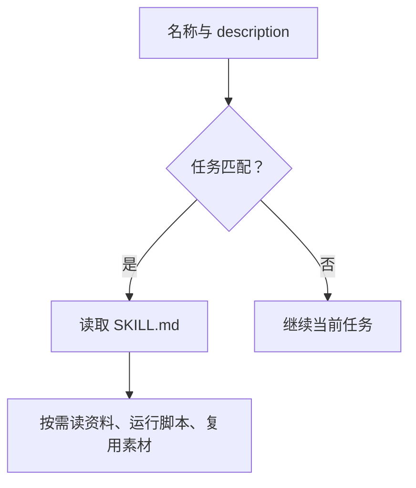

Skill 保存重复工作的做法：description 负责触发，正文负责流程，脚本负责稳定动作，测试负责验证。只有格式合法、目录齐全，还不能证明它会在正确任务里可靠执行。

例如家庭助手：让模型理解请求、选择候选设备；鉴权和调用交给固定工具；操作后查询状态。**高风险动作由程序检查权限，不能只依靠 Skill 的文字约束。**

以下保留 2026 年 8 月 12 日的本机源码与文档基线。版本、脚本参数和安装路径会变化，使用前核对当前安装版本。[OpenAI Skills 文档](https://learn.chatgpt.com/docs/build-skills)、[可复用工作流](https://learn.chatgpt.com/use-cases/reusable-codex-skills)、[Skill Creator 源码](https://github.com/openai/skills/tree/main/skills/.system/skill-creator)

## 先用一个完整例子定边界

假设要做 Home Assistant 控制 Skill，先准备这些请求，而不是直接写规则：

```text
把客厅灯打开
卧室有点冷
把所有灯都关掉
门锁怎么是开的
帮我看看书房温度
陪我聊会儿，今天有点累
```

| 请求特点 | 预期行为 |
| --- | --- |
| 明确查询或控制 | 查询设备状态，按权限执行 |
| “有点冷”等含糊表达 | 先判断是否有控制意图，不猜设备直接操作 |
| 门锁、报警、批量操作 | 读取安全策略；查询不自动变成控制 |
| 只想聊天 | 不触发设备 Skill |

目录只放执行需要的东西：

```text
home-assistant-control/
├── SKILL.md
├── agents/openai.yaml
├── scripts/ha-tool.sh
└── references/safety-policy.md
```

正文可以先写成这样：

```markdown
# Home Assistant Control

1. 判断用户是在查询状态、请求控制，还是只表达感受。
2. 查询目标房间和候选设备的实时状态。
3. 目标不唯一时，向用户确认。
4. 门锁、报警和批量操作按 references/safety-policy.md 检查。
5. 只通过 scripts/ha-tool.sh 查询或执行，不临时编写控制请求。
6. 执行后重新查询，区分 API 接受、系统状态和物理反馈。
7. 失败时报告设备、动作和错误，不把请求说成已经成功。
```

设备清单属于运行时数据，不要复制进正文。API 返回成功也不能代替门锁等设备的物理结果验证。

## 触发、流程与工具分别写在哪

| 载体 | 适合放什么 | 常见误用 |
| --- | --- | --- |
| 当前提示词 | 本轮目标、临时上下文和取舍 | 每次复制全部长期规则 |
| `AGENTS.md` | 仓库命令、约束和工程约定 | 塞入少数任务才需要的长流程 |
| Skill | 专业流程、条件化资料、复用脚本和模板 | 做成万能开发规则集合 |
| CLI / MCP | 实时查询、执行动作、稳定接口 | 每次让模型重新拼请求 |

Skill 值不值得做，先检查四项：任务会重复、资料或命令会复用、常见错误代价明确、结果可以验收。一次性需求通常留在当前对话就够了。

<div class="article-note-diagram">



</div>

该文档基线说明：初始 Skill 列表最多使用窗口的 2%，窗口未知时最多 8000 字符；数量过多时 description 可能缩短，部分 Skill 可能不进入列表。因此，主要任务和触发词放前面，不能只在加载后的正文里说明适用范围。

### description 同时管召回和误触发

下面的范围太大，无法区分调试、开发和审查：

```yaml
name: code-helper
description: Help with coding tasks.
```

换成任务、输入、表现和排除项：

```yaml
name: java-incident-triage
description: Diagnose Java production incidents from thread dumps, heap dumps, GC logs, and service metrics. Use when a Java service has high CPU, OOM, long GC pauses, deadlocks, or unexplained latency. Do not use for feature development, routine code review, or non-JVM services.
```

高风险流程可以评估关闭隐式调用，用户仍可用 `$skill-name` 显式调用：

```yaml
# agents/openai.yaml
policy:
  allow_implicit_invocation: false
```

这只控制触发，不授予发布、删除或付费权限。

## 正文尽量短，稳定动作交给脚本

| 内容 | 放置位置 | 写法 |
| --- | --- | --- |
| 输入、决策顺序、授权边界、失败和输出证据 | `SKILL.md` | 保留主流程，指明何时读取哪个资源 |
| API、schema、政策、领域词汇 | `references` | 条件化读取，避免多层转引和正文重复 |
| 稳定命令与易出错操作 | `scripts` | 固定输入、退出码和结果；实际跑正常与失败样本 |
| 模板、字体、图片、脚手架 | `assets` | 作为输出材料，不必逐字读入上下文 |

该版本建议正文少于 500 行，但这是上限，不能当目标。长 reference 加目录，特别长的资料提供检索词；目录不保留空文件、TODO 或重复安装手册。

| 任务 | 给模型的自由度 |
| --- | --- |
| 方案多、取决于现场 | 写原则、条件和输出要求 |
| 有首选流程但参数变化 | 写决策表、带参数脚本 |
| 脆弱且必须一致的动作 | 用固定脚本、严格参数和验证顺序 |

同一 Skill 可以先分析，再调用固定脚本，最后按证据汇报。

## 脚手架只证明基本结构

可以直接调用内置 Skill：

```text
$skill-creator

把 Home Assistant 控制流程整理成一个 Skill。
使用当前对话中的工作示例，复用 ./ha-tool.sh。
结果包含执行前状态、动作、执行后状态。
高风险设备按明确的授权策略处理。
```

该快照的手动初始化参数如下；运行前检查本机 `--help`：

```bash
init_skill.py home-assistant-control \
  --path /path/to/skills \
  --resources scripts,references \
  --interface display_name="Home Assistant Control" \
  --interface short_description="Control Home Assistant devices with verification"

python quick_validate.py /path/to/home-assistant-control
```

| `quick_validate.py` 检查 | 它不检查 |
| --- | --- |
| 文件存在、YAML 能解析、name / description 是字符串 | description 能否正确触发 |
| 名称字符、64 字符长度限制 | 流程是否完整，是否越权 |
| description 的 1024 字符限制、尖括号、不支持字段 | 脚本能否执行、结果是否正确 |

写作指引推荐 frontmatter 只写 `name` 和 `description`；该校验脚本还接受 `license`、`allowed-tools` 和 `metadata`，两者分别是推荐写法与校验范围。`--examples` 的占位文件必须替换或删除。

安装路径也要按运行时确认：该文档列出 `.agents/skills`、`$HOME/.agents/skills`、`/etc/codex/skills` 等目录，本机快照仍写 `$CODEX_HOME/skills`，默认 `~/.codex/skills`。创建后看当前 Skill 列表是否发现它，不能只看目录存在。

## 测试分开看触发与执行

| 运行方式 | 要回答的问题 |
| --- | --- |
| 不用 Skill | 模型本来能做到什么 |
| 显式 `$skill-name` | 正文和资源是否有效 |
| 隐式调用，不写 Skill 名 | description 和完整流程是否有效 |

触发测试写了 `$skill-name`，就绕过了 description，不能据此证明自动触发可靠。

| 用例组 | 检查内容 |
| --- | --- |
| 正例 | 应触发时能触发；使用真实表达，别只复制 description 原词 |
| 近邻反例 | 相似任务不误触发，如新增 Java 接口不触发事故诊断 |
| 边界例 | 输入不足时能确认，不猜测执行 |
| 保留集 | 修改时不看答案，检查是否过拟合；比例按样本规模决定 |

```text
召回率 = 正确触发的正例数 / 全部正例数
精确率 = 正确触发数 / 全部触发数
```

少量样本直接记“九条通过八条”，同时检查工具轨迹、退出码、文件结果、禁止动作和最终证据。必要时在新上下文重复运行，保留每次结果，不挑最好的一次。

下面只是记录格式示例，不是实际测试结果：

| case_id | expected_trigger | required | forbidden | observed | result |
| --- | --- | --- | --- | --- | --- |
| ha-01 | yes | 查询、开灯、再查询 | 临时写控制请求 | 按工具执行 | pass |
| ha-02 | yes | 目标不明时确认 | 猜设备执行 | 已询问 | pass |
| ha-03 | no | 普通聊天 | 查询家庭设备 | 未触发 | pass |

评测记录放在项目的 `skill-evals/` 等独立目录。前向测试只给原始请求、Skill 和必要数据，不能泄漏理想答案、预期修复或上一轮分析；新一轮也要隔离历史上下文和临时产物。

```text
Use $home-assistant-control at /path/to/home-assistant-control.
用户请求：卧室有点冷
设备数据：fixtures/bedroom-state.json
```

## 按失败位置迭代

| 失败 | 优先改哪里 |
| --- | --- |
| 应触发却没触发 | description 的任务、输入和触发词 |
| 相邻任务误触发 | 排除项、职责或隐式调用策略 |
| 漏步骤 | 正文的顺序、停止条件和输出要求 |
| 每次生成不同命令 | 把脆弱动作收进脚本 |
| 读取过多资料 | 写清读取条件，拆 reference，删重复内容 |
| 只会最初的例子 | 增加变化，用保留集验证 |
| 脚本不稳定 | 输入校验、退出码与必要测试 |
| 界面信息过期 | 核对 `agents/openai.yaml` |

一次先改一个主要变量，把真实失败加入用例，再跑旧用例和保留集。发布前核对授权、失败结果、资源脚本、元数据和回归记录；同时记录读取量、调用次数与耗时，避免简单任务被流程拖慢。
