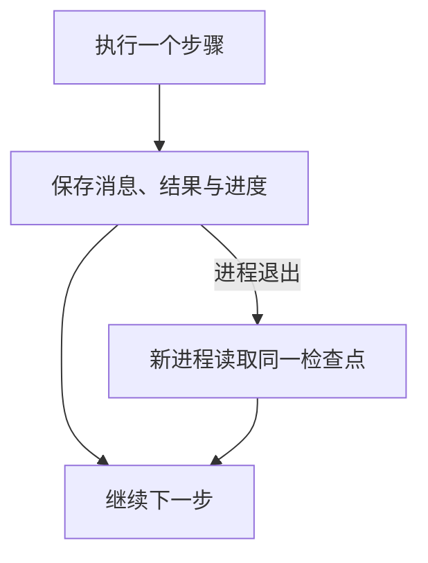

**恢复不是找回聊天记录，而是让新进程知道：用户要做什么、已经完成什么、下一步能做什么。** 因此，消息、工具结果和执行进度都要保存在进程之外。新进程读取这些记录，重新组织模型输入，从尚未完成的步骤继续。

只保存用户问题，能知道“说过什么”；保存工具调用、结果和下一步，才能知道“已经做过什么”。工具可能已经执行、结果却未保存时，恢复程序必须先查询外部状态，不能直接重试。

恢复需要同时解决四件事：

1. **状态外置**：Checkpoint 保存恢复所需的最小确定状态。
2. **恢复调度**：队列消费者、启动恢复程序或看门狗重新领取任务。
3. **执行权**：状态机守住终态，租约分配带期限的执行权，接管序号拒绝旧进程写入。
4. **副作用保护**：操作按 ID 去重，未知结果先查询，取消与补偿沿业务链路完成。

## 1. 最小恢复：保存问题、工具结果和下一步

假设用户问“客厅多少度”，程序分三步处理：

```text
理解问题 → 调用温度工具 → 根据读数回复
```

工具已经返回 23.5°C，程序却在回复前重启。能否继续，取决于重启前保存了什么。

| 已经保存的数据 | 新进程能做什么 |
| --- | --- |
| 什么都没保存 | 不知道用户刚才问过什么 |
| 只保存用户问题 | 可以重新查询，但不知道上一次已经查过 |
| 保存问题、工具结果和下一步 | 直接根据这次读数回复 |

最小的存储分工是：

| 保存什么 | 放在哪里 | 恢复时的用途 |
| --- | --- | --- |
| 消息与工具结果 | 数据库 | 找回问题、已取得的结果及顺序 |
| 当前进度和下一步 | 数据库 | 决定从哪里继续 |
| 文件、图片、大段原文 | 对象存储，数据库保存稳定引用 | 找回实际内容，而不只剩失效链接 |

同一个会话使用固定 `thread_id`；一次具体执行另有 `run_id`。用户、会话和执行不是同一个对象。恢复时还要校验当前身份有权读取，不能只凭拿到 ID 就放行。

```json
{
  "thread_id": "room-demo",
  "run_id": "run-42",
  "next_step": "reply",
  "messages_ref": "messages-of-run-42",
  "tool_result_ref": "temperature-result-7"
}
```

每个关键步骤完成后立即保存，不等整轮结束：

```text
收到问题    保存用户消息
决定调用    保存工具名、参数和调用 ID
拿到读数    保存工具结果，记录下一步是 reply
回复完成    保存最终消息，记录任务已结束
```

调用模型和工具放在短事务之外，不要让数据库事务等待远程请求。工具调用与结果要保留同一个调用 ID，例如 `call-7`，否则恢复后无法正确拼出模型输入。



数据库必须独立于应用实例。写在可替换容器里的 SQLite 文件仍可能随容器消失；单机持久卷可以跨进程恢复，多实例服务优先使用共享数据库。[Kubernetes 卷的生命周期](https://kubernetes.io/docs/concepts/storage/volumes/#emptydir)

## 2. 实测：工具结果保存后退出，新进程只继续回复

[完整示例](/examples/agent-context-recovery.py)使用真实的 LangGraph 和 PostgreSQL，温度和模型决策是模拟的。它不连接真实设备，也不调用付费模型。

准备独立演示数据库，不要连接生产库：

```bash
python3 -m venv .venv-agent-recovery
. .venv-agent-recovery/bin/activate
python -m pip install 'langgraph==1.2.11' \
  'langgraph-checkpoint-postgres==3.1.2' \
  'psycopg[binary,pool]==3.3.5'
curl -fsSLo agent-context-recovery.py \
  https://blog.mlxb.cc/examples/agent-context-recovery.py

# 粘贴演示库连接串并回车，输入不回显。
read -r -s AGENT_DEMO_DATABASE_URL
export AGENT_DEMO_DATABASE_URL
python agent-context-recovery.py setup
```

制造“工具结果已保存、回复尚未生成”的故障：

```bash
python agent-context-recovery.py start \
  --thread recovery-demo-1 --crash-before-reply
```

程序在回复前退出，退出码 75 是安排好的故障点。随后用新进程读取状态并继续：

```bash
python agent-context-recovery.py status --thread recovery-demo-1
python agent-context-recovery.py resume --thread recovery-demo-1
```

恢复前应看到用户问题、工具调用和工具结果三条消息，待执行节点为 `reply`。恢复后只生成回复，温度工具不重跑。

两个配置不能漏掉：使用 PostgreSQL 检查点，并继续传入相同的 `thread_id`：

```python
config = {"configurable": {"thread_id": "recovery-demo-1"}}
graph.invoke(None, config, durability="sync")
```

`None` 表示继续已有运行，不追加一次原始问题；`sync` 要求进入下一步前保存检查点。若只在整轮退出时保存，就无法提供这种中途恢复能力。[LangGraph 持久化模式](https://docs.langchain.com/oss/python/langgraph/checkpointers#durability-modes)

这个实验只覆盖“工具结果已经保存后进程退出”。它没有证明任意时刻崩溃都不会重复动作，也没有验证数据库故障切换或多个进程同时接手。

## 3. 长任务把 Run、Step 和 Artifact 分开

深度研究、批量文档和代码修改会跨过队列、多个进程和人工等待，聊天记录不足以表达任务。先把三种记录分开：

- **Run**：一次用户目标的完整执行实例，例如“生成本周经营分析”。
- **Step**：Run 内一个可重试、可观察的步骤，例如“拉取订单”“生成图表”。
- **Artifact**：步骤产生的持久化成果，例如检索 JSON、报告文件和模型输出。

Checkpoint 保存恢复所需的最小状态，不是定时复制全部内存：

```json
{
  "run_id": "run_123",
  "checkpoint_version": 7,
  "phase": "analysis",
  "completed_steps": ["collect_sources", "deduplicate"],
  "artifacts": { "sources": "artifact://src_456" },
  "budget": {
    "remaining_tool_calls": 8,
    "remaining_cost_usd": 0.42
  }
}
```

实际项目还应包括已确认输入、工具结果、模型与 Prompt 版本、下一步允许的动作和待审批内容。恢复时据此重建上下文，不依赖旧进程对象。

### 状态机守住终态

Run 可以使用这些状态：

```text
PENDING → RUNNING → WAITING_APPROVAL → RUNNING
RUNNING → WAITING_EXTERNAL → RUNNING
RUNNING → SUCCEEDED
RUNNING → FAILED
RUNNING → CANCEL_REQUESTED → CANCELLED
```

`SUCCEEDED`、`FAILED`、`CANCELLED` 是终态。已成功任务不能被迟到的失败消息改回失败，已取消任务也不能因 Worker 最后上报成功而复活。

每次迁移使用版本号或条件更新：

```sql
UPDATE agent_run
SET status = 'SUCCEEDED',
    version = version + 1,
    finished_at = now()
WHERE id = :run_id
  AND status = 'RUNNING'
  AND version = :expected_version;
```

受影响行数为 0，说明状态已经变化，当前 Worker 不能覆盖它。

### 队列通知任务，数据库保存真相

消息可能重复、延迟或乱序，Worker 也可能在处理后、尚未 ACK 时崩溃。消息里只放稳定标识：

```json
{ "run_id": "run_123", "step_id": "step_04", "attempt": 2 }
```

Worker 收到后从数据库读取最新状态，再决定是否执行，不能把队列消息当作唯一状态源。

## 4. 多进程接手需要租约和接管序号

Worker 领取 Step 时写入租约，也就是一段有期限的执行权：

```text
owner        = worker-7
lease_until  = now + 60s
attempt      = attempt + 1
```

执行中定期续约。Worker 崩溃且租约到期后，其他 Worker 才能接管。领取必须是原子操作：

```sql
UPDATE agent_step
SET status = 'RUNNING',
    owner = :worker,
    lease_until = :lease_until,
    attempt = attempt + 1
WHERE id = :step_id
  AND status IN ('PENDING', 'RUNNING')
  AND (lease_until IS NULL OR lease_until < now())
RETURNING attempt;
```

租约过期不代表旧 Worker 已停止。它可能只是卡住，恢复后仍会提交结果。每次接管递增的 `attempt` 同时作为 fencing token（接管序号）：提交结果时要求序号匹配，旧 Worker 的过期写入就会被拒绝。

**租约只解决执行所有权，不自动解决外部副作用。** 旧 Worker 在失去租约前已经发出的请求，仍要按操作 ID 查询和去重。

检查点存好后，任务也不会自己继续。接手方式可以组合：

- 服务启动时扫描非终态 Run，把租约已过期的任务重新排队。
- 常驻队列消费者按消息领取任务。
- 看门狗发现长时间没有新事件的 Run，告警或回收。

恢复调度只负责重新派发，是否真的再执行一步，仍由状态机、租约和幂等检查决定。

## 5. 副作用未知时，先查询再决定

假设指令是“把亮度再降低 10%”。设备已经执行，程序却在保存结果前退出。新进程只看到“准备调用”，不知道设备是否动作。直接重试可能再次降低亮度。

恢复时按三种情况处理：

| 上次操作状态 | 恢复动作 |
| --- | --- |
| 已确认成功 | 复用结果，继续下一步 |
| 已确认未发出 | 可以执行 |
| 结果未知 | 先查询外部状态；无法确认时暂停或人工核对 |

接口支持幂等键时，重试复用同一个业务操作标识。框架 Checkpoint 和业务工具结果若分两次提交，可以先保存工具操作结果，节点重试时按操作 ID 找回，再补框架 Checkpoint。先后调用两个保存函数不等于同一事务。

LangGraph 的 `interrupt()` 恢复时会重新进入所在节点，中断前的通知或订单创建可能再次执行。重要外部操作必须去重，或拆成有独立恢复边界的步骤。[中断恢复规则](https://docs.langchain.com/oss/python/langgraph/interrupts#rules-of-interrupts)

跨网络的务实目标是：

```text
至少一次投递
+ 幂等工具
+ 去重记录
+ 状态查询
+ 必要时补偿
= 业务上只产生一次可见结果
```

每个 Step 还要限制最大尝试次数、总时间、可重试错误、退避和预算。`INVALID_ARGUMENT`、`PERMISSION_DENIED` 不应盲目重试；限流和短暂依赖失败也只能在明确上限内重试。

补偿不是数据库回滚。创建草稿可以删除草稿，预占库存可以释放库存，但邮件已经送达就无法撤回。难补偿动作尽量放到流程末端，并先审批。

## 6. 取消与人工接管都是业务链路

用户点击取消，不能只改前端状态：

1. Run 进入 `CANCEL_REQUESTED`，不再调度新 Step。
2. 通知正在运行的 Worker，在安全点停止当前工具。
3. 释放 Lease 和临时资源，需要时执行补偿。
4. 外部操作无法中断时，明确显示“取消已收到，等待当前操作结束”。
5. 最后进入 `CANCELLED`，按策略保留或清理 Artifact。

迟到的结果不能把已取消任务改回成功。

进入人工接管时，保存暂停原因、已完成步骤、失败位置、建议的人类动作、当前参数与证据，以及继续执行入口。人工处理后从明确 Checkpoint 继续，而不是从头重跑。

## 7. 上线前还要验证输出、版本和存储

**浏览器重连与数据库恢复是两件事。** 给输出消息固定 ID，客户端重连后查询消息或补收后续事件。SSE 的 `Last-Event-ID` 能说明客户端收到了哪里，服务端仍要保存可补发事件或消息快照。[SSE 事件 ID](https://html.spec.whatwg.org/dev/server-sent-events.html)

未生成完的半句话按草稿处理，不能当成完整回复接进下一轮。客户端重复提交输入要按请求 ID 去重。

工作流和状态格式要有版本。新代码读不懂旧进度时明确暂停或迁移，不要静默从头执行。发布前停止领取新任务并等待当前步骤保存，但状态仍不能只靠进程退出前的一次清理。

应用重启与数据库丢数据也是不同故障。PostgreSQL 提交配置、Redis 持久化和副本策略都会影响恢复保证。[PostgreSQL 提交保证](https://www.postgresql.org/docs/current/wal-async-commit.html)、[Redis 持久化](https://redis.io/docs/latest/operate/oss_and_stack/management/persistence/)

模型 KV Cache 只减少重复推理计算，不能替代应用的业务记录。摘要和向量索引可以帮助选择上下文，工具是否成功却必须查确切操作记录。

## 8. 最小数据模型与验收

```text
agent_run
  id, user_id, status, version
  goal, created_at, finished_at
  cancel_requested_at, budget_json

agent_step
  id, run_id, type, status
  attempt, owner, lease_until
  input_artifact_id, output_artifact_id
  error_code, started_at, finished_at

agent_artifact
  id, run_id, kind, uri, checksum, metadata_json

agent_event
  id, run_id, step_id, sequence
  type, payload_json, created_at
```

Run/Step 表用于读取当前状态，Event 用于审计和重放。监控还要看各状态停留时间、重试率、Lease 超时、终态冲突、取消耗时、人工接管率和无进展循环。

上线前至少演练：

- 模型调用中途超时；
- 工具成功后、写结果前崩溃；
- 同一消息重复投递；
- 迟到消息试图覆盖终态；
- 审批等待数小时后恢复；
- 用户在步骤执行中取消；
- 外部系统返回未知状态；
- Artifact 损坏或丢失；
- 预算耗尽。

实现方式按恢复深度选择：

| 项目情况 | 建议起点 |
| --- | --- |
| 主要是短聊天 | 保存完整消息、附件和请求去重记录 |
| 多步 Agent，需要暂停和恢复 | 使用框架的持久化检查点，例如 LangGraph 加 PostgreSQL |
| 跨服务、长时间等待、复杂重试 | 评估现有任务系统或 Temporal 等持久化工作流 |

已有 Java 任务表、队列和 Worker 时，直接补消息、工具操作记录和恢复入口，不必为了 Agent 换语言。Temporal 通过执行历史重放恢复，模型调用等不确定操作放到 Activity 中，仍要防止重复业务动作。[Temporal 恢复机制](https://docs.temporal.io/workflow-execution#replays)

验收先看三个结果：已接收输入重启后仍在；已保存工具结果能够复用，执行没有回到起点；工具结果未知时系统会查询或暂停，不会悄悄重复高风险动作。
