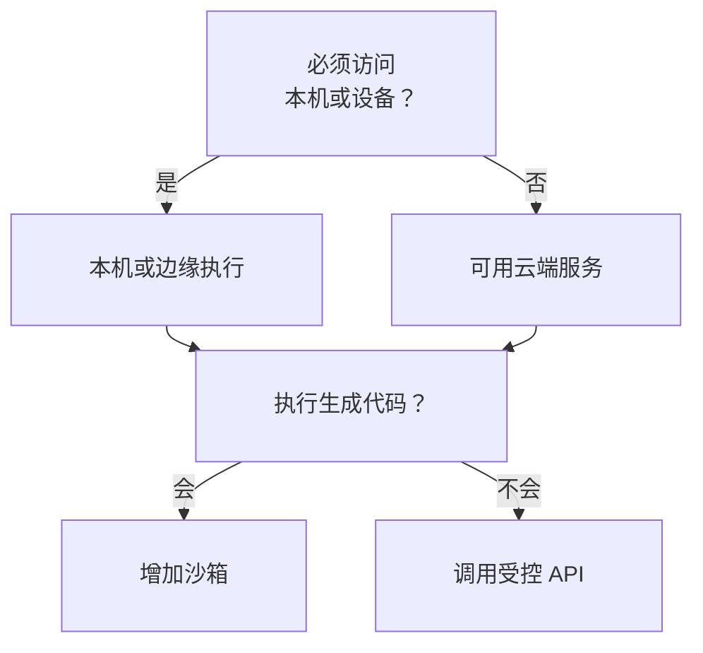

**Agent 放在哪里，先看它要访问哪里的资源，以及会执行什么代码。** 操作电脑上的文件和软件，用本机执行；服务大量用户、调用固定业务接口，用云端服务；控制家电或机器人，把最后的检查和操作留在现场。会运行模型生成的代码时，再加沙箱。

沙箱是受限制的执行空间，可以在本机，也可以在云端。模型 API 的位置和 Agent 的位置要分开看：调用云端模型，本地程序仍然可以负责推进任务、运行工具和保存进度。容器只是隔离手段，使用 Docker 不等于已经限制了文件、网络与密钥访问。[NIST 容器安全指南](https://csrc.nist.gov/pubs/sp/800/190/final)

## 用家庭助手看懂位置

用户说“客厅太热，开空调”。可以让云端模型理解请求，由家庭服务器重新读取温度、校验设备与参数，再调用 Home Assistant。控制结果和操作 ID 保存下来，云端超时后先查询这次操作，避免重复执行。

| 部分 | 放在哪里 | 为什么 |
| --- | --- | --- |
| 模型理解 | 云端或家庭服务器 | 按算力、网络和数据要求选择 |
| Agent 主程序（Harness） | 云端或本地 | 负责调用模型、观察结果、决定下一步 |
| 设备工具 | 家庭服务器 | 能访问设备，并在执行前后核对现场状态 |
| 任务记录 | 进程之外的持久存储 | 保存消息、操作结果与进度，重启后继续 |

模型在本地，这是边缘部署；模型在云端、控制在本地，这是混合部署。断网时能保留哪些能力，取决于本地是否已经具备模型、规则和工具。[Home Assistant 本地语音](https://www.home-assistant.io/voice_control/)、[云端语音方案](https://www.home-assistant.io/voice_control/voice_remote_cloud_assistant/)

## 先排除不满足条件的方案

| 硬性条件 | 先确定什么 |
| --- | --- |
| 数据不能离开本机或内网 | 执行、存储和模型请求都要符合数据边界；仅本地执行还不够 |
| 必须操作本机软件 | 保留本地执行程序，云端无法直接替代它 |
| 必须断网工作 | 模型、规则、依赖和工具要有可用的本地版本 |
| 会运行生成的代码 | 限制目录、网络、密钥、CPU、内存与运行时间 |
| 控制真实设备 | 执行前读取最新状态，执行后确认实际结果 |
| 中断后必须继续 | 消息、工具结果与进度不能只存在进程内存 |

## 可行方案怎样比较

| 方案 | 适合的任务 | 得到什么 | 主要代价 |
| --- | --- | --- | --- |
| 本机执行 | 个人编程、桌面自动化、私人文件 | 复用已有软件和环境 | 休眠会中断，用户环境不同，权限要收紧 |
| 云端服务 | 客服、知识库、固定业务接口 | 统一发布、扩容和观测 | 租户隔离、网络依赖、接口授权与恢复 |
| 云端沙箱 | 拉代码、跑测试、浏览器与临时文件 | 隔离任务与宿主，便于重建 | 启动等待、依赖安装与计算费用 |
| 边缘执行 | 家电、机器人、工业网关 | 靠近设备，可保留本地能力 | 算力有限，硬件与升级复杂，动作影响现实设备 |
| 混合部署 | 云端理解、本地或内网操作 | 同时使用云端算力和现场资源 | 跨网络的未知结果、身份传递与重复执行 |

本机方案可以用目录权限和操作确认收紧访问；运行生成的 Shell 或代码时，还要限制网络与文件访问。[Claude Code 安装](https://docs.anthropic.com/en/docs/claude-code/getting-started)、[本地沙箱机制](https://www.anthropic.com/engineering/claude-code-sandboxing)

云端服务通过参数受控的接口查询订单、搜索资料、提交审批即可。普通业务接口仍需按用户授权，无须为了 Agent 给每次问答创建虚拟机。托管服务的会话与观测能力见 [Google Agent Runtime](https://docs.cloud.google.com/gemini-enterprise-agent-platform/scale)、[Microsoft Foundry Agent Service](https://learn.microsoft.com/en-us/azure/ai-services/agents/overview)。

云端沙箱要把成果和任务记录保存到环境之外，再用固定镜像、快照或预热降低启动成本。临时磁盘能保留多久要按服务合同确认。[GitHub Copilot Cloud Agent 环境](https://docs.github.com/en/copilot/how-tos/copilot-on-github/customize-copilot/customize-cloud-agent/customize-the-agent-environment)、[AWS AgentCore 会话隔离](https://docs.aws.amazon.com/bedrock-agentcore/latest/devguide/runtime-sessions.html)、[E2B 隔离环境](https://e2b.dev/)

混合部署每次操作使用固定 ID，超时后查询原结果，再决定是否重试。任务主程序、记录和沙箱可以分别重建；跨机器用同一追踪编号串起模型请求、工具调用和结果。[Anthropic Managed Agents 架构](https://www.anthropic.com/engineering/managed-agents)、[OpenTelemetry Trace](https://opentelemetry.io/docs/concepts/signals/traces/)

## 模型也在端侧时，多检查四项

这一步只在离线、数据边界或延迟要求需要时考虑。使用本地工具，并不自动要求本地模型。

| 检查项 | 可执行做法 |
| --- | --- |
| 量化与精度 | 按设备内存和芯片选模型与 4-bit、8-bit 等量化版本；关键判断用自己的任务做精度回归，不能只看通用榜单 |
| 内存与恢复 | 模型按需加载，响应系统内存压力；非活跃模型可卸载。关键状态及时落盘，进程被结束时不能指望最后一次清理 |
| 功耗与发热 | 测持续推理，而不只测单次延迟；按需触发，避免常驻轮询 |
| 同步与维护 | 本地数据加密，授权且联网后再同步；按业务规则合并冲突，不能简单假定端侧永远优先。维护芯片适配、量化版本与模型更新 |

iOS 的内存压力通知（如 `didReceiveMemoryWarning`）可以帮助提前释放资源，但系统终止进程前不一定给应用处理机会。[Apple 内存压力说明](https://developer.apple.com/documentation/xcode/responding-to-low-memory-warnings) 同步失败也不应阻塞已经可在本地完成的功能。

## 三个项目的起点

| 项目 | 条件 | 建议起点 |
| --- | --- | --- |
| 企业客服 | 用户多，只查知识库和固定订单接口 | 云端服务；数据库保存消息和任务进度 |
| 个人编程助手 | 依赖现有项目、数据库与编译环境 | 本机执行；用本地沙箱限制生成代码 |
| 团队编程任务 | 独立拉取代码、安装依赖、测试并交付 | 云端沙箱；准备可重复安装的环境，成果持久保存 |
| 家庭助手 | 设备和最新状态都在家里 | 本地固定脚本控制；模型按条件本地或云端运行 |

所有方案都要单独设计任务恢复。检查点负责保存，执行服务负责接手；长时间等待与复杂重试可以评估持久化工作流。[Temporal](https://docs.temporal.io/)、[Agent 保存状态与恢复](/ai/agent-context-persistence-recovery/)

相关实践：[Agent 感知环境变化，怎样用好 LLM 缓存](/ai/agent-environment-awareness-llm-cache/)。
