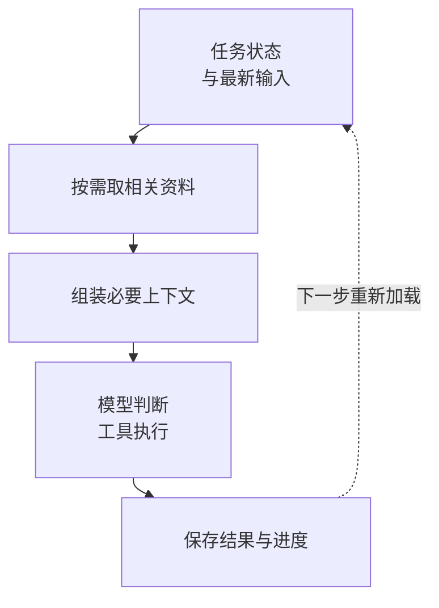
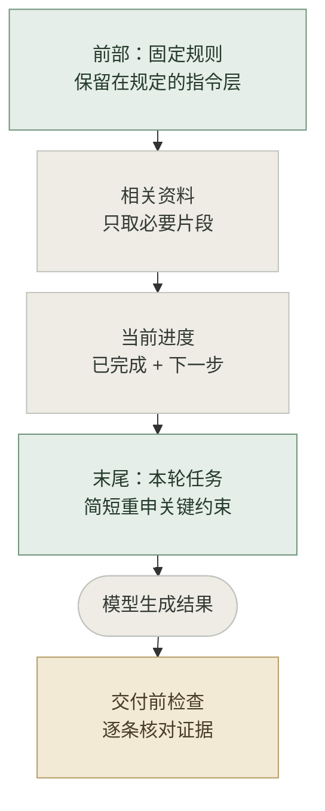

**Context Engineering 负责决定模型这一步该看到什么。** 输入材料的选择会影响质量、成本和延迟。Prompt Engineering 关注“指令这句话怎么写”，Context Engineering 关注整个上下文里应该放什么、不放什么：材料太少，模型找不到依据；什么都塞进去，关键约束会被无关内容淹没，费用和延迟同步上升。

管理的办法是按职责分层：系统规则保持稳定，当前任务状态结构化保存，RAG 为当前问题取证，Memory 只留未来有价值的事实，工具结果先摘要再附引用，接近预算时做可审计的压缩。有两条边界要放在最前面：压缩摘要是有损视图，关键事实和终态必须能回到原始 trace 与结构化状态核对；权限永远由执行层强制检查，写进上下文不等于真的被约束。

## 一个场景：生成月度报告

假设 Agent 的任务是“生成并提交月度报告”。两种做法的差别：

- **全量塞入**：系统提示里堆全部业务文档，聊天记录原样保留，工具每次返回完整日志。第一轮尚可，到第十轮预算耗尽，“发布前必须人工确认”这类关键约束被淹没在日志里。
- **按职责加载**：每轮只组装当前决策需要的信息，完整数据按引用回查。

按职责加载时，这个任务的上下文大致是：

```text
系统规则    → 职责边界、输出契约（稳定，可缓存）
任务状态    → 目标、约束、当前步骤（结构化 JSON）
最近对话    → 用户最新指令与澄清
检索结果    → 本月指标口径文档片段（带来源）
记忆        → 用户确认过的报表格式偏好
工具结果    → 指标查询摘要 + 完整数据引用
输出预留    → 生成报告草稿所需 token
```

其中任务状态是一个结构化对象，每轮只把当前决策需要的字段放进上下文，也更容易持久化和恢复：

```json
{
  "goal": "生成并提交月度报告",
  "constraints": [
    "只使用已批准数据源",
    "发布前必须人工确认"
  ],
  "completed": [
    "collect_data"
  ],
  "current_step": "validate_metrics",
  "open_questions": [
    "是否排除测试租户"
  ],
  "artifacts": {
    "raw_metrics": "artifact://metrics-123"
  }
}
```

工具输出也采用“摘要 + 引用”。下面用测试日志说明结构，需要细节时再读完整记录：

```json
{
  "summary": "3 个测试失败，均与时区有关",
  "items": [
    {
      "test": "scheduleAtMidnight",
      "error": "expected UTC+8, got UTC"
    }
  ],
  "truncated": true,
  "artifact_uri": "artifact://test-log-456"
}
```

## 六类信息各自负责什么

| 层 | 负责 | 不应该负责 |
|---|---|---|
| System Prompt | 稳定角色、边界、决策原则 | 长篇业务知识、动态状态 |
| Task State | 当前目标、约束、已完成步骤 | 用户全部历史 |
| Conversation | 当前交互所需的近因信息 | 永久记忆 |
| RAG | 从外部知识中即时检索证据 | 保存用户长期偏好 |
| Memory | 跨会话保存经过筛选的事实和经验 | 原样堆积聊天记录 |
| Tool Result | 支撑下一次决策的最新观察 | 无限日志、完整二进制 |

## 各层操作要点

| 层 | 该做 | 不该做 |
|---|---|---|
| System Prompt | 写职责、允许/禁止动作、不可信内容处理、停止条件、输出契约；计算版本号并让评测对应版本 | 塞全部 API 文档、客户资料、每轮都变的任务状态、数百条相互冲突的边缘规则 |
| Task State | 结构化保存目标/约束/进度，便于持久化和恢复 | 用聊天历史隐式承载任务状态 |
| RAG | 查询改写 → 权限过滤 → 混合召回 → rerank → 去重和多样性 → 片段压缩 → 来源引用 → 证据不足时明确返回不足 | 只用向量相似度（产品名、错误码、订单号等精确实体需要关键词或结构化查询）；把检索结果当可信指令 |
| Memory | 区分偏好、事实、情景、程序等类型；写入前做候选提取 → 类型判断 → 来源验证 → 敏感数据检查 → 租户绑定 → 去重合并 → 过期策略 | 原样堆积聊天记录；让模型通过普通对话修改身份、权限等受保护状态 |
| Tool Result | 结构化摘要 + 截断标记 + artifact 引用 | 每轮附完整日志或二进制内容 |
| Compaction | 压缩为已确认事实、已完成步骤、未解决问题、关键工具结果引用、用户最新约束、已否决方案及原因；摘要与原始 trace 分开保存 | 把摘要当事实来源；让压缩把“不确定”变成“确定”或丢失否定词 |

三条容易被忽略的横切问题：

- **Just-in-time 加载**：不要在任务开始时把所有可能相关的信息都放进来。让 Agent 通过受限工具按需获取——先看目录和摘要，再选相关对象，必要时继续深入。这和工程师先看 `tree` 再打开相关文件，而不是一次 `cat` 整个仓库是同一个道理。
- **检索结果不可信**：检索到的内容同样是外部数据，不能改变系统权限和目标。
- **缓存**：稳定系统前缀、Tool Schema、文档解析结果、Embedding、权限过滤后的检索候选、确定性工具结果都可以缓存。缓存键至少包含内容哈希、模型或解析版本、租户与权限范围、数据版本、过期时间；不要跨用户复用含私有信息的 Prompt cache。

## 完整处理顺序

一轮决策的完整顺序大致是：

<div class="article-note-diagram">



</div>

每步先判断是否已完成、是否仍在权限和预算内，需要继续时才进入下一轮。接近上下文预算时压缩旧轨迹并保留引用。压缩发生之后，高风险事实（金额、权限、终态）应从结构化状态或原始 trace 重新读取，而不是依赖摘要。

## Token 预算：一个计算示例

不要等上下文溢出才临时裁剪。原则是**先预留输出，再分配输入**。下面是一个自定示例（不是任何厂商的推荐配方，比例应按任务的检索密度和对话长度调整）：假设有效窗口 100k tokens——

| 用途 | 占比 | token |
|---|---|---|
| 输出预留 | 10% | 10k |
| 系统规则与工具定义 | 15% | 15k |
| 当前任务状态 | 15% | 15k |
| 最近对话 | 20% | 20k |
| 检索与记忆 | 30% | 30k |
| 工具结果 | 10% | 10k |

配套监控比比例本身更重要：每一类上下文占用、每轮增长速度、被裁剪的信息、检索命中后是否真的被引用、上下文长度与成功率/延迟/成本的关系。

## 上下文变长以后，为什么还会漏约束

模型可能读到了规则，却没有执行。《Lost in the Middle》在问答与检索任务中观察到，多个受测模型更容易利用开头和结尾的信息，中间较差，任务表现呈“两端高、中间低”的 U 形。**这不等于所有模型都固定给两端更高的 attention 权重**：实验测的是任务表现，具体结果取决于模型、任务与上下文长度。[论文](https://aclanthology.org/2024.tacl-1.9/)

Chroma 在任务复杂度不变时，也观察到输入变长后的性能下降；干扰内容同样会影响表现。这意味着“材料都在窗口里”只证明程序把内容发了出去，不证明模型稳定使用了每一项要求。[Context Rot](https://www.trychroma.com/research/context-rot)

排查时先区分两种情况：如果规则被截断、被摘要删掉，或 Skill 没有加载，要先把缺少的内容补回当前请求；如果规则确实在输入里，再调整材料数量、组织方式和交付检查。

### 怎样组织本轮材料

兼顾开头的规则与末尾的请求，不把关键要求只埋在长材料中间。下面是可测试的组织方式；其中“材料在前、问题在后”来自 Anthropic 对 Claude 长文档输入的建议，不能当作所有模型的最佳顺序。[官方建议](https://platform.claude.com/docs/en/build-with-claude/prompt-engineering/claude-prompting-best-practices#long-context-prompting)

<div class="context-note-visual">



</div>

具体做法有七项：

<div class="context-note-actions">

| 方法 | 直接怎么做 |
| --- | --- |
| **少放资料** | 文档只读相关段落，Skill 按需加载，日志只取报错附近。 |
| **兼顾两端** | 固定规则保留在前部的规定指令层；长材料后简短重申本轮任务和少量关键约束。 |
| **分清主次** | 强约束保留原文，参考资料可摘要，过期要求清理掉。 |
| **先找证据** | 先定位原文、函数或运行结果，再作判断。 |
| **保存进度** | 阶段交接时，带上目标、约束、进度、待办和来源。 |
| **逐条复查** | 单独一轮提供约束与结果，逐条给出检查证据。 |
| **程序兜底** | 字段用 Schema 校验，接口兼容用回归测试，工具权限由执行层限制。 |

</div>

位置调整不会改变平台的指令层级或工具权限。末尾重申的约束要与原有规则一致，不必在两端复制整份规则或长文档。

### 交付前怎样逐条复查

假设让编码 Agent 给订单查询增加分页：

```text
规则区（保留在平台规定的指令层，交接时原样保留）：
C1. 保留旧请求的返回字段和默认行为。
C2. 不修改数据库结构。

本轮材料：
参考资料（可摘要）：订单接口文档的分页段落。
已确认：旧客户端仍在使用无分页参数的请求。

本轮请求（放在长材料之后）：
增加可选分页参数。遵守 C1、C2。

交付前逐条检查：
C1 → 给出旧请求的测试结果。
C2 → 给出数据库相关改动的 diff 检查结果。
未验证就写“未验证”；检查失败，修正后重查。
```

复查时提供的是**原始约束 + 实际结果**。只问“你检查过了吗”，模型的一句“检查过了”不能作为证据。ICLR 2024 的研究还发现，当时受测模型在缺少外部反馈的推理自纠错中可能变差；这不证明所有复查无效，但说明自检不能代替证据。[自纠错研究](https://proceedings.iclr.cc/paper_files/paper/2024/hash/8b4add8b0aa8749d80a34ca5d941c355-Abstract-Conference.html)

验证这些做法时，固定模型与任务，多跑几次，比较**约束遗漏率、任务通过率、Token 和耗时**。不要把单次更顺眼的回答当成稳定改进。

## 常见失败模式

| 失败模式 | 实际后果 |
|---|---|
| 上下文越长越好 | 成本上升，关键指令反而被忽略 |
| 把 RAG 当 Memory | 当前取证和跨会话复用互相污染 |
| 把摘要当事实 | 有损视图被当成终态，审计无法回溯 |
| 所有工具永远可见 | 工具过多增加选择错误；应按任务阶段只暴露必要工具 |
| 把权限写进 Prompt | 权限必须由执行层强制，Context Engineering 解决不了这个问题 |

落地时可以从最朴素的路径开始：给上下文分类并记录 token 占用，把任务状态改成结构化对象，给工具输出加摘要与引用，RAG 加权限过滤，记忆加来源与过期，超预算时生成可审计的压缩，再用 eval 比较不同策略的任务成功率。

延伸阅读：

- [RAG 知识库工程](/rag/)：外部资料怎样解析、检索、引用和更新。
- [Agent 记忆系统：原理、方案与场景选型](/ai/agent-memory-principles/)：哪些信息值得跨会话保存。
- [Anthropic：Effective context engineering for AI agents](https://www.anthropic.com/engineering/effective-context-engineering-for-ai-agents)
