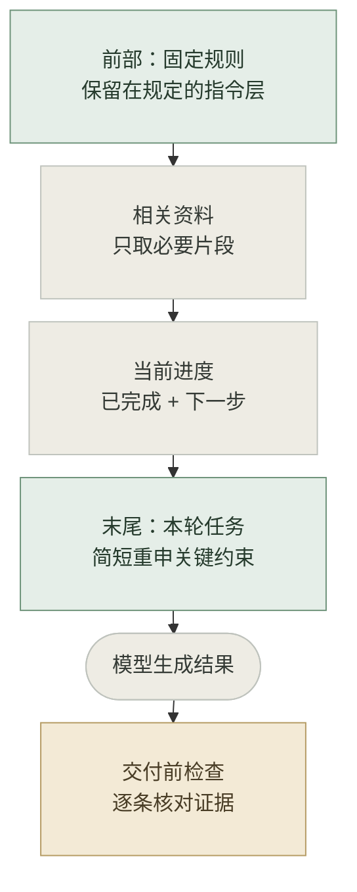

**模型可能读到了规则，却没有执行。减少遗漏，先少放无关资料，固定规则保留在规定的指令层，长材料后简短重申本轮任务与关键约束，交付前逐条检查。** 这些方法能降低风险，不能保证零遗漏。

长上下文中的信息位置也会影响结果。《Lost in the Middle》在问答与检索任务中观察到，多个受测模型更容易利用开头和结尾的信息，中间较差，任务表现呈“两端高、中间低”的 U 形。**这不等于所有模型都固定给两端更高的 attention 权重**：实验测的是任务表现，具体结果取决于模型、任务与上下文长度。[论文](https://aclanthology.org/2024.tacl-1.9/)

先确认规则确实发给了模型。被截断、被摘要删掉，或 Skill 没加载时，要把缺少的内容补回当前请求。

## 一张图，看懂本轮怎么组织

兼顾开头的规则与末尾的请求，不把关键要求只埋在长材料中间。下面是可测试的组织方式；其中“材料在前、问题在后”来自 Anthropic 对 Claude 长文档输入的建议，不能当作所有模型的最佳顺序。[官方建议](https://platform.claude.com/docs/en/build-with-claude/prompt-engineering/claude-prompting-best-practices#long-context-prompting)

<div class="context-note-visual">



</div>

## 七个做法，直接照着用

<div class="context-note-actions">

| 方法 | 直接怎么做 |
| --- | --- |
| **少放资料** | 文档只读相关段落，Skill 按需加载，日志只取报错附近。 |
| **兼顾两端** | 固定规则保留在前部的规定指令层；长材料后简短重申本轮任务和少量关键约束。 |
| **分清主次** | 强约束保留原文，参考资料可摘要，过期要求清理掉。 |
| **先找证据** | 先定位原文、函数或运行结果，再作判断。 |
| **保存进度** | 阶段交接时，带上目标、约束、进度、待办和来源。 |
| **逐条复查** | 单独一轮提供约束与结果，逐条给出检查证据。 |
| **程序兜底** | 字段用 Schema 校验，接口兼容用回归测试，工具权限由执行层限制。 |

</div>

位置调整不会改变平台的指令层级或工具权限。末尾重申的约束要与原有规则一致，不必在两端复制整份规则或长文档。

## 一份短模板

假设让编码 Agent 给订单查询增加分页：

```text
规则区（保留在平台规定的指令层，交接时原样保留）：
C1. 保留旧请求的返回字段和默认行为。
C2. 不修改数据库结构。

本轮材料：
参考资料（可摘要）：订单接口文档的分页段落。
已确认：旧客户端仍在使用无分页参数的请求。

本轮请求（放在长材料之后）：
增加可选分页参数。遵守 C1、C2。

交付前逐条检查：
C1 → 给出旧请求的测试结果。
C2 → 给出数据库相关改动的 diff 检查结果。
未验证就写“未验证”；检查失败，修正后重查。
```

复查时提供的是**原始约束 + 实际结果**。只问“你检查过了吗”，模型的一句“检查过了”不能作为证据。

## 研究结论与权威依据

<div class="context-note-actions">

| 结论 | 依据与适用边界 |
| --- | --- |
| **长度影响** | Chroma 在任务复杂度不变时，也观察到输入变长后的性能下降；干扰内容同样会影响表现。[Context Rot](https://www.trychroma.com/research/context-rot) |
| **位置影响** | 论文也观察到只呈现末尾优势的受测模型，不能把 U 形当成所有模型的固定规律。在材料前后重复问题，对合成键值检索帮助很大，对多文档问答的位置问题改善有限。[Lost in the Middle，第 4 节与附录 E](https://arxiv.org/html/2307.03172v3) |
| **末尾提问** | Anthropic 对 Claude 的长文档输入推荐“材料在前，问题在后”，并建议先提取相关原文；不代表所有模型始终最关注末尾。[官方建议](https://platform.claude.com/docs/en/build-with-claude/prompt-engineering/claude-prompting-best-practices#long-context-prompting) |
| **压缩有损** | 摘要可能遗漏关键细节。强约束保留原文，重要事实保留可回查的来源。[Anthropic 上下文工程](https://www.anthropic.com/engineering/effective-context-engineering-for-ai-agents) |
| **自检限制** | ICLR 2024 发现，当时受测模型在缺少外部反馈的推理自纠错中可能变差；不证明所有复查无效，但自检不能代替证据。[自纠错研究](https://proceedings.iclr.cc/paper_files/paper/2024/hash/8b4add8b0aa8749d80a34ca5d941c355-Abstract-Conference.html) |

</div>

验证效果：固定模型与任务，多跑几次，比较**约束遗漏率、任务通过率、Token 和耗时**。

相关笔记：[上下文工程](/ai/context-engineering-guide/)、[RAG 原理与实践](/rag/chapters/rag-primer/)。
