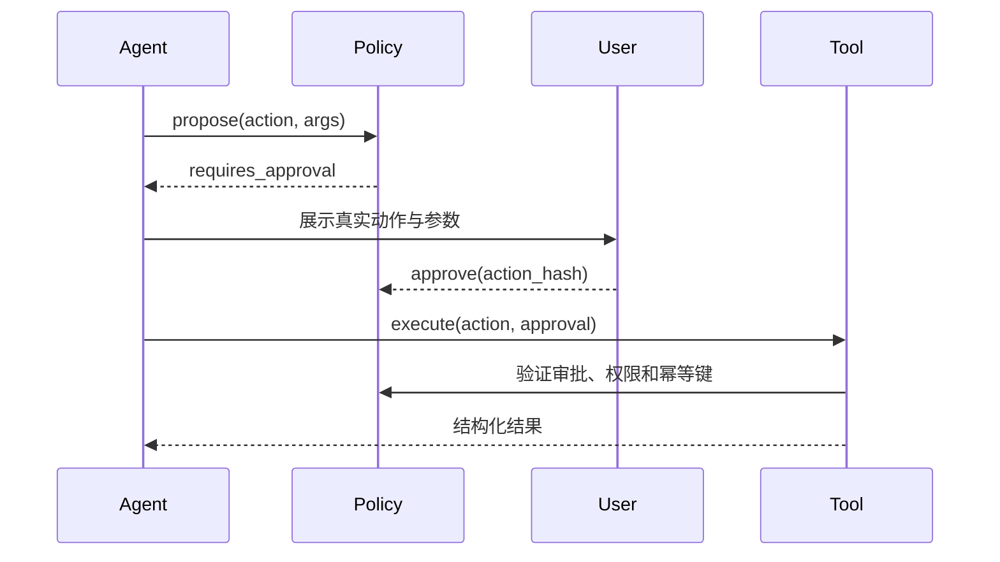

**生产 Tool 是受权限和状态保护的业务接口。** 模型提出工具名和参数，代码校验身份、范围、审批与幂等，再执行动作；Schema 合法只证明形状，不证明有权操作或业务正确。

以退款为例：第一次请求已经提交，回复却超时了。第二次调用要用同一幂等键查询原结果，而不是再退一次。权限、重复调用、未知结果和审计，都要在接入模型前定义。

## 先暴露业务意图，再设计参数

面向订单等业务任务，任意 SQL 会把边界留给模型猜。下面两个片段是契约示意，接入具体 SDK 时还需使用它的工具定义格式。

```json
{
  "name": "run_sql",
  "parameters": {
    "sql": { "type": "string" }
  }
}
```

查询订单可以改为有限的业务接口：

```json
{
  "name": "list_customer_orders",
  "description": "读取当前已授权客户最近的订单，只读。",
  "parameters": {
    "type": "object",
    "properties": {
      "customer_id": {
        "type": "string",
        "description": "由当前会话授权上下文提供的客户 ID"
      },
      "limit": {
        "type": "integer",
        "minimum": 1,
        "maximum": 20
      }
    },
    "required": ["customer_id", "limit"],
    "additionalProperties": false
  }
}
```

当前用户和租户由服务端绑定，模型传入的 `customer_id` 仍要核对归属。工具名称与职责应清楚、少重叠，返回当前决策需要的结果。[Anthropic Tool 设计](https://www.anthropic.com/engineering/writing-tools-for-agents)

| 参数规则 | 怎样落到契约 |
| --- | --- |
| 一件明确的业务事 | 动词加对象；说明适用与禁止条件 |
| 减少歧义 | 区分 ID、展示名、自然语言；枚举优先于自由文本 |
| 限制资源 | 数字、字符串与数组有上限；默认拒绝额外字段 |
| 执行层再校验 | Schema、资源归属、状态条件与权限分别检查 |

例如工具只允许建待审批邮件草稿：

```json
{
  "name": "schedule_email",
  "description": "创建待审批的邮件草稿，不会直接发送。用户要求立即发送时也只能创建草稿。",
  "parameters": {
    "type": "object",
    "properties": {
      "recipient_id": { "type": "string" },
      "subject": { "type": "string", "maxLength": 120 },
      "body": { "type": "string", "maxLength": 10000 },
      "send_after": {
        "type": "string",
        "format": "date-time"
      }
    },
    "required": ["recipient_id", "subject", "body", "send_after"],
    "additionalProperties": false
  }
}
```

“不直接发送”必须由实现保证。不同模型支持的 Schema 子集不同；字段限制还要在服务端验证，不能只依靠提示。

## 风险与授权绑定到具体动作

以下是风险划分示例，自动执行范围取决于产品规则与已有授权。

| 等级 | 示例 | 检查方式 |
| --- | --- | --- |
| R0 低敏只读 | 公开天气 | 任务内自动执行 |
| R1 私有只读 | 本人订单 | 验证身份与资源归属，结果脱敏 |
| R2 可逆写入 | 草稿、标签 | 明确授权范围、回执与撤销方式 |
| R3 难逆或高影响 | 发信、发布、删除、改权限 | 授权绑定真实目标和参数 |
| R4 金融或生产控制 | 付款、签约、生产 DDL | 业务要求的强身份与审批，部分动作不开放给 Agent |

独立的 `{ "approved": true }` 不能证明批准了什么。需要记录动作、参数哈希、主体和有效期：

```json
{
  "approval_id": "apr_123",
  "actor_id": "user_42",
  "tool": "send_email",
  "args_hash": "sha256:...",
  "expires_at": "2026-07-31T12:00:00Z"
}
```

收件人、金额等关键参数改变后，旧授权不再覆盖新动作。



## 写操作先解决幂等和未知结果

```http
POST /refunds
Idempotency-Key: run_123:step_4
```

服务端保存“幂等键 → 参数哈希 → 执行状态 → 最终结果”。

| 同一键再次到达 | 处理 |
| --- | --- |
| 参数相同且已完成 | 返回原结果 |
| 参数不同 | 拒绝复用 |
| 仍在执行 | 返回进行中 |
| 已失败 | 仅在明确允许的策略下重试 |

幂等键对应一次业务操作，不能拿自然语言文本或每次新生成的随机值充当稳定键。

| 错误类别 | 下一步 |
| --- | --- |
| 参数非法 | 不盲目重试，可让模型修正一次 |
| 权限失败 | 拒绝，不泄漏内部细节 |
| 429 限流 | 结合 `Retry-After` 有限退避 |
| 502、短暂依赖失败 | 确认可重试且有次数、时间上限 |
| 已退款、版本冲突 | 重新读状态再判断 |
| 超时且结果未知 | 按操作 ID 或幂等键查询，再决定是否重发 |

```json
{
  "ok": false,
  "error": {
    "code": "REFUND_ALREADY_EXISTS",
    "category": "business_conflict",
    "retryable": false,
    "safe_message": "该订单已有退款申请",
    "correlation_id": "corr_456"
  }
}
```

## 返回短结果，完整数据可追溯

```json
{
  "ok": true,
  "data": {
    "orders": [],
    "next_cursor": null
  },
  "meta": {
    "truncated": false,
    "source": "orders-service",
    "observed_at": "2026-07-31T10:00:00Z"
  }
}
```

长列表分页，文档返回摘要与引用，二进制返回受控句柄。不要把数据库堆栈、内部 URL、密钥或完整日志塞给模型。

## 用审计和失败用例验收

| 记录组 | 字段 |
| --- | --- |
| 谁、做什么 | run/step ID，用户与 Agent 身份，工具版本 |
| 凭什么执行 | 参数哈希及脱敏参数，权限策略版本，审批 ID |
| 执行到哪里 | 开始、结束、耗时，幂等键，结果类别，外部 correlation ID |

日志不保存完整 token、密码、Cookie、原始身份资料和无必要的用户内容。

测试至少覆盖合法最小参数、边界值、多余字段、越权 ID、重复请求、未知结果、429/5xx、过长输出、审批过期或参数改变、注入诱导、取消与补偿。验收需要看到实际状态和记录，工具返回成功还不够。相关方法见 [Agent 评测](/ai/agent-evaluation-observability/)。
