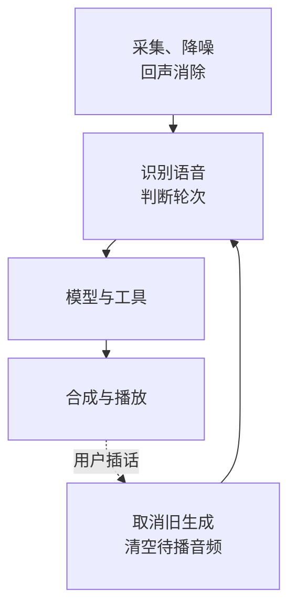

**实时语音 Agent 要同时管住回应时间、打断和实际动作状态。** ASR 把声音转成文字，模型与工具处理请求，TTS 再合成声音；每一轮用同一个 turn ID 串起生成、播放和工具结果。停止扬声器还不够，旧生成与待执行动作也要取消或隔离。

先在单设备把半双工轮次做稳，再增加打断、恢复和全双工。验收看“用户结束说话到第一段可听回复”，也看口头回执是否符合真实工具结果，不能只看模型总耗时。

## 一轮对话怎样经过系统

<div class="article-note-diagram">



</div>

| 要测的阶段 | 指标 |
| --- | --- |
| 用户停顿到判定轮次结束 | endpointing latency |
| 最后一帧到 ASR final | ASR finalize latency |
| 文本到模型首个 token | model time-to-first-token |
| 外部操作 | tool latency |
| 文本到首个音频包 | TTS time-to-first-audio |
| 网络与播放缓冲 | transport / jitter buffer |

每段独立记录时间戳和 turn ID。部分阶段可重叠，按端到端观测找瓶颈，不把各段预算简单当作实际延迟。

## “有人说话”和“一轮说完”分开判断

VAD 判断语音是否出现，Turn Detection 判断这一轮是否结束。停顿阈值短会抢话、截断中文停顿；阈值长会迟迟不回应。结合音频 VAD、ASR partial、标点与语义完整性、最大等待时间，按键或显式结束可作兜底。

| ASR 结果 | 可以做什么 | 不能据此做什么 |
| --- | --- | --- |
| partial（还会修订） | 实时字幕、预热意图、准备上下文、辅助判断仍在说话 | 直接执行退款、取消等副作用 |
| final 或稳定轮次 | 校验参数与权限，满足授权条件后执行 | 把识别成功当作动作成功 |

识别过程可能变化：

```text
“帮我取消…”
“帮我取消明天的提醒”
“不要，改成后天”
```

工具等待时说“正在查询”，需要授权时展示真实动作，失败时说明实际状态。确认工具结果后才给完成回执，不能先说“已经完成”。

## 打断必须贯穿整条链路

用户在播放时插话，依次处理：检测语音 → 降低或停止播放 → 清掉未播缓冲 → 取消当前 TTS → 尽可能取消模型生成 → 记录实际已播放位置 → 新一轮送入 ASR。

```text
SPEAKING → INTERRUPTING → LISTENING
```

已完成的外部操作不会随打断撤销；正在执行且结果未知的动作需查询状态，后续新动作停止调度。服务端继续生成时仍可能计费，下一轮上下文也不能误以为整段旧回答都已被用户听到。

对话状态明确保存：

```text
IDLE
CONNECTING
LISTENING
THINKING
CALLING_TOOL
SPEAKING
INTERRUPTING
RECONNECTING
ERROR
```

UI、音频和服务端按同一组状态及 session/version 更新。迟到事件用轮次与序号隔离：

```json
{
  "session_id": "voice_123",
  "turn_id": 18,
  "event": "tts.audio.delta",
  "sequence": 42
}
```

进入 turn 19 后，turn 18 的音频不能继续播放。

## 协议与断线恢复

| 链路 | 常见选择 | 边界 |
| --- | --- | --- |
| 浏览器、移动端双向音频 | WebRTC | 提供媒体、拥塞与抖动处理，不替代业务状态机 |
| 字幕、turn 与 UI 事件 | WebSocket；单向推送可用 SSE | 与音频分别恢复，不能因重连丢弃旧轮次 |
| 设备命令与状态 | MQTT | 命令包含设备 ID、版本、有效期和幂等 ID |
| 内部服务调用 | HTTP / gRPC | 独立处理鉴权、超时与未知结果 |

媒体与控制通道可以分开。[W3C WebRTC](https://www.w3.org/TR/webrtc/) 恢复时使用稳定 session ID、递增 turn/sequence、已确认游标、短期缓冲与服务端 TTL，并明确返回 resume 或 restart。

区分媒体、控制通道、ASR/TTS 提供商断开，以及后台、切网和短暂抖动。无法安全续传时，要求用户重说刚才一句，不能偷偷拼接缺帧音频。

## 音频接入与隐私

先确认采样率、声道、PCM/Opus 编码和帧长，再检查增益、降噪、回声消除、蓝牙切换与扬声器回采。浏览器先拿到麦克风，再排查模型或网络：

```javascript
if (!window.isSecureContext) {
  throw new Error("麦克风需要 HTTPS 或 localhost 安全上下文");
}

const stream = await navigator.mediaDevices.getUserMedia({
  audio: {
    echoCancellation: true,
    noiseSuppression: true,
    autoGainControl: true
  }
});
```

这些约束是请求，实际设置取决于浏览器和设备。[W3C Media Capture](https://www.w3.org/TR/mediacapture-streams/)

| 需要控制的内容 | 做法 |
| --- | --- |
| 麦克风与保存 | 开启状态可见；录音、转写、长期保存分别告知并取得相应授权，原始音频短期保留 |
| 身份与动作 | 声纹不能作为唯一身份依据；高风险动作有参数确认，工具遵循最小权限 |
| 外部音频与记录 | 作为不可信输入，transcript/Trace 脱敏，不能让音频指令自动扩权 |

## 按真实环境验收

| 指标组 | 检查项 |
| --- | --- |
| 接入和速度 | 首次连接成功率，首音频 P50/P95，单分钟成本 |
| 识别与轮次 | 字错率、业务实体准确率，提前或过晚结束比例 |
| 打断和恢复 | 打断生效时间、旧音频泄漏时长、重连恢复率 |
| 工具 | 成功率、错误回执是否符合真实状态 |

测试覆盖安静室内、电视或多人说话、扬声器、蓝牙、弱网切网、快速插话、长停顿，以及方言、数字、英文缩写和专有词。按“半双工 → 时间戳与轮次 → 打断 → 工具反馈 → 恢复 → 多环境测试”推进，再优化音色、情绪和全双工。
