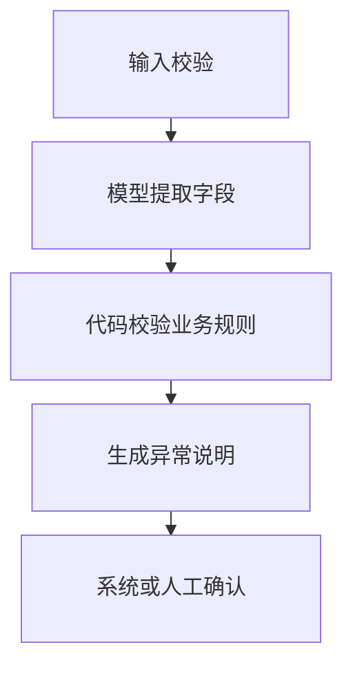

**步骤固定时，先用普通代码或 Workflow；只有下一步取决于不确定输入和中间反馈时，才考虑 Agent。** Agent 用成本、延迟和可预测性换动态决策能力，还需要能限制动作、观察结果、验证失败与恢复。

先与最简单的可行方案比较。单 Agent 失败时，先检查目标、工具和评测，增加角色不会自动补齐这些缺口。[Anthropic：Building effective agents](https://www.anthropic.com/engineering/building-effective-agents)、[OpenAI Agent 实践指南](https://openai.com/business/guides-and-resources/a-practical-guide-to-building-ai-agents/)

## 报销审核：局部用模型即可

模型从发票和说明中提取字段，程序校验金额、预算、重复报销和权限；模型生成异常解释，高风险情况交给人工。业务流程已知，不需要让 Agent 自由决定全部步骤。

<div class="article-note-diagram">



</div>

## 四种方案按条件选

| 方案 | 适合 | 主要代价 |
| --- | --- | --- |
| 普通代码 | 规则清楚、输入结构化 | 变化需要修改规则 |
| Workflow | 步骤基本固定，局部需要模型 | 编排与流程维护 |
| 单 Agent | 目标明确，步骤依赖中间观察 | 调用成本、延迟和不确定性 |
| 多 Agent | 真正独立的子任务或上下文隔离 | 协调、冲突、权限和评测成本 |

| 情况 | 更合适的处理 |
| --- | --- |
| 税率、字段映射、权限、定时同步、数据库约束已有规则 | 代码执行，不让模型替代确定性判断 |
| 错误代价高且不能独立验证 | 模型整理或建议，规则或人作最终决定 |
| 只需要一次无工具问答 | 单次模型调用，不必包装成 Agent |
| 接口要求几十毫秒 | 比较规则、缓存、小模型分类或预计算 |
| 没有行动工具或结果反馈 | 先补能力与反馈，反复生成文本不是执行闭环 |
| 没有任务集、Trace、副作用检查与回滚 | 先建立验证，再扩大自主权 |

## 单 Agent 什么时候够用

工具集合有限，目标明确，每步有结果反馈，副作用受控，且可以限制步数、时间与费用时，先用一个 Agent。输入是否非结构化、步骤是否动态、失败能否恢复、收益能否覆盖成本，是四个主要判断。

| 多 Agent 的理由 | 必须成立的条件 |
| --- | --- |
| 上下文隔离 | 子任务需要不同资料或工具，拆分确实减少干扰 |
| 真正并行 | 调查相互独立；串行依赖不会因多角色变快 |
| 独立验证 | 有不同检查标准与证据，并保留确定性测试 |

角色名、重复发同一 Prompt、模型投票或“一个做不好就多加几个”，都不是充分理由。每增加一个角色，还增加版本、消息协议、超时重试、权限、轨迹和失败组合；仍需统一状态和最终责任人。

## 最后算完整成本

```text
每任务价值
- 模型成本
- 工具和基础设施成本
- 人工接管成本
- 错误与补偿成本
- 评测和维护成本
= 实际收益
```

基线可以是人工、规则系统、普通搜索、单次模型调用或有限状态工作流。先估计上面的总成本，再用同一批任务测目标是否完成、延迟、人工接管和错误补偿，不能只和“什么都不做”比较。
