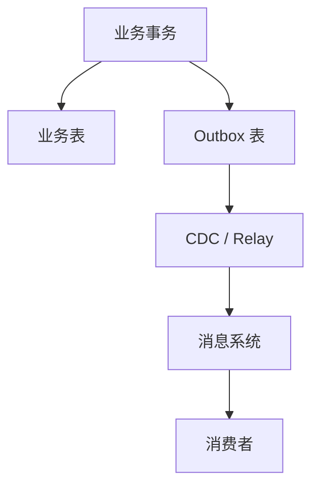

Outbox 让业务更新与待发送事件在同一个数据库事务里提交，再由 Relay 异步发送。它避免“业务成功却没有留下消息待办”，但消息仍可能重复、延迟或消费失败，需要消费者幂等、顺序规则和重放能力。

例如订单已支付，进程却在发消息前崩溃。Outbox 中仍有已提交的支付事件，Relay 恢复后可以继续发送；下游要能识别同一个事件被再次投递。

## 一个订单支付事件走完整链路

用户支付成功，订单服务更新状态并在同一事务写入 Outbox：

```sql
begin;

update orders
set status = 'PAID'
where id = :order_id and status = 'UNPAID';

-- 仅在状态首次变更成功时写入下面的事件；占位符为应用绑定参数

insert into outbox_event (
  id, aggregate_type, aggregate_id,
  event_type, payload, created_at
) values (
  :event_id, 'order', :order_id,
  'OrderPaid', :payload, now()
);

commit;
```

Relay 轮询这张表或用 CDC 捕获变更，把事件路由到消息系统。Debezium 的 [Outbox Event Router](https://debezium.io/documentation/reference/stable/transformations/outbox-event-router.html) 就是按聚合类型、聚合 ID 和 payload 做这件事的现成实现。

<div class="article-note-diagram">



</div>

事件本身要支持追踪和演进，最小结构如下：

```json
{
  "eventId": "01J...",
  "eventType": "OrderPaid",
  "eventVersion": 2,
  "aggregateId": "order-123",
  "occurredAt": "2026-01-23T10:20:30Z",
  "traceId": "trace-456",
  "payload": {
    "orderId": "order-123",
    "amount": 19900,
    "currency": "CNY"
  }
}
```

| 字段 | 用途 |
| --- | --- |
| `eventId` | 消费者幂等去重 |
| `aggregateId` | 分区键与顺序范围 |
| `eventVersion` | Schema 兼容演进 |
| `occurredAt` / `traceId` | 排序参考与全链路追踪 |
| `payload` | 业务事实本身 |

下游的发票服务消费这条事件时，把“记录已消费”和业务更新放进同一个数据库事务：

```sql
begin;

insert into consumed_event(event_id, consumer)
values (:event_id, 'invoice-service')
on conflict do nothing;

-- 只有 insert 成功（首次见到该事件）时才执行业务更新

commit;
```

业务操作本身也要防重复：“把状态设置为 PAID”天然比“余额加 100”容易幂等；调用外部支付、发信等副作用时，副作用方需要独立的幂等键（比如以 `orderId + eventType` 派生）；超时后结果未知时先查询外部系统状态，不要直接重试。注意不要把 at-least-once 当成所有系统的唯一语义——交付承诺由传输和消费端共同决定：常见 broker 提供至少一次交付，所以消费者必须幂等；部分传输支持事务或更强的语义，也只覆盖 broker 内部，外部副作用仍需自己的幂等键。

## 顺序、失败与重放

全局顺序昂贵且吞吐低，常见做法是用 `aggregateId` 作为分区键，让同一订单、账户或设备的事件进入同一分区，顺序承诺缩小到业务实体范围内。即使分区内有序，消费者仍要处理旧版本事件迟到、重放事件与实时事件交错、单个坏消息阻塞整个分区的情况；可以在聚合上维护 `sequence` 或业务版本，拒绝倒退更新。

消费失败大致分三类，处理方式不同：

| 失败类型 | 处理方式 |
| --- | --- |
| 临时依赖故障 | 指数退避并限制重试次数 |
| 输入永久无效 | 进入隔离队列并告警 |
| 代码缺陷或版本不兼容 | 停止相关消费，修复后重放 |

死信队列不是消息坟场，每条隔离消息都应保留失败原因、消费者版本、重试次数和恢复负责人。能重放才算可恢复，但重放前要解决两件事：事件 Schema 的版本兼容，以及外部副作用（发信、扣款、推送）的重复执行。

Schema 演进的原则：优先新增可选字段，不改变已有字段语义；消费者先兼容新旧版本，再升级生产者；事件保存业务事实，不保存某个消费者的页面模型；长期保留的事件需要 Schema Registry 或等价的契约检查。

## 上线前检查

- 业务写入与 Outbox 在同一事务；
- Relay 有延迟、积压和失败告警；
- 消费者有幂等记录，外部副作用有幂等键；
- 分区键与业务顺序范围一致；
- 事件有版本和 Trace ID；
- 重放不会重复发信、扣款或推送；
- 死信有处理流程；
- 关键事件有端到端对账。
