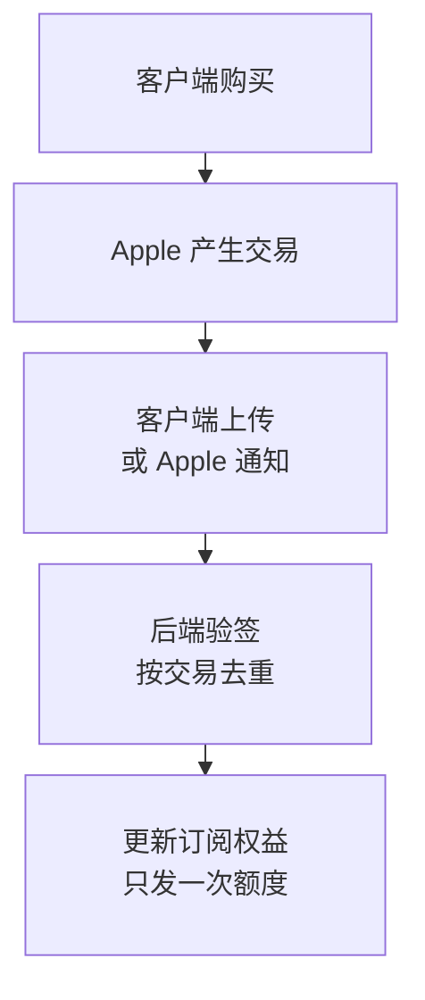

**iOS 订阅系统要分开确认三件事：Apple 是否产生有效交易、用户现在是否有订阅权益、业务额度是否已经发放和扣减。** 客户端用 StoreKit 2 发起购买，后端验证签名、计算权益，并通过唯一约束和数据库事务防止重复发放。客户端显示“付款成功”，还不能代表业务交付完成。

下面以常规月付、年付自动续期订阅为例。商品与额度是参考设计；实现时要按产品约定确认套餐切换、退款和计费时机。完整字段、Swift 片段及异常矩阵分别放在[订阅实现](/architecture/ios-subscription-implementation/)和[Credits 实现](/architecture/credits-metering-implementation/)中，均直接展开。

## 一次购买怎样完成

假设用户购买每月 3,000 Credits 的套餐。客户端先创建业务订单，拿到绑定业务账号的 `appAccountToken`，再向 StoreKit 发起购买。Apple 产生交易后，客户端上传和服务端通知可能同时到达，也可能先后到达。

两条入口要进入同一处理器。交易用 `environment, transactionId` 去重，额度用 `grantKey` 去重；数据库唯一约束负责拦住并发重复，不能只先查一次“是否存在”。后端确认权益和额度已经写好，客户端才结束交易。[StoreKit Transaction](https://developer.apple.com/documentation/storekit/transaction)、[finish()](https://developer.apple.com/documentation/storekit/transaction/finish%28%29)

## 四类事实各自保存

一套订阅系统同时处理四件事。

| 事实 | 负责方 | 系统里的记录 |
| --- | --- | --- |
| 用户想购买哪个商品 | 业务后端 | 支付订单 |
| Apple 是否产生有效交易 | Apple | Apple 交易 |
| 用户当前有没有订阅权益 | 业务后端根据 Apple 状态计算 | 用户订阅 |
| 业务已经发了多少 Credits | Credits 服务 | 发放记录、余额和每日账单 |

支付订单不能证明 Apple 已扣款。Apple 交易也不能单独证明当前仍有权益，一笔去年到期的交易仍然可以通过签名验证。当前权益要结合交易到期时间、撤销信息、宽限期和最新续费状态计算。

客户端负责展示商品、发起购买、监听交易、上传签名和刷新界面。后端负责创建订单、验证 Apple 签名、接收服务端通知、维护订阅、发放 Credits、执行扣减和提供查询接口。后端保存最终业务状态，客户端不直接修改订阅或余额。

## 最容易混淆的状态

| 状态或事件 | 应当怎样处理 |
| --- | --- |
| 订单创建 | 只说明购买意图，不能发权益或额度 |
| 交易验签 | 继续核对环境、商品、账号、到期与撤销情况 |
| 交付完成 | 订阅与额度落库后标为 `FULFILLED`；临时失败可恢复 |
| 关闭续费 | 已付周期内仍有权益，不立即清余额 |
| 重复交易 | 返回原业务结果，不再次发额度 |
| 通知乱序 | 按交易、签名时间和最新订阅状态计算，不直接覆盖 |
| 余额耗尽 | 后端停止下一次付费调用，返回 `CREDITS_EXHAUSTED` |

一笔旧交易可以验签成功，但已经过期或处理过。关闭自动续费也不等于当前订阅已失效。Apple 的当前状态和交易历史必须分开看。[RenewalState](https://developer.apple.com/documentation/storekit/product/subscriptioninfo/renewalstate)

## 商品与额度先定清楚

同组商品的等级与周期决定升级、降级和切换的生效时间。常规升级立即生效，降级通常等到下次续费；同等级切换还要看周期。年付若按月发业务额度，月度计划由后端维护，Apple 不会每个月再生成扣款交易。[自动续期订阅](https://developer.apple.com/app-store/subscriptions/)、[订阅计费](https://developer.apple.com/documentation/storekit/handling-subscriptions-billing)

永久购买的 Credits 与订阅期使用配额需要明确区分。Apple 规定，内购购买的 Credits 或游戏货币不能过期；不能仅靠改名，就把购买余额改成可到期额度。[App Review Guidelines 3.1.1](https://developer.apple.com/app-store/review/guidelines/)

| 规则 | 实现前必须确定 |
| --- | --- |
| 月付与年付 | 每个业务权益周期发多少，何时发放 |
| 升级 | 发整份还是补差额；使用什么幂等键 |
| 到期与退款 | 哪种配额结束、哪种余额保留，如何记录调整 |
| 按用量计费 | 谁生成用量，采用哪版费率，何时取整 |
| 固定价任务 | 创建、交付等哪个业务事件触发收费，失败如何处理 |

## 按阅读任务继续

| 需要解决的问题 | 对应实现说明 |
| --- | --- |
| 商品、订单、StoreKit、JWS、通知和订阅恢复 | [iOS 订阅实现](/architecture/ios-subscription-implementation/) |
| 发放幂等、年付月发、实时扣减、日终结算与余额耗尽 | [Credits 发放与计量实现](/architecture/credits-metering-implementation/) |

## 验收看完整证据链

订单存在 → Apple 交易验证通过 → 订阅状态正确 → Credits 只发一次 → 用量按费率扣减 → 异常能恢复。只看到购买成功页面或 HTTP 200，都不够。

先验证本地 StoreKit 场景，再做 Sandbox 端到端联调，最后单独核验 Production 的商品、签名、通知与真实购买。每次应能串起订单、交易、通知、权益与额度变化。[Sandbox 测试](https://developer.apple.com/documentation/storekit/testing-in-app-purchases-with-sandbox)

[返回 App 商店实战手册](/app-stores/)
