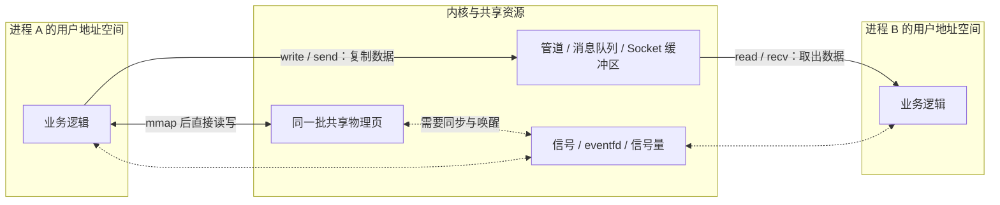
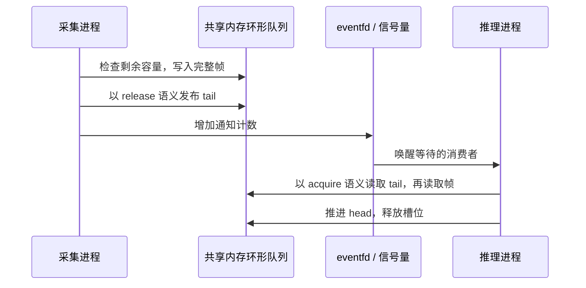

同一宿主机上的独立进程需要双向请求响应时，**默认优先考虑 Unix Domain Socket（UDS）**：支持无亲缘关系进程、双向通信、多客户端和文件描述符传递，也有较明确的权限控制手段。父子进程只传一路字节流，用匿名管道更简单；只有在大块数据高频交换、且测量证明普通通道的复制或序列化开销不可接受时，才值得引入共享内存。

IPC 选型不能只看“谁最快”。真正决定方案的是数据形态、消息边界、通信方向、进程关系、背压、权限、崩溃恢复和未来是否跨机器。信号量、互斥锁和 eventfd 主要解决同步或通知，不应与传输业务数据的管道、Socket 混为一类。

本文以 Linux/Unix 为主。“同一宿主机”还隐含通信对象处在能够互相访问的命名空间中；容器即使运行在同一台物理机上，也可能看不到对方的文件系统、IPC 对象或网络地址。

## 先拆开三个问题：数据、同步、发现与权限

进程有各自独立的用户态虚拟地址空间，不能直接读取另一个进程的普通变量。IPC 通常沿两条路径实现：

- **内核转发数据**：管道、消息队列和 Socket 通过系统调用把数据交给内核，再由接收进程读取。
- **共享同一份存储**：共享内存或 `MAP_SHARED` 文件映射让不同进程的虚拟地址指向同一批物理页；建立映射后，普通读写不必每次进入内核。



一套可运行的 IPC 方案还要回答另外两个问题：接收方何时能读、写完整的数据，以及双方怎样找到并验证对方。前者需要信号量、进程共享锁、原子变量、eventfd 等机制；后者涉及继承的文件描述符、文件系统路径、IPC 名称、端口、对端身份和访问权限。共享内存只解决“看见同一份数据”，并不会自动解决这两个问题。

## 常见方案放在一起比较

| 方案 | 数据与语义 | 建立通信关系 | 主要优势 | 主要代价与限制 |
| --- | --- | --- | --- | --- |
| 匿名管道 `pipe` | 单向字节流，无消息边界 | 通常由共同祖先创建并继承 fd | 简单，天然适合标准输入输出 | 缓冲区有限；双向要两条；多写者要防交错 |
| 命名管道 FIFO | 单向字节流，无消息边界 | 文件系统路径 | 无亲缘进程也能使用 | 打开顺序可能阻塞；路径与权限要管理 |
| UDS `SOCK_STREAM` | 双向、有序字节流 | 路径、Linux abstract namespace 或 `socketpair` | 本机 RPC、多客户端、传 fd、事件循环 | 仍需应用层分帧、超时和重试协议 |
| UDS `SOCK_DGRAM` / `SOCK_SEQPACKET` | 保留消息边界 | 同上 | 消息模型清晰，避免自行拆包 | 单条消息和缓冲仍有限；可移植性有差异 |
| System V / POSIX 消息队列 | 内核保存离散消息 | IPC key、ID 或队列名 | 小消息、按类型或优先级接收 | 容量有限；非持久化；缺少业务消费语义 |
| POSIX / System V 共享内存 | 多进程读写同一内存区域 | IPC 对象、路径或传入的 fd | 高频大数据路径短，避免消息逐次复制 | 同步、内存序、布局、恢复全部要自行设计 |
| 文件与 `mmap` | 持久文件或共享文件映射 | 文件路径或 fd | 可持久化、便于检查，适合大对象交接 | 通知与并发另做；可见不等于已落盘 |
| 信号、`eventfd`、信号量 | 事件、计数或同步状态 | PID、fd、名称或共享内存 | 控制通知和同步开销低 | 不是通用业务数据通道 |
| 回环 TCP / UDP | 网络字节流或数据报 | `127.0.0.1`、`::1` 和端口 | 协议生态成熟，未来可跨机器 | 本机也要处理网络安全、端口和协议问题 |

这张表没有把“异步、可靠、实时”当成某个名字的固定属性。阻塞或非阻塞取决于 fd 和调用方式；消息到达内核不等于业务处理完成；低延迟也取决于队列、调度、数据大小和负载，而不只取决于 IPC 类型。Linux 的具体语义可分别查阅 [pipe(7)](https://man7.org/linux/man-pages/man7/pipe.7.html)、[unix(7)](https://man7.org/linux/man-pages/man7/unix.7.html) 和 [mq_overview(7)](https://man7.org/linux/man-pages/man7/mq_overview.7.html)。

## 管道：最短的父子进程数据通路

### 原理与实际例子

执行下面的命令时，Shell 创建管道和两个子进程，把 `ps` 的标准输出接到 `grep` 的标准输入：

```bash
ps -ef | grep '[m]y-worker'
```

`pipe()` 返回读端和写端两个文件描述符。`fork()` 后，相关进程继承指向同一管道对象的描述符；数据写进内核维护的有限缓冲区，再由读端取出。FIFO 只是把“找到同一管道”的方式改成文件系统路径，数据并不会因此写入普通磁盘文件。

管道适合日志过滤、压缩、格式转换等单向流式处理。接收方可以边读边处理，不必等发送方生成完整文件。

### 必须注意的四点

**字节流没有消息边界。** 写端调用三次 `write()`，读端不保证用三次 `read()` 对应取回。需要逐条请求时，应自行添加长度前缀、分隔符和转义规则，或者改用保留边界的通道。

**阻塞就是背压的一部分。** 管道为空时，阻塞读会等待；缓冲区满时，阻塞写会等待。非阻塞模式则可能返回 `EAGAIN`。程序必须处理短读、短写和关闭，不能假设一次调用完成全部数据。

**原子写不等于消息边界。** Linux 上不超过 `PIPE_BUF` 的写入具有规定的原子性，可避免多写者的数据交错，但读端仍只看到字节流。超过该限制的写入可能交错。

**多余的 fd 会改变关闭语义。** 所有写端关闭后，读端才能读到 EOF；所有读端关闭后，继续写入会触发 `SIGPIPE` 或返回 `EPIPE`。父子进程应关闭各自不用的端点，否则可能出现“对端已经退出，读操作却一直等不到 EOF”。

FIFO 还要处理读写双方打开顺序、路径残留和文件权限。它适合简单工具衔接，不适合在一条通道上叠加复杂的双向 RPC 协议。

## Unix Domain Socket：本机进程通信的默认起点

### 一个本机 worker 调用该怎样走

假设 API 进程把文本交给同一机器上的推理 worker。worker 在 `/run/my-app/inference.sock` 监听，API 建立 UDS 连接并发送请求：

```text
API 进程                              推理 worker
   | 连接 inference.sock                  |
   |------------------------------------>|
   | request_id + 文本长度 + 文本字节       |
   |------------------------------------>|
   |                          排队、推理、生成结果
   | request_id + 状态 + 结果长度 + 结果     |
   |<------------------------------------|
```

底层使用 `AF_UNIX`，数据仍经内核 socket 缓冲区转发，但不经过 IP 路由和 TCP/UDP 协议处理。对普通大小的请求响应，UDS 已经提供足够的语义：无亲缘进程、双向、多客户端、面向连接，以及和事件循环兼容的 fd 接口。

Docker API 是可见的实际例子：客户端可以通过 `/var/run/docker.sock` 调用本机 Docker 服务，例如使用 `curl --unix-socket /var/run/docker.sock http://localhost/_ping`。这个例子也说明“不走网络”不等于“没有权限风险”：能写 Docker socket 通常意味着能请求高权限操作，不能只把它当作普通本地文件开放。

### 三种类型不要混用语义

`SOCK_STREAM` 提供有序字节流，应用仍要定义分帧。`SOCK_DGRAM` 和 Linux 支持的 `SOCK_SEQPACKET` 保留消息边界，其中后者提供面向连接、顺序交付的消息通道。保留边界只解决“这一条消息到哪里结束”，不会自动提供业务确认、持久化或恰好一次执行。[unix(7)](https://man7.org/linux/man-pages/man7/unix.7.html) 还记录了不同类型和平台的可移植性差异。

### UDS 的工程优势与注意点

**文件描述符可以随消息传递。** 通过 `sendmsg()` / `recvmsg()` 和 `SCM_RIGHTS`，一个进程能把打开文件、共享内存或 eventfd 的引用交给另一个进程。传递的不是对端可直接使用的相同 fd 数字，而是接收进程 fd 表中的新引用。控制消息走 UDS、大块数据放共享内存，是常见组合。

**本机身份可以校验。** Linux 可在连接的 socket 上使用 `SO_PEERCRED` 获取对端 PID、UID、GID，也可为数据报启用 `SO_PASSCRED`。仍应结合路径权限、服务账户和安全模块策略做授权，不能只信任请求体里自报的身份。

**路径本身就是部署契约。** 路径 socket 要管理目录权限、属主、`umask`、路径长度和异常退出后的残留文件。Linux abstract namespace 没有文件系统路径，但也没有路径权限语义，且不具备跨平台可移植性。清理残留 socket 文件前应确认没有活服务仍占用该地址，避免让新实例误删正在使用的入口。

如果还要类型化接口、流式响应或跨语言代码生成，可以在 UDS 上运行 HTTP、gRPC 等协议。那是上层协议选择，不是另一种内核 IPC 原语。

## 消息队列：要小消息边界，不要把它当 Kafka

Linux 有 System V 消息队列和 POSIX 消息队列两套接口。发送方把一条消息复制到内核队列，接收方再复制到自己的缓冲区；读取后消息从队列移除。System V 支持按消息类型选择接收，POSIX 消息队列支持优先级，具体行为分别受对应 API 和系统限制约束。

它适合控制命令、状态变化等较小的离散消息。相比字节流，应用不必自行分帧；相比 UDS，它不需要先建立一条客户端到服务端的连接。

限制也比名字所暗示的更多：

- 单条消息、单队列消息数和总内存都有限，大对象不应硬塞入队列。
- POSIX 队列具有内核持久性，即未 `mq_unlink()` 时可存在到系统关闭；这不等于落盘，重启后不会保留。
- 从队列取走消息只代表传输完成，不代表业务处理成功。消费者崩溃后的重放、去重、消费组和跨机器复制需要额外的软件。
- 多个接收者从同一队列取消息通常是竞争消费，不等于每个接收者都收到一份；广播需要另行设计。

因此，只要还需要双向 RPC、连接身份或传 fd，UDS 往往更通用。消息队列的价值是简单的内核消息边界，而不是替代持久化消息中间件。[POSIX 消息队列的生命周期和资源限制](https://man7.org/linux/man-pages/man7/mq_overview.7.html)应在部署前按目标系统核对。

## 共享内存：用更短的数据路径换更高的协议复杂度

### 为什么它适合大块高频数据

假设视频采集进程要把连续帧交给同机推理进程。如果每帧都经消息队列或 Socket 复制，传输成本和背压会随帧大小增加。共享内存允许双方把同一批物理页映射进各自地址空间：生产者写入帧槽位，消费者直接读取该槽位，不必为每次读写把整帧复制进内核再复制出来。

POSIX 接口通常按 `shm_open()` → `ftruncate()` → `mmap()` 建立对象和映射；System V 是另一套较老的接口。Linux 也可创建 `memfd`，再通过 UDS 把 fd 传给对端。[shm_overview(7)](https://man7.org/linux/man-pages/man7/shm_overview.7.html)明确说明共享对象的生命周期，[mmap(2)](https://man7.org/linux/man-pages/man2/mmap.2.html)则说明 `MAP_SHARED` 的可见性语义。

“避免逐次复制”不等于整个处理链绝对零拷贝。采集设备到生产者、生产者到共享区、消费者到后续设备是否还要复制，取决于完整实现。

### 一个可用的环形队列至少包含什么

共享区可以划分为固定头部和多个帧槽位，头部保存格式版本、槽位大小、`head`、`tail` 和状态。生产者写完一个槽位后发布 `tail`，消费者发现新数据后读取，再推进 `head` 释放空间；eventfd、信号量或 futex 负责等待和唤醒。



这里的顺序不能颠倒。如果先发布 `tail` 再写帧，消费者可能读到半成品；如果只写普通标志而没有正确的原子操作和内存序，编译器或处理器也不保证跨进程看到预期的写入顺序。eventfd 的计数通知还可能合并，消费者被唤醒后应持续处理，直到队列为空，而不是假设一次通知只对应一帧。

### 选型前必须接受的代价

**不要存进程内指针。** 同一映射在两个进程里的虚拟地址可以不同，共享区应使用偏移量、索引和明确对齐的定长头部。

**锁必须支持进程共享。** 普通进程内互斥锁不能直接拿来保护共享区；即使初始化为进程共享，也要考虑持锁进程崩溃后的恢复。可恢复锁、重新初始化整个区域或由监管进程重建，都是不同复杂度的方案。

**容量必须有界且有策略。** 队列满时是阻塞、丢旧帧、丢新帧还是断开重建，应由业务决定。没有背压的共享内存只是把积压变成难以观察的内存状态。

**协议要能升级和清理。** 头部应包含版本、长度和必要的校验信息，并约定谁创建、谁删除、异常退出后谁回收。共享对象的路径和权限同样属于安全边界。

只有当大块或高频数据确实成为瓶颈时，这些成本才有回报。传几个控制字段仍选共享内存，通常是在用协议复杂度换几乎看不出的收益。

## 信号、eventfd、信号量和文件锁：负责通知与同步

这些机制常出现在“IPC 方式列表”中，但它们解决的不是同一层问题。

**信号适合低频控制事件。** 例如向服务发送 `SIGTERM` 请求退出；`SIGHUP` 是否表示重新加载配置，则由具体程序约定。标准信号不排队，同种信号在等待期间多次产生可能只保留一次，因此不能用 `SIGUSR1` 的次数统计任务数。信号处理函数只能安全调用有限的 async-signal-safe 操作，常见做法是在处理函数里设置标志或写 self-pipe，再交给主循环；Linux 也可用 `signalfd` 同步读取信号。详见 [signal(7)](https://man7.org/linux/man-pages/man7/signal.7.html)。

**eventfd 适合事件计数和唤醒。** 它由内核维护一个 64 位计数器，写入会增加计数，读取会按模式取走或递减计数，并可接入 `poll` / `epoll`。它常和共享内存配合，也可以继承或通过 UDS 传递 fd；但它本身不保存帧或业务对象。详见 [eventfd(2)](https://man7.org/linux/man-pages/man2/eventfd.2.html)。

**信号量、互斥锁、条件变量和 futex 主要协调访问顺序。** POSIX 命名信号量可按名称共享，未命名信号量要放进共享内存并初始化为进程共享。它们可表示“有数据”“有空位”或保护临界区，但不应承担业务消息传输。[sem_overview(7)](https://man7.org/linux/man-pages/man7/sem_overview.7.html)给出了命名与未命名信号量的区别。

**文件锁适合协调文件访问。** 它能让遵守同一锁协议的进程协调修改约定区域，却不是可靠的消息队列，也无法约束绕过协议的写入。锁类型、进程崩溃后的释放、NFS 等文件系统语义都要按实际环境确认。

## 文件与 mmap：需要交接产物或持久化时再选

普通文件适合低频、较大的产物交接，例如一个进程生成模型包，另一个进程读取。写方可先在相同文件系统内写临时文件，完成并关闭后再 `rename()` 到约定路径，让读方看到完整的新文件；还需要用 inotify、UDS 或其他通道通知“新版本已就绪”。只轮询目录不仅增加延迟，也容易把文件存在误认为内容可读。

使用 `mmap(..., MAP_SHARED, ...)` 映射同一文件时，多个进程可通过页缓存看到同一份内容。它兼具文件寻址和共享访问，但仍需要同步；文件映射的可见性也不等于持久化完成，需要落盘保证时要按语义使用 `msync()`、`fsync()` 等接口。

如果需求包含原子事务、查询、持久队列或崩溃后恢复，数据库或专用存储通常比自制文件协议更合适。不要因为文件接口简单，就重新实现一套不可靠的数据库。

## 回环 TCP / UDP：为未来跨机器或现有协议栈付费

本机进程当然也能通过 `127.0.0.1` 或 `::1` 使用 TCP/UDP。以下情况值得直接选择它：

- 已明确要从本机 sidecar 演进为远程服务；
- 现有客户端、SDK、负载测试和可观测工具都基于网络协议；
- 需要与不支持 UDS 的运行时或平台协作。

代价是地址、端口、网络命名空间和协议栈都进入故障范围。绑定回环地址可以避免直接暴露到其他机器，但不能替代对同机其他用户或进程的认证授权。容器之间是否共享回环地址也取决于网络命名空间；两个容器各自访问 `127.0.0.1`，通常访问的是各自命名空间，而不是宿主机上的对方。

如果通信始终只发生在本机，又需要传 fd 或基于文件权限管理服务入口，UDS 通常更贴合需求。

## 选型顺序：先排除，再比较

按下面的顺序问，通常比背“性能排行榜”更容易得到稳定答案：

1. **只是退出、重载或唤醒吗？** 用信号或 eventfd；需要计数和事件循环集成时优先 eventfd。业务数据另走数据通道。
2. **是不是父子进程的一条单向流？** 用匿名管道；无亲缘但仍只是简单单向流，可用 FIFO。
3. **是不是本机服务的双向请求响应？** 默认 UDS `SOCK_STREAM`，并在上层定义分帧、请求 ID、超时和错误协议。
4. **是不是独立的小消息，而且不需要连接语义？** 比较 POSIX/System V 消息队列与 UDS 数据报；需要优先级或按类型接收时前者更直接，需要身份、传 fd 或后续 RPC 时后者更通用。
5. **是不是大块数据或高频帧流？** 先用 UDS 建立可工作的基线并测量；瓶颈确认后再用“共享内存 + 有界环形队列 + 同步 + 通知”。
6. **是不是需要持久化或崩溃后恢复？** 选文件、数据库或真正的持久化系统；不要把内核消息队列的 kernel persistence 当磁盘持久化。
7. **是否很快会跨机器？** 直接使用 TCP/UDP 和上层 RPC，避免先设计一套只能本机运行的接口再重写。

几个典型场景对应的取舍如下：

| 场景 | 推荐起点 | 放弃了什么或改选条件 |
| --- | --- | --- |
| `producer \| consumer` 命令链 | 匿名管道 | 需要双向 RPC 时换 UDS |
| 两个独立服务传少量日志行 | FIFO 或 UDS 数据报 | 需要可靠查询、重放时上持久日志系统 |
| API 调用本机推理 worker | UDS 字节流 + 长度分帧 | 大帧成为瓶颈时，控制面保留 UDS，数据面换共享内存 |
| 本机 Agent 调用沙箱工具进程 | UDS，加对端身份和协议权限 | 需要传打开文件或共享区时增加 `SCM_RIGHTS` |
| 视频帧、音频块、共享特征缓冲区 | 共享内存 + eventfd / 信号量 | 数据量小或频率低时退回 UDS |
| 服务退出、配置重载 | `SIGTERM`、约定的 `SIGHUP` | 携带参数或需要可靠计数时换 UDS / eventfd |
| 进程生成大型文件供另一个进程使用 | 临时文件 + 原子重命名 + 通知 | 需要事务和查询时用数据库或存储系统 |
| 本机 sidecar 将来会拆到远端 | 回环 TCP + RPC | 若确定永不跨机且需传 fd，可改 UDS |

## 无论选哪种，都要补齐这层通信契约

IPC 原语只提供通道，不会自动给出完整应用协议。上线前至少要明确：

- **分帧与序列化**：最大消息长度、长度前缀或边界、编码格式、版本和兼容策略；不要直接把语言运行时对象或含指针的内存结构交给另一个进程。
- **请求关联与超时**：请求 ID、 deadline、取消传播和连接断开行为；超时不代表对端没有执行。
- **重试与幂等**：发送成功、对端收到、业务提交是三个不同事件。可能重复执行的请求需要幂等键、去重记录或结果查询，不能靠 IPC 名称推断“恰好一次”。
- **有界队列与背压**：规定缓冲区满时阻塞、拒绝、丢弃还是降级，并暴露队列深度和等待时间。
- **认证与最小权限**：限制目录、socket、共享对象和端口访问；Linux 下按需校验对端凭据，不信任消息中自报的 PID 或身份。
- **生命周期与恢复**：约定创建者、删除者、fd 关闭、残留对象清理、服务重启和共享区重建策略。
- **可观测性**：记录请求 ID、消息大小、排队时间、失败阶段和对端版本，区分连接失败、传输失败、超时与业务失败。

性能比较也应使用自己的消息大小、并发数、读写比例和部署环境，观察吞吐量、p50/p99 延迟、CPU、内存和背压表现。脱离这些条件说“共享内存最快”或“UDS 一定比 TCP 快多少”，都不能直接指导选型。

## 最终建议

先把普通本机服务通信做成 **UDS + 明确的应用协议**，父子进程流式处理保留管道，大块高频数据再把数据面升级为共享内存。控制通知、同步和持久化分别选专用机制，不要求一个 IPC 方案包办所有问题。这样得到的不只是可用的传输通道，也是一套在积压、超时、崩溃和升级时仍能解释行为的系统。

入门图解可参考[小林 coding 的进程间通信文章](https://www.xiaolincoding.com/os/4_process/process_commu.html)；需要按消息边界、身份传递和 Android Binder 继续扩展时，可阅读 [JavaGuide 的 IPC 综述](https://javaguide.cn/cs-basics/operating-system/ipc.html)。具体接口行为仍以目标平台的官方手册为准。
