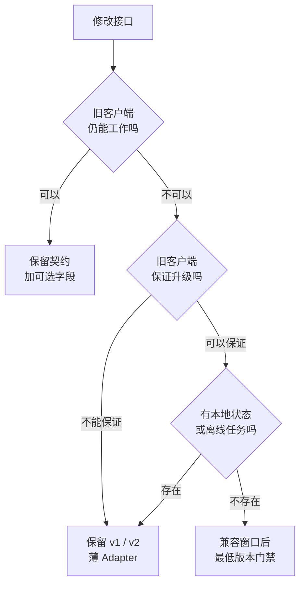
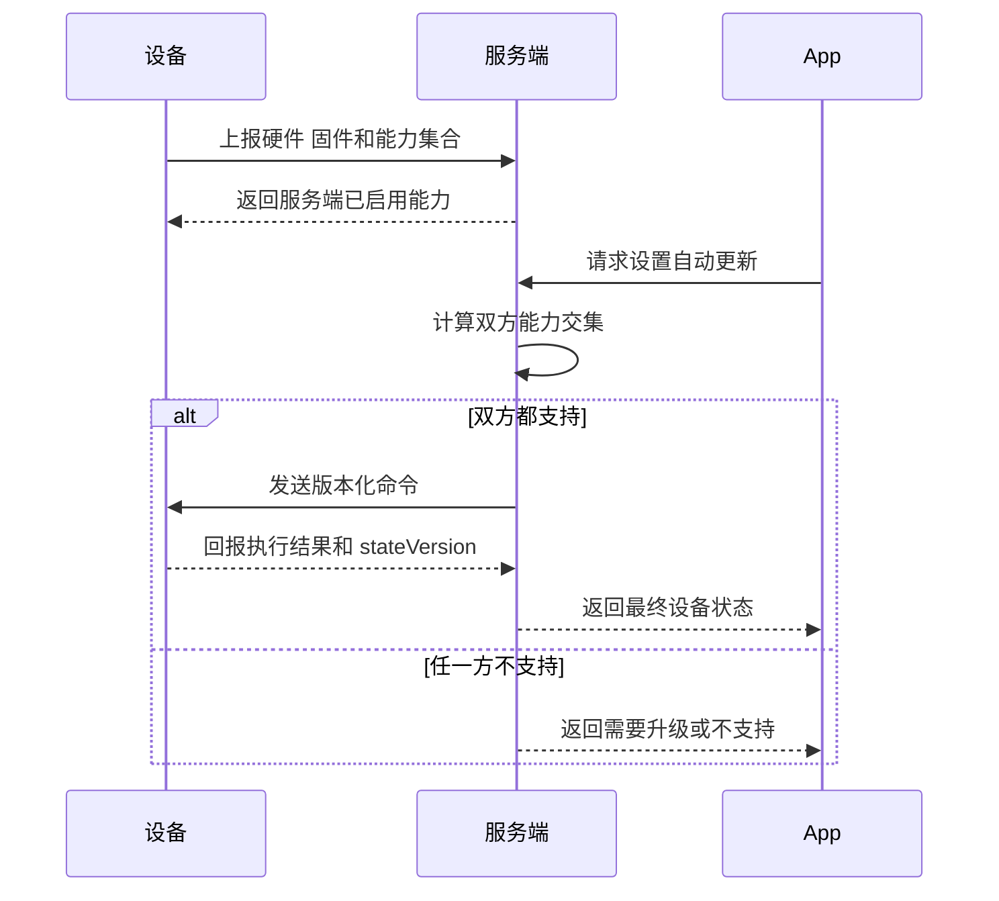
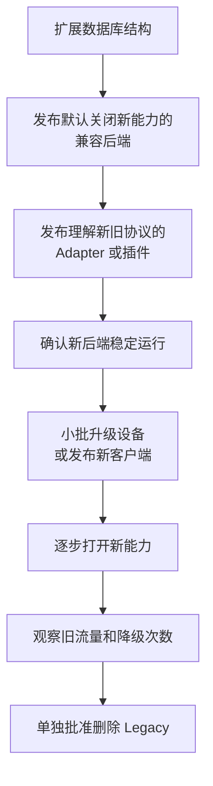

客户端、服务端和设备无法同时升级时，最省兼容成本的方向是单向的：先发布兼容新旧契约的后端，确认稳定后再升级设备或发布客户端，新端只连接新后端，系统不用维护反向兼容分支。接口变化优先用可选字段扩展，语义破坏时才并行保留版本；多种硬件按能力协商而不是按固件版本判断；旧路径退役要看流量和能力覆盖率的真实证据，不能只看代码里还有没有调用者。

文末复盘一个按这条路径设计的真实项目（App + 云端 + 边缘设备）。需要先说明边界：这套代码目前停在独立开发分支，只通过了定向测试，生产 DDL、后端部署、新 App 切换、多设备验收和 Legacy 退役都未完成——它能说明设计选择，不是生产验收通过的证明。

下面按一次典型的分批升级场景展开：后端要先扩，客户端随后发版，设备固件最后分批推。

## 接口变了，需不需要新版本

只有一种自有客户端时，最省事的办法通常是继续用原接口：增加可选请求字段，客户端不传时沿用旧行为；响应增加字段，旧客户端会忽略。已有字段、默认值、错误码和权限要求保持不动，这类改动跟随原契约发布，没必要每次都创建新版本。

有个容易踩的坑：JSON 能解析，不等于客户端还能正常运行。Google 在 [AIP-180](https://google.aip.dev/180) 里把兼容分成源代码、传输格式和业务语义几层。响应新增枚举值看上去只是多了一种取值，旧客户端若写了穷举分支仍可能直接失败；服务端给列表加分页，也会让原本一次取全量的客户端悄悄少拿一部分。

<div class="article-note-diagram">



</div>

当字段含义、状态机或业务规则已经改变，继续往原接口里塞条件判断会越来越危险，此时保留 `/v1/...` 再增加 `/v2/...`。URL 版本最容易调试和路由，Header 能保持资源路径稳定，Query Parameter 便于直接查看；三种方式都有人用，选定一种并贯穿日志、缓存和文档即可（[GitHub REST API 的版本规则](https://docs.github.com/en/rest/about-the-rest-api/api-versions)是 URL 版本的公开例子）。注意把 App 构建版本和 API 契约版本分开：App 发了一次版不代表接口变了，一份 App 也可能在迁移期同时调用 v1 和 v2。

客户端启动或登录时可以做一次握手，决定当前客户端能用哪些功能，也能提示升级：

```json
{
  "clientBuild": 120,
  "supportedApiVersions": ["1", "2"],
  "negotiatedApiVersion": "2",
  "capabilities": ["offline-sync-v2"],
  "minSupportedBuild": 105,
  "latestBuild": 123,
  "updatePolicy": "recommended"
}
```

握手管不到已经排队的离线命令；长连接断开后要重新协商，多节点服务也不能只把协商结果放在一台机器的内存里。应用版本太低时，服务端应返回稳定的业务错误码（例如 `CLIENT_VERSION_UNSUPPORTED`）并给出最低版本、更新地址和宽限期。HTTP `426 Upgrade Required` 按 [RFC 9110](https://www.rfc-editor.org/rfc/rfc9110.html) 的语义是用来切换当前连接上的通信协议的，拿它表示 App 版本太低并不合适。

## 强制升级只用于无法安全兼容的情况

消费级 App 很难被可靠地强制升级。[Apple 的分阶段发布](https://developer.apple.com/help/app-store-connect/update-your-app/release-a-version-update-in-phases)只会逐步覆盖开启自动更新的用户，用户仍可手动下载；Android 的即时更新需要用户接受，也可能被取消或安装失败。商店显示新版已发布，不能证明旧客户端已经消失。

严重安全漏洞、旧协议会损坏数据、法规要求改变、服务端无法安全维持旧语义——这几种情况可以启用最低版本门禁。普通功能迭代更适合提示升级，并让旧版本继续完成登录、同步、导出和账号恢复。

只要客户端保存草稿、本地数据库或离线写队列，兼容窗口就要覆盖最长离线时间、队列 TTL 和重试期。每条离线命令应携带自己的 `schemaVersion` 或 `commandVersion`；涉及计费、结算和状态机的记录还要保存 `ruleVersion`，否则历史记录可能被新规则重新解释。典型时序是：服务端先发布兼容代码，旧客户端继续走 v1 并把离线命令存进队列，新客户端开始走 v2；旧命令恢复上传时服务端按 v1 解析并幂等处理，直到旧流量和旧队列都归零。

## 业务规则破坏语义时必须记录版本

接口不变，模块内部的规则也可能发生破坏性变化：计费顺序调整、订单状态机重写、任务调度算法替换，都可能让同一份历史数据得到不同结果。直接替换实现会让新请求和在途任务一起切换，回滚时也很难知道该恢复哪套规则。

这类改动可以在调用方与实现之间放一层稳定接口，让旧实现和新实现暂时共存：按记录中的 `ruleVersion` 和灰度配置路由，旧记录走旧规则，新记录走新规则，两边输出到兼容的数据结构并做差异监控。新请求先进小流量，新实现稳定后停止创建旧版本记录，等在途任务结束再删旧实现。

Feature Flag 可以控制新实现接收多少流量，也能在异常时迅速关掉入口，但它无法让旧实现读懂已经写坏的数据。数据库仍要先扩展结构，确保两套代码都能读写，随后回填和校验，最后才收缩旧结构。

## 多种硬件按能力协商

设备加入以后，`firmwareVersion >= 3.2.0` 这样的判断很快会失效：同一固件可能为不同 SKU 使用不同编译选项，同一型号也可能更换主板或外设，设备还会处在部分损坏、模块缺失和升级回滚后的状态。版本相同，实际能力未必相同。

[Matter 1.2 核心规范](https://csa-iot.org/wp-content/uploads/2023/10/Matter-1.2-Core-Specification.pdf)提供了一个实用思路：设备用 `FeatureMap` 声明支持的功能，用 `ClusterRevision` 表示实现了哪一版能力定义，控制端读取两者后再决定展示什么界面、发送什么命令。固件版本仍然有用，适合排障、分组和选择 OTA 目标，不适合单独决定一条业务命令能不能执行。

一份能力声明可以很简单：

```json
{
  "deviceId": "stage-a",
  "hardwareRevision": "rev-c",
  "firmwareVersion": "3.4.1",
  "capabilitySetVersion": 7,
  "capabilities": [
    "storage.multi-volume.v1",
    "device-control.volume.v1",
    "device-control.auto-update.v1"
  ]
}
```

服务端也要声明自己准备开放哪些能力，只有两边的能力集合都包含目标项才发送新命令：

<div class="article-scroll-diagram">



</div>

设备重连、升级或回滚后重新上报，能力缓存带版本号或哈希，避免服务端一直相信旧快照。多设备操作还要回答一个用户层面的问题：一组设备里三台成功、一台降级、一台离线，接口不能只返回一个笼统的成功，至少要逐台区分完成、降级、拒绝和超时。涉及门锁、扣费或安全策略时，静默降级通常比明确失败更危险。

## 状态快照与命令记录分开

设备可能离线，App 又希望立即设置一个目标值。Device Shadow 一类模型把期望状态放进 `desired`，把设备实际状态放进 `reported`，再根据差异生成 `delta`。[AWS IoT Device Shadow](https://docs.aws.amazon.com/iot/latest/developerguide/device-shadow-document.html) 还提供递增的 `version`，设备可以拒绝过期更新，服务端也能避免旧消息覆盖新状态。

Shadow 适合让状态最终收敛，不能充当完整的命令队列。一次开门、扣费或播放操作需要独立的请求记录、执行结果和审计信息。MQTT QoS 1 允许重复交付，有副作用的命令仍要依靠 `messageId` 或 `idempotencyKey` 去重。

整体结构可以这样摆：App 提交业务意图，服务端编排时查能力注册表、写命令记录，再经 Adapter 转成各硬件的协议；设备回报的状态汇总后做 `stateVersion` 校验，App 最终看到每台设备的结果。Adapter 只负责转换字段、单位、错误和协议格式，业务规则放在服务端的统一模型里。若新旧协议的语义无法互相表达，就保留两套规则实现并把规则版本写入业务记录——把设备型号判断散落在业务代码中，过一两年后很难再说清哪条旧分支还在使用。

## 方案选型先看客户端和硬件数量

只有一个客户端类型时，完整 BFF 往往偏重，[微软的 BFF 指南](https://learn.microsoft.com/en-us/azure/architecture/patterns/backends-for-frontends)也把单一前端列为不适合的情况；薄 Adapter 已经能隔开 v1 和 v2，核心业务仍然只有一份。多种硬件长期共存时，优先选能力驱动的服务端编排。

| 方案 | 适合的系统 | 主要代价 |
| --- | --- | --- |
| 最低能力交集 | 功能少，所有设备必须表现一致 | 新硬件长期被旧硬件限制 |
| 能力驱动的服务端编排 | 异构设备长期共存，需要逐台返回结果 | 要维护能力注册表、编排和补偿 |
| 边缘网关转换 | 旧设备不能 OTA，需要离线运行或局域网协议很多 | 网关会集中故障，协议转换可能丢语义 |
| 最低版本门禁 | 安全、计费和跨设备一致性要求很高 | 旧设备会被阻断，升级失败必须有出口 |
| 双协议迁移 | 已有大量在线设备，新旧路径需要共存一段时间 | 测试矩阵扩大，旧路径容易永久留下 |

## 迁移顺序与失败恢复

一套能独立发布的顺序通常长这样：

<div class="article-note-diagram">



</div>

每一步的放行条件和失败恢复方式：

| 步骤 | 放行条件 | 失败时怎么恢复 |
| --- | --- | --- |
| 扩展数据库结构 | 只加可空列、新表和索引，旧代码仍能读写 | 应用回滚时保留新增结构，不删 |
| 发布兼容后端 | 新能力默认关闭，新旧契约都可用 | 关闭新能力开关即可回到旧行为 |
| 双写与回填 | 分批回填历史数据，双读对账通过 | 切回旧读取来源，保留回填结果 |
| 升级设备或发客户端 | 后端稳定：流量已切换、指标正常、所有区域和滚动实例完成升级 | 后端回滚不能越过协议边界；设备侧要有 OTA 失败出口（如 [Android A/B 更新](https://source.android.com/docs/core/ota/ab)的双槽位） |
| 删除 Legacy | 旧接口流量归零、旧队列耗尽、能力覆盖率达标，单独批准 | 不可逆，前面证据不足就不执行 |

回滚不能只看旧安装包还在不在：新版本写出的数据若旧代码读不懂，代码切回去了系统仍然恢复不了。涉及跨系统双写时，还要用 Outbox、幂等和对账处理其中一次写入失败的情况。

测试矩阵不必把所有历史版本两两组合，至少守住四组关系：最新服务端 × 最老受支持客户端、× 当前生产客户端、× 待发布客户端、× 待升级设备固件。设备系统再加上旧插件与新插件、关键硬件 revision、离线重放和乱序状态。[Pact 的消费者契约测试与 can-i-deploy](https://docs.pact.io/pact_broker/can_i_deploy)可以把接口组合变成发布门禁，设备执行、状态迁移和 OTA 仍需要集成测试与实机验证。

旧路径退役需要证据：旧接口流量、协议降级次数、旧 App 分布、设备能力覆盖率、离线队列寿命和双写差异都应可观测。代码里已经找不到调用者，只能说明当前仓库没有引用，说明不了生产环境没有旧客户端。

## 匿名项目复盘：主体方案正确，旧入口删早了

这套由 App、云端和边缘设备组成的系统，最近把账号级业务拆成了设备级业务。它保留原有接口，另建 V2 Controller、DTO、服务和独立存储键：旧 App 与旧插件继续走 Legacy，新插件能够识别两种载荷，新 App 只在设备和服务端都声明目标能力时进入 V2。

设备上报使用版本化信封：`messageId` 负责幂等，`requestId` 串起 HTTP 受理、MQTT 命令和设备结果，`stateVersion` 阻止乱序状态覆盖最新快照。数据库先增加可空字段和新表，回滚应用时不删这些结构。这个主体方案与前文的推荐路径一致。

固件升级后来增加了前置版本链：管理端可以指定某个版本必须先经过哪一版，服务端根据设备当前版本返回最早缺少的安装包。它解决了老设备不能直接跨越数据格式或引导程序变化的问题，但这条前置链只按平台和版本记录选包——不同主板、CPU 架构和设备能力怎样选安装包，灰度中止与安装失败怎样回滚，当前实现都没有覆盖。它是完整 OTA 方案中的一小段。

这段改动同时删掉了旧的公开版本查询接口。现有材料没有旧接口流量归零、客户端覆盖率和单独下线批准的证据，新接口也还没有补进客户端契约文档。前置版本链本身合理，删除旧入口的时机没有站稳。如开头所说，这套代码目前停在独立开发分支，定向测试覆盖了能力协商、状态版本和固件前置链，其余环节未完成。新版本发布只代表迁移开始：等最老的受支持客户端仍能工作、离线命令处理完、不同硬件都给出可解释的结果、旧流量确实归零，删除才有依据。

## 参考资料

- [Google API 向后兼容指南](https://google.aip.dev/180)
- [GitHub REST API 版本规则](https://docs.github.com/en/rest/about-the-rest-api/api-versions)
- [Matter 1.2 核心规范](https://csa-iot.org/wp-content/uploads/2023/10/Matter-1.2-Core-Specification.pdf)
- [AWS IoT Device Shadow 文档](https://docs.aws.amazon.com/iot/latest/developerguide/device-shadow-document.html)
- [Android A/B 系统更新](https://source.android.com/docs/core/ota/ab)
- [Apple 分阶段发布说明](https://developer.apple.com/help/app-store-connect/update-your-app/release-a-version-update-in-phases)
- [HTTP Deprecation 响应头规范](https://www.rfc-editor.org/rfc/rfc9745.html)
- [HTTP 语义规范](https://www.rfc-editor.org/rfc/rfc9110.html)
- [Azure BFF 架构模式](https://learn.microsoft.com/en-us/azure/architecture/patterns/backends-for-frontends)
- [Pact 发布兼容矩阵](https://docs.pact.io/pact_broker/can_i_deploy)
