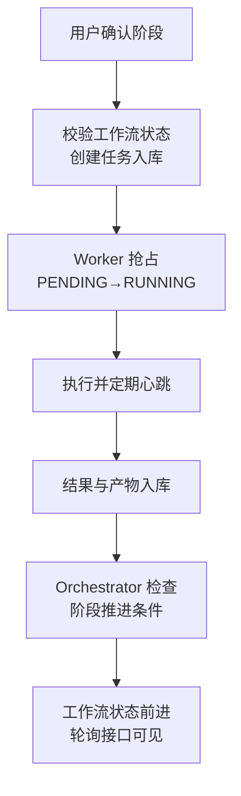
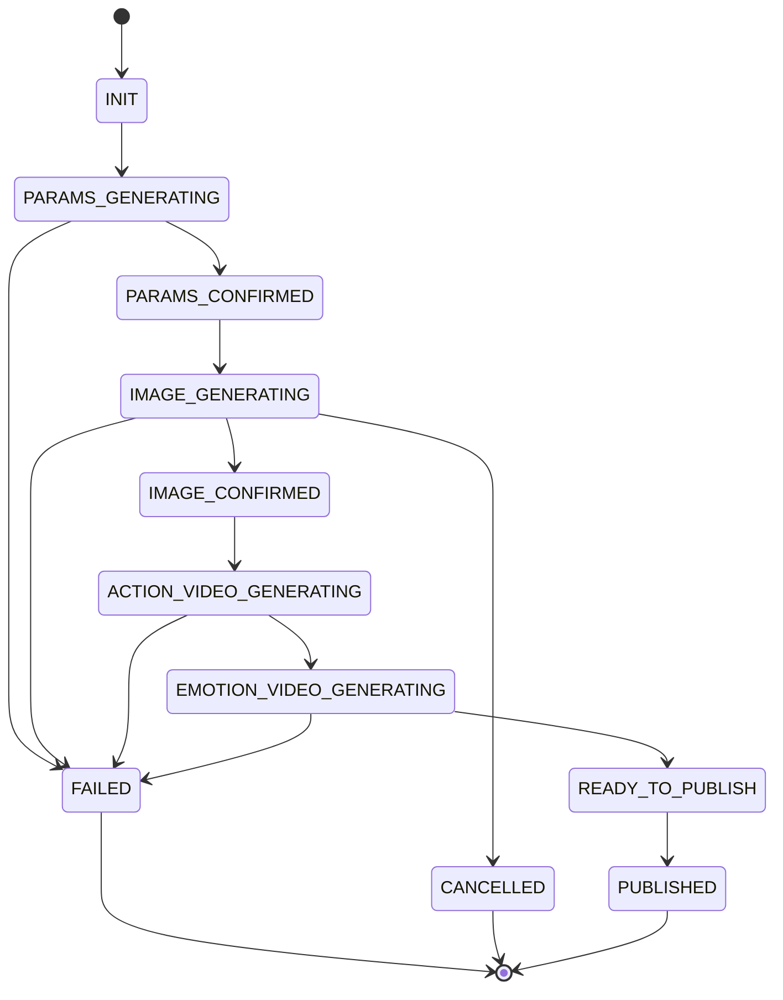

这是我做过的一个虚拟角色生成项目的任务系统复盘。业务链路是固定的：用户输入人物背景与描述，AI 生成参数并由用户确认，生成正身图和侧身图，用户可反复调整形象，然后生成动作视频和 8 种情绪视频，最后用户确认发布，角色进入手机 App 提供对话能力。

链路固定，但每个阶段都耗时、异步、可能失败，用户还会中途回退。所以这个系统的核心问题不是“怎么定义任意流程”，而是三件事：任务怎么运行、异常退出后怎么恢复、流程结束后怎么阻止错误动作继续发生。这篇不讲通用工作流引擎，只复盘这三件事在固定业务流程下怎样做。

| 阶段 | 产物 | 怎样进入下一步 |
| --- | --- | --- |
| 参数生成 | 人物参数 | 用户确认，不满意就调整 |
| 图片生成 | 正身图、侧身图 | 用户确认形象，可重新生成 |
| 动作生成 | 进入、离开动作视频 | 所需产物齐备 |
| 情绪生成 | 8 种情绪视频 | 只补失败任务，保留成功结果 |
| 发布 | 当前版本的完整角色 | 用户确认发布 |
| App 服务 | 角色对话能力 | 不允许旧任务覆盖已发布产物 |


## 为什么没有用工作流框架

流程拓扑稳定，变化主要在参数、阶段结果和版本。这个项目采用固定阶段与自定义状态结构，保留前置约束、局部回退和结果隔离。选择依据是业务范围，不是通用框架能否画出流程。

| 实际难点 | 需要的机制 |
| --- | --- |
| 第三方超时、Worker 或服务退出 | 保存状态、查询外部结果、心跳回收 |
| 用户在旧任务结束前重新生成 | 新版本隔离，拒绝旧结果覆盖 |
| 部分情绪视频失败 | 独立任务、局部重试，保留成功产物 |

## 三层模型：工作流实例、任务、产物

系统先把对象边界切清楚：`workflow_instance` 描述这个角色走到哪一步，`task` 描述当前有哪些事在执行，`asset_version` 描述这一轮生成产出了什么。

```json
{
  "workflowId": "wf_123",
  "characterId": "char_456",
  "stage": "IMAGE_GENERATING",
  "status": "RUNNING",
  "currentVersion": 3,
  "terminatedReason": null,
  "createdAt": "2026-03-05T10:00:00Z",
  "updatedAt": "2026-03-05T10:10:00Z"
}
```

```json
{
  "taskId": "task_001",
  "workflowId": "wf_123",
  "version": 3,
  "stage": "EMOTION_VIDEO_GENERATING",
  "taskType": "GENERATE_EMOTION_VIDEO",
  "status": "PENDING",
  "retryCount": 0,
  "payload": {
    "emotion": "happy"
  },
  "workerId": null,
  "heartbeatAt": null,
  "result": null,
  "errorCode": null
}
```

两个关键设计。一是 `currentVersion`：用户每次重新生图都进入一个新的版本空间，版本号放进工作流实例、任务、产物和状态查询接口，没有这层隔离，旧结果迟早污染新流程。二是任务粒度：一个工作流里会有正身图、侧身图、进入/离开动作视频、8 个情绪视频等许多任务，它们必须能独立失败、独立重试、独立回收，任务一粗恢复成本就直线上升。

一条任务的执行链是：

<div class="article-note-diagram">



</div>

这里最重要的原则是：流程推进的依据不是“某个函数返回了”，而是“状态被持久化确认了”——任务结果已持久化、产物已入库、当前阶段满足推进条件，三者齐备工作流状态才允许前进。否则“看起来跑完了”，其实只是把脏状态往后推。

## 两个状态机，职责分开

任务状态和工作流状态必须分层建模，混在一起后面所有恢复逻辑都会别扭。

| 层 | 状态集合 | 职责 |
| --- | --- | --- |
| 任务状态机 | `PENDING` / `RUNNING` / `SUCCESS` / `FAILED` / `TIMEOUT` / `CANCELLED` | 描述单个执行单元的调度结果；终态保持足够少，状态太多会让排障和恢复急剧复杂化 |
| 工作流状态机 | `INIT` → `PARAMS_GENERATING` → `PARAMS_CONFIRMED` → `IMAGE_GENERATING` → `IMAGE_CONFIRMED` → `ACTION_VIDEO_GENERATING` → `EMOTION_VIDEO_GENERATING` → `READY_TO_PUBLISH` → `PUBLISHED`，另有 `FAILED` / `CANCELLED` | 描述业务阶段推进；贴近用户可理解的进度 |

<div class="article-scroll-diagram">



</div>

分层的理由用情绪视频就能说明：8 个情绪视频并行生成，“开心”失败、“生气”“难过”等已成功，此时这个任务是 `FAILED`，但工作流不整体失败，只是进入“部分失败，允许补跑”的业务状态。如果两层混在一起，一个局部任务失败会导致整条流程被误判结束，前端分不清“整体失败”还是“局部失败”，恢复也只能整条重跑。

## 恢复机制是系统最值钱的部分

AI 任务失败是常态，系统必须接受失败；不能接受的是状态失真——任务其实失败了前端却显示成功、旧版本结果写回新流程、已取消的流程继续被推进、已发布的角色被旧任务覆盖。几类典型异常的处理方式：

| 异常 | 机制 | 关键点 |
| --- | --- | --- |
| Worker 执行到一半宕机 | 心跳 + 超时回收：Worker 定期更新 `heartbeatAt`，调度器把超过阈值未续租的任务标记为 `TIMEOUT`，再决定重试或失败终止 | 抢占本身要幂等，避免同一任务被多个 Worker 同时消费 |
| 第三方服务超时或延迟返回 | 提交时记录外部请求 ID，轮询或回调查询外部状态，超过最长等待标记超时 | 晚到结果必须先校验版本与终态再写回；很多系统不是死于超时，而是死于超时后的晚到结果回写 |
| 用户在旧任务未结束时重新生成 | `currentVersion` 切到新版本，旧版本未完成任务批量标记 `CANCELLED`，只有当前有效版本的产物允许进入展示和发布链路 | 没有版本隔离，旧结果可能覆盖新版本的图片、视频或状态 |
| 部分情绪视频失败 | 保留已成功任务结果，失败任务单独重试，工作流保持当前阶段不提前进入终态 | 长链路系统的恢复要偏向“局部修复”，不是“整条重跑” |

## 前端为什么用轮询

前期我选择轮询而不是 WebSocket 或推送，原因很务实：这个阶段真正缺的不是实时性，而是状态可信。用户关心的是现在在哪个阶段、还要等多久、是正在执行还是卡住了、哪些产物已经出来了，轮询已经能满足。推送可以等状态逻辑稳定之后再加。

轮询接口不能只返回一个“处理中”，要返回结构化状态：

```json
{
  "workflowStatus": "RUNNING",
  "stage": "EMOTION_VIDEO_GENERATING",
  "progress": 72,
  "version": 3,
  "completedAssets": ["front_image", "side_image", "action_enter"],
  "runningTasks": 3,
  "failedTasks": 1,
  "message": "正在生成情绪视频"
}
```

两个注意点：按阶段动态调整轮询间隔，不要高频固定轮询；工作流进入终态后前端必须停止轮询，否则既浪费资源，也放大状态不一致。

## 终态是一层保护，不是一个字段

长链路任务系统里，终态真正的意义是：一旦进入终态，系统必须阻止后续错误动作继续发生。

| 终态 | 含义 | 进入后的系统保证 |
| --- | --- | --- |
| `PUBLISHED` | 角色已发布，资产进入 App 服务链路 | 发布后的角色不能被旧版本产物覆盖 |
| `FAILED` | 当前版本无法继续推进 | 旧任务结果不能再推进流程，调度器不再创建新任务 |
| `CANCELLED` | 用户主动取消或被新版本替代 | 前端停止轮询，晚到结果一律拒绝 |

终态还要区分业务终态和技术终态：`FAILED` 是技术终态，但业务上允许用户点“重新生成”开启一个新版本。这不是“从失败回退”，而是“以新版本重开一条新链路”。不区分这两者，系统会在“回退旧流程”和“启动新流程”之间混乱，最后说不清一条状态到底属于谁。

## 第一版踩过的四个坑

1. **任务粒度过粗。** 一开始把“情绪视频生成”当成一个大任务，一个情绪失败整个阶段重跑。改成按情绪拆任务后，系统才具备局部恢复能力。
2. **没有版本隔离。** 这是最危险的问题：用户重新生图后，旧任务晚返回，把新版本的展示结果覆盖了。把 `version` 放进工作流实例、任务、产物和状态查询接口之后，系统才稳定下来。
3. **只看任务成功，不看产物落库。** 出现过任务执行成功、资源还没写完、前端已经显示“完成”的 bug。改成“任务成功 + 产物入库完成”双条件后，流程推进才算有效。
4. **缺少卡死任务回收。** 没有心跳和超时扫描时，队列里很快堆积大量伪 `RUNNING` 任务——不结束、不重试、不失败，看起来最安静，实际上最危险。

## 后续优化方向

- **从轮询升级到事件通知**：任务量和用户规模上来后，改用状态变化事件推送和关键节点通知，减少空轮询。
- **阶段化资源池**：图片、动作视频、情绪视频的资源模型完全不同，按阶段拆 Worker 池，避免轻任务被重任务拖垮。
- **优先级与限流**：角色创建优先级、付费用户优先级、重试任务限流、单用户并发控制。
- **可观测性**：各阶段平均耗时、各类型任务失败率、超时任务数量、队列堆积、单角色生成总耗时。
- **成本治理**：重试和重复生成很容易放大成本，需要持续回答单角色平均生成成本、哪个阶段最贵、哪类失败最容易触发重复扣费、哪些产物可以复用。

这个系统做下来，我最深的感受是：固定流程系统的重点不在编排能力，而在状态控制能力。长链路 AI 业务的核心问题不是生成，而是恢复；恢复的前提是把状态、版本、终态和异常处理先设计清楚。框架能省一部分代码，替你做不了这些判断。
