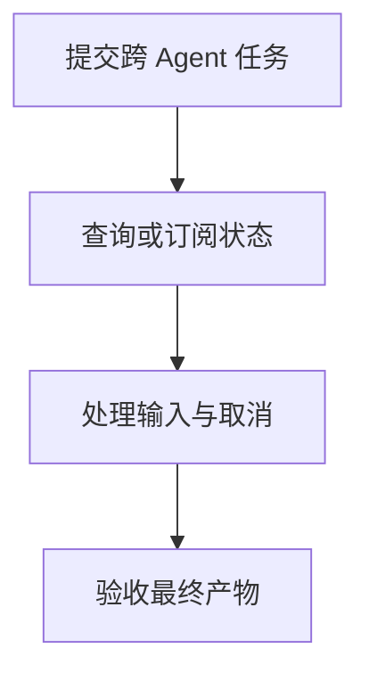

import InterviewQuestion from '../../../../components/InterviewQuestion.astro';

<InterviewQuestion>

A2A 面向 Agent 之间的协作，可用任务状态、消息和产物描述跨系统工作；MCP 主要连接 Agent 与工具或数据服务。跨 Agent 长任务需要可查询的状态，不能只依赖一次 HTTP 回复。

## 任务协议要包含生命周期

使用任务标识关联提交、进度、需要补充输入、完成和失败；产物有标识、格式和出处。客户端处理断连、恢复和重复通知，服务端校验协作权限。不同版本的状态枚举和传输支持应按实际协议核对。

### 取消任务等于撤销已发生的操作吗？

不等于。取消请求只能影响仍可停止的工作，已提交的业务变更需要查询与补偿。任务终态还应说明哪些产物有效、哪些步骤已产生副作用。

资料

核对于 2026-10-14。[A2A 协议规范](https://a2a-protocol.org/latest/specification/)。正文场景、示例代码与方案取舍为教学示例；具体接口按选定版本核对。

</InterviewQuestion>
