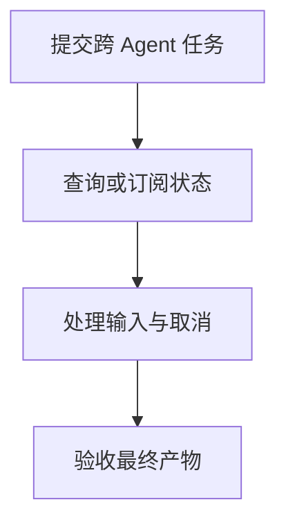

import InterviewQuestion from '../../../../components/InterviewQuestion.astro';

<InterviewQuestion>

A2A 面向 Agent 之间的协作，可用任务状态、消息和产物描述跨系统工作；MCP 主要连接 Agent 与工具或数据服务。跨 Agent 长任务需要可查询的状态，不能只依赖一次 HTTP 回复。

## 任务协议要包含生命周期

Task 用任务标识和状态关联提交、处理、等待补充输入、完成或失败。Artifact 用 `artifactId` 标识任务产物，`parts` 承载文本、文件或结构化数据；产物与普通对话消息分开，便于客户端持续收集和验收结果。引用出处和业务验收规则仍需应用补充，协议不会自动证明产物正确。

客户端应处理断连、状态查询和重复通知，服务端校验协作权限。流式增量产物还要按所用版本的追加与结束标记组装，不能把每个片段当成完整结果。状态枚举、方法名和传输支持按双方协商的版本核对。

### 取消任务等于撤销已发生的操作吗？

不等于。取消请求只能影响仍可停止的工作，已提交的业务变更需要查询与补偿。任务终态还应说明哪些产物有效、哪些步骤已产生副作用。

资料

核对于 2026-10-15。[A2A 协议规范](https://a2a-protocol.org/latest/specification/)。

</InterviewQuestion>
