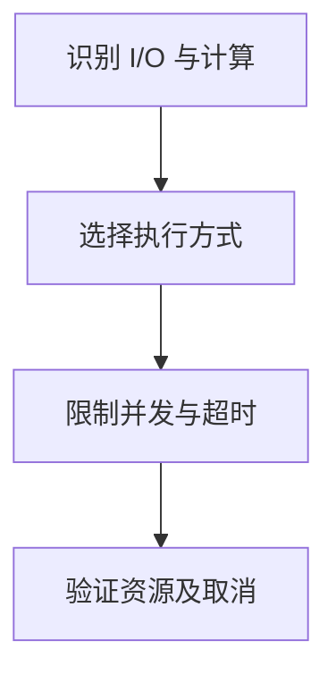

import InterviewQuestion from '../../../../components/InterviewQuestion.astro';

<InterviewQuestion>

模型 API 和网络工具多为 I/O 等待，适合异步并发；阻塞 SDK 可在线程中隔离，CPU 密集计算可考虑进程或释放 GIL 的库。选择要看实际运行时和依赖，不能把 async 当成自动并行计算。

## 异步链路仍然需要容量控制

使用有界并发、超时和取消，避免一次启动所有任务压垮下游。同步文件操作或重计算会阻塞事件循环。对线程、进程与异步方案分别测吞吐、P95、内存和资源回收；Python 版本及 GIL 配置会影响结论。

### 取消异步任务后，远程调用一定停止吗？

不一定，客户端取消只说明本地等待终止。远程可能已经执行，需要调用标识和状态查询；写任务不能因等待取消就直接重复提交。

资料

核对于 2026-10-14。[Python asyncio Tasks](https://docs.python.org/3/library/asyncio-task.html)。正文场景、示例代码与方案取舍为教学示例；具体接口按选定版本核对。

</InterviewQuestion>
