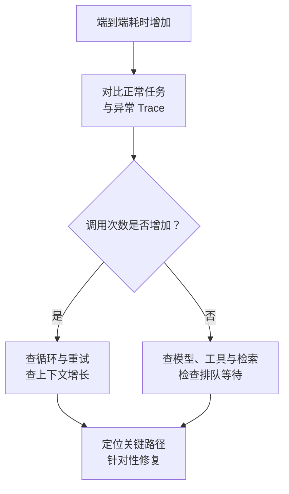

import InterviewQuestion from '../../../../components/InterviewQuestion.astro';

<InterviewQuestion>

先找到这次任务的执行路径，再比较正常任务与异常任务：是调用次数增加，还是某一步变慢。Trace 用 trace_id 及 Span 的父子关系关联模型、检索和工具步骤，run_id 作为业务字段关联具体任务；两种标识不能混为一谈。记录开始结束、状态、重试、输入输出量及版本，才能定位等待发生在哪里。

## 时间不能只把所有 Span 相加

串行步骤会累积耗时，并行步骤要看任务依赖形成的关键路径。教学例：两个查询同时开始，分别耗时 2 秒和 5 秒，汇总前通常要等较慢的查询；这段墙钟时间不是 7 秒。再检查排队等待是否发生在 Span 计时之外。

模型变慢时区分首 Token 与总生成时间，检查输入增长和输出量；工具变慢时查看依赖服务、连接池、锁及超时。一次 429 若在 SDK、网关和应用分别重试，可能造成重复等待。修复后用同条件任务复测质量与延迟。

### 日志记全 Prompt 才够吗？

不必。先保留步骤、标识、用量、错误及版本，对敏感内容做受控记录。日志和 Trace 应支持定位，而不是把用户数据无限复制到日志平台。

资料

核对于 2026-10-15。[AgentScope Tracing](https://doc.agentscope.io/tutorial/task_tracing.html)、[OpenTelemetry 的 Trace 与 Span](https://opentelemetry.io/docs/concepts/signals/traces/)。关键路径、故障分类和两查询算例为工程解释。

</InterviewQuestion>
