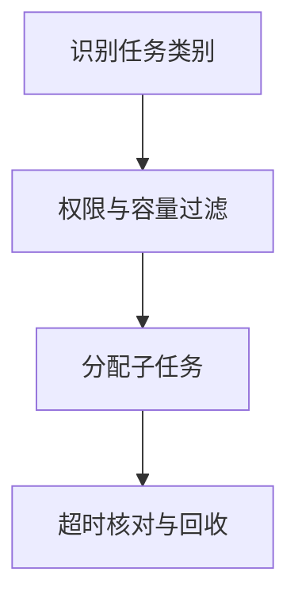

import InterviewQuestion from '../../../../components/InterviewQuestion.astro';

<InterviewQuestion>

路由器根据任务、能力、权限和当前容量选择执行者，输出受约束的角色或任务类型。固定分类可优先使用规则或小模型；不确定时澄清，不能把所有模糊请求发送给权限最大的 Agent。

## 路由结果也是待验证的决策

维护能力目录和输入契约，检查执行者是否接收该任务类型。任务分配携带标识、截止时间与回传地址，超时后查询状态再决定重试。重派写任务前确认旧执行是否已产生副作用。

### 怎样测试路由器？

使用跨类别、歧义、超范围和无权限请求，检查分类、拒绝、负载和最终成功率。分类正确但执行者缺少上下文，任务仍会失败。

资料

核对于 2026-10-15。[LangChain 多 Agent 模式](https://docs.langchain.com/oss/python/langchain/multi-agent)。

</InterviewQuestion>
