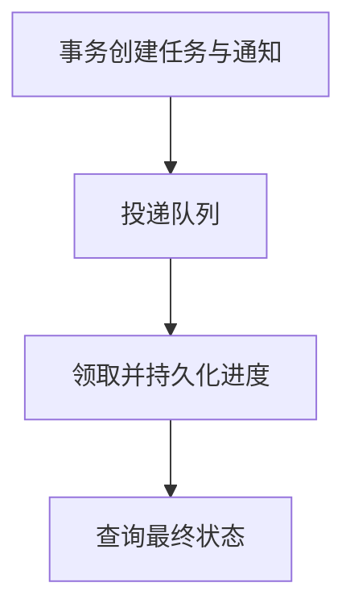

import InterviewQuestion from '../../../../components/InterviewQuestion.astro';

<InterviewQuestion>

请求先创建持久化任务并返回 task_id，Worker 从队列领取任务，状态和产物可独立查询。任务表是业务状态来源；队列通知不应成为唯一进度记录。

## 处理提交与消费的两端重复

数据库提交任务与发送消息可用事务 Outbox 衔接，再由投递器重试。消费端用任务状态、版本和执行标识去重，领取后续租。业务副作用采用幂等或状态核对；积压按租户、优先级与下游容量限流。

### 数据库成功但发消息失败怎么办？

Outbox 与任务记录同事务提交，后台扫描并重发。Worker 执行成功但确认消息失败时会重复投递，所以仍需消费端幂等；这套方案不能自动使外部写操作恰好一次。

资料

核对于 2026-10-15。[AWS：事务 Outbox 与重复消费](https://docs.aws.amazon.com/prescriptive-guidance/latest/cloud-design-patterns/transactional-outbox.html)、[分布式锁与 Fencing](https://martin.kleppmann.com/2016/02/08/how-to-do-distributed-locking.html)。任务表、租约与限流组合为工程设计，不是消息队列默认提供的端到端保证。

</InterviewQuestion>
