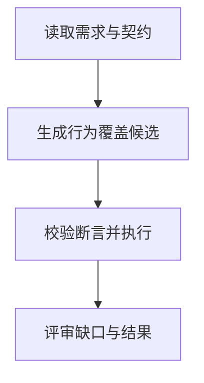

import InterviewQuestion from '../../../../components/InterviewQuestion.astro';

<InterviewQuestion>

输入新需求、接口契约和可核对的验收条件，Agent 生成测试候选，再由规则、执行与评审筛选。没有历史用例不等于没有判定依据；先澄清不确定需求，避免凭模型想象业务。

## 从行为覆盖到真实执行

提取正常流程、边界、失败、权限、状态迁移和组合约束，把每项关联到需求。测试数据与外部依赖隔离，验证测试确实能捕获错误，而不是只匹配当前实现。生成结果记录覆盖缺口和待确认事项。

### 生成很多测试能证明质量好吗？

数量容易被近重复放大。用需求覆盖、缺陷检出、误报、维护成本和执行稳定性评价，审查断言是否具有业务意义；关键验收仍由负责人确认。

资料

核对于 2026-10-14。[Spring AI 工具调用](https://docs.spring.io/spring-ai/reference/api/tools.html)、[OpenTelemetry Traces](https://opentelemetry.io/docs/concepts/signals/traces/)。正文场景、示例代码与方案取舍为教学示例；具体接口按选定版本核对。

</InterviewQuestion>
