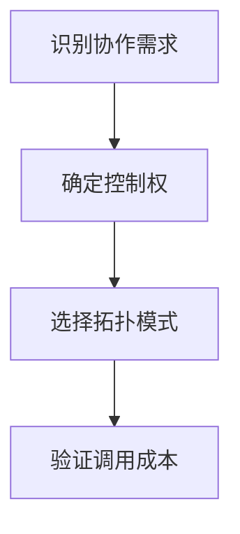

import InterviewQuestion from '../../../../components/InterviewQuestion.astro';

<InterviewQuestion>

Supervisor 统一派发并汇总；Handoff 把当前控制权和必要状态交给另一角色；Router 先按任务类别分发。选择取决于谁负责全局状态、是否需要多轮交互、任务能否独立完成。

## 先明确控制权和产物边界

并行资料调研适合集中汇总，售前转售后可用明确交接，固定领域分类可用 Router。避免两个角色同时认为自己是最终协调者。模式可以组合，但每次控制转移都要说明后续接收消息的对象。

### 为什么不全部采用 Supervisor？

中心化容易观测，但会增加中转调用和上下文负担。若子角色直接与用户进行长对话，频繁中转可能不划算；复杂度应由实际任务收益支撑。

资料

核对于 2026-10-14。[LangChain 多 Agent 模式](https://docs.langchain.com/oss/python/langchain/multi-agent)。正文场景、示例代码与方案取舍为教学示例；具体接口按选定版本核对。

</InterviewQuestion>
