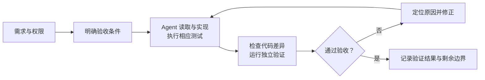

import InterviewQuestion from '../../../../components/InterviewQuestion.astro';

<InterviewQuestion>

先给出目标、现有约定、允许的变更和可观察的验收条件，再让 Agent 执行。生成结束后检查差异，运行与风险相称的验证，并核对真实结果。能编译和示例能跑，只覆盖部分正确性；AI 自评也不能替代独立证据。

## 测试不能只复述实现

教学例：库存扣减应从需求得到“库存为零时拒绝、并发不超卖、重复请求不重复扣减”，再设计验证。若实现与测试都误把重复请求当作新订单，测试全绿也不能说明需求正确。

简单文案修改可以检查实际页面；会改变权限、并发或外部写操作的代码，需要相应的集成或故障验证。Agent 可以运行这些检查，人负责判断证据是否覆盖目标，以及哪些发布动作已获授权。

### AI 写错了，怎样继续？

先保留最小失败输入、错误和调用位置，查清是需求不明、资料过期、代码错误还是环境问题。把具体失败交回 Agent 修复，别只让它反复“再优化一下”。通过相同回归条件后，才报告问题已解决。

资料

核对于 2026-10-14。[Anthropic：Agent 评测中的任务与验证](https://www.anthropic.com/engineering/demystifying-evals-for-ai-agents)。库存案例和交付流程为本站工程建议，不是候选人的项目成果。

</InterviewQuestion>
