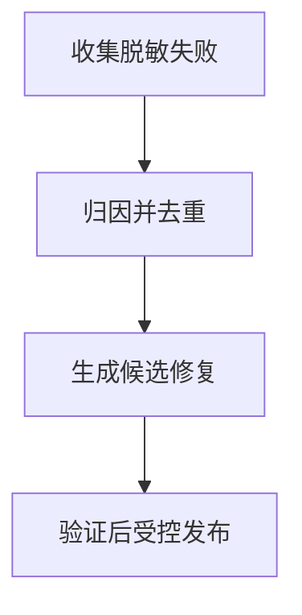

import InterviewQuestion from '../../../../components/InterviewQuestion.astro';

<InterviewQuestion>

闭环先收集可解释的失败，再分类、修复并回归。模型可以提出 Skill 或 Prompt 修改，但候选变更必须经过验证和发布控制；不能把用户一次负反馈直接写成全局规则。

## 按故障所在阶段分类

区分需求理解、证据检索、工具选择、执行、权限和答案归纳。保留脱敏输入、版本、轨迹与期望结果，修复后在历史和未见样本上验证。重复失败去重，按影响与覆盖面排序，而不是只追逐最新一例。

### 自动生成的经验什么时候进入生产？

先在限定范围检验，确认来源和适用版本，再通过评测门槛发布。经验有有效期和撤销机制；无法判断真实性或含有隐私的内容不能直接共享。

资料

核对于 2026-10-14。[Reflexion 论文](https://arxiv.org/abs/2303.11366)、[OpenTelemetry Traces](https://opentelemetry.io/docs/concepts/signals/traces/)。正文场景、示例代码与方案取舍为教学示例；具体接口按选定版本核对。

</InterviewQuestion>
