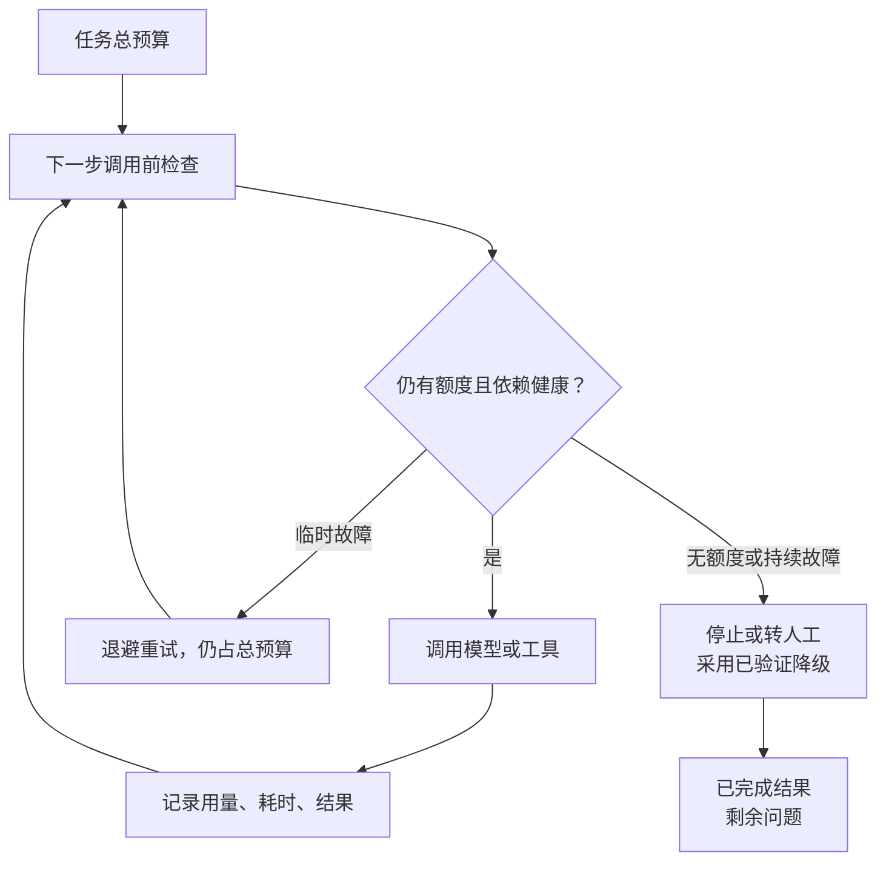

import InterviewQuestion from '../../../../components/InterviewQuestion.astro';

<InterviewQuestion>

限制单次输出长度，只管得住一次模型调用。Agent 会多轮调用模型和工具，所以预算要覆盖整个任务：总时长、模型调用次数、工具调用次数、Token 和允许的费用。

执行层在下一次调用前检查剩余预算，运行中记录实际用量。不能只把“最多调用五次”写进提示词。并发子任务要共享或分配总预算，别让每个子 Agent 都拿一份完整额度。

## 先查哪一段把开销放大了

按 run_id 串起模型和工具的 Trace，看调用次数、输入增长、工具耗时及重复参数。常见问题是工具结果过长、失败后重复查询，或者应用、网关和 SDK 每层都重试一次，把请求倍增。

重试集中到明确的一层，区分可重试故障和权限、参数错误。限流控制请求速度，预算限制总消耗，熔断在依赖持续失败时暂时停止请求。三者解决的不是同一件事。

### 大模型失败，切到小模型就行吗？

先验证任务成功率、工具协议、结构化输出和权限约束是否仍满足。降级模型可能产生不同调用或更差的结果；不能为了省钱让它执行未经验证的写操作。也可以只把简单分类任务交给小模型。

### 达到预算时，怎样回复用户？

保存已完成结果，指出哪一步没完成及原因。没有查到证据时，不要让模型强行编一个答案。费用以服务商实际计量为准，本地估算应与计费记录分开。

资料

核对于 2026-10-13。[Spring AI Alibaba 模型调用限制与工具重试](https://github.com/spring-ai-alibaba/website/blob/main/docs/frameworks/agent-framework/tutorials/hooks.md)、[阿里云 Agent 可观测性](https://github.com/aliyun/ai-agent-handbook/blob/main/04-governance/%E7%AC%AC%2013%20%E7%AB%A0%E3%80%80Agent%20%E7%9A%84%E5%8F%AF%E8%A7%82%E6%B5%8B%E6%80%A7.md)。总预算与分层重试的处理为工程建议。

</InterviewQuestion>
