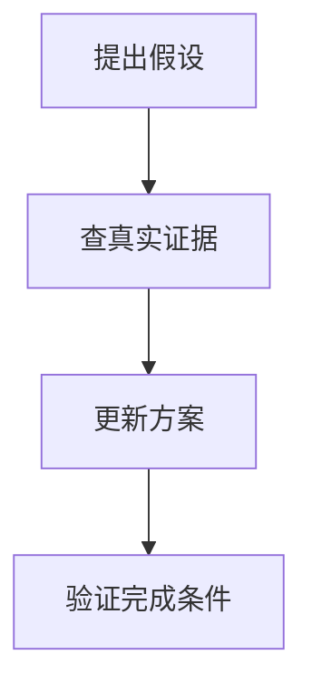

import InterviewQuestion from '../../../../components/InterviewQuestion.astro';

<InterviewQuestion>

CoT 在一次推理中展开中间步骤；ReAct 把推理与真实工具反馈交替执行；Tree of Thoughts 则探索多个候选推理路径并选择后续分支。三者解决的控制问题不同，更多推理步骤也会增加成本。

## 用任务决定是否分支

以排查订单超时为例，单靠 CoT 可以列出原因，但不能证明服务是否异常。ReAct 可以查询监控再调整判断。若任务有多个可比较的方案，才考虑分支搜索，并定义可计算的评分、剪枝条件和总预算。解释性文字不能代替真实执行记录。

### 把完整思考过程写出来就更容易排障吗？

排障应保存工具输入输出、状态变化和可核对的决策摘要。模型写出的推理文本可能遗漏或误述真实原因；不要把它当成忠实的内部计算过程，也不要为了日志要求输出敏感信息。

资料

核对于 2026-10-14。[ReAct 论文](https://arxiv.org/abs/2210.03629)。正文场景、示例代码与方案取舍为教学示例；具体接口按选定版本核对。

</InterviewQuestion>
