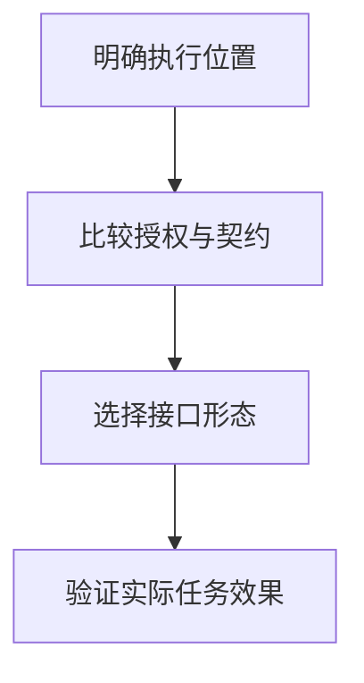

import InterviewQuestion from '../../../../components/InterviewQuestion.astro';

<InterviewQuestion>

CLI 容易复用现有命令、脚本和文件工作流；MCP 提供统一的能力发现与调用协议。选择取决于部署位置、授权、输出结构和维护方式，协议本身不会自动提高工具正确率。

## 比较实际执行边界

本地代码仓库可使用受限 CLI，固定工作目录、允许的命令和输出上限。远程多用户业务服务更适合显式工具契约和身份校验。两者都要处理超时、取消、幂等与结果未知；CLI 参数应以数组传递，避免拼接不可信 Shell 文本。

### Skill 能替代 CLI 或 MCP 吗？

Skill 主要组织做事方法和按需加载的资料，可以指导调用 CLI 或 MCP。实际能力、权限与执行器仍需存在，不是写一份 Markdown 就能获得系统权限。

资料

核对于 2026-10-14。[MCP Tools 2025-11-25](https://modelcontextprotocol.io/specification/2025-11-25/server/tools)、[Agent Skills 规范](https://agentskills.io/specification)。正文场景、示例代码与方案取舍为教学示例；具体接口按选定版本核对。

</InterviewQuestion>
