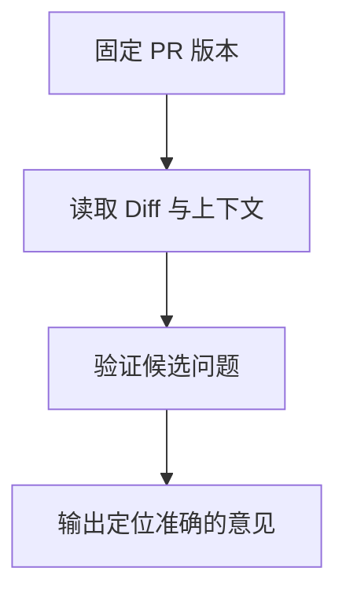

import InterviewQuestion from '../../../../components/InterviewQuestion.astro';

<InterviewQuestion>

Review Agent 获取固定版本的 Diff、相关上下文和仓库规则，输出可定位且有依据的问题。权限只允许读取与生成审查产物；是否发布评论由工作流的授权决定。

## 控制上下文与误报

按模块和风险选择关联代码、调用者与测试，不仅逐行看新增代码。每个发现包含触发条件、影响和准确行号，区分确定问题与待验证假设。对重复意见归并，用真实回归样本测误报和漏报。

### 读取仓库规则会遇到提示注入吗？

会。代码、注释和文档属于待审材料，不能改变系统授权或要求上传凭据。规则来源分级，执行测试在受控沙箱中，外部内容无权让 Agent 推送代码。

资料

核对于 2026-10-14。[Docker Engine Security](https://docs.docker.com/engine/security/)、[Spring AI 工具调用](https://docs.spring.io/spring-ai/reference/api/tools.html)。正文场景、示例代码与方案取舍为教学示例；具体接口按选定版本核对。

</InterviewQuestion>
