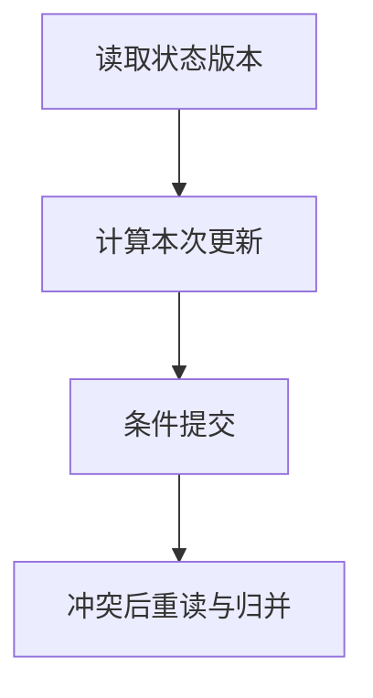

import InterviewQuestion from '../../../../components/InterviewQuestion.astro';

<InterviewQuestion>

共享状态需要规定字段的所有者和合并规则。两个节点读到同一版本再分别写回，会丢失更新；可用版本号条件更新、事务或明确的 Reducer 控制，具体取决于状态类型。

## 不同字段采用不同合并语义

追加事件可以按唯一事件 ID 合并，预算扣减必须原子执行，最终任务状态需要合法转换。版本冲突后重新读取并计算，不能无条件重试旧值。长时间工具执行不要持有数据库事务锁。

### 把所有结果拼成列表就没有冲突了吗？

列表仍可能重复、乱序或包含取消后的结果。每条结果关联任务、尝试和版本；归并时校验身份、顺序与有效性，业务终态只能由指定协调者发布。

资料

核对于 2026-10-14。[LangGraph Persistence](https://docs.langchain.com/oss/python/langgraph/persistence)。正文场景、示例代码与方案取舍为教学示例；具体接口按选定版本核对。

</InterviewQuestion>
