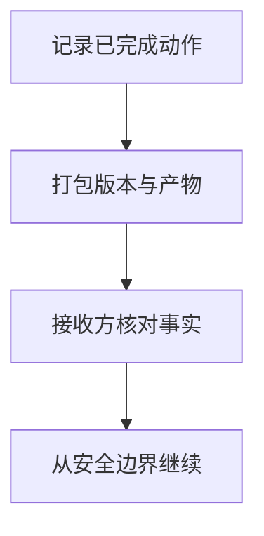

import InterviewQuestion from '../../../../components/InterviewQuestion.astro';

<InterviewQuestion>

原生检查点记录运行时状态，摘要只保留部分语义，二者不能互相替代。跨 Runtime 交接需要明确已完成动作、待做任务、产物版本与工作区事实，接收者先核对再继续。

## 以真实产物验证交接描述

交接记录目标、约束、工具操作标识、文件哈希、测试结果与未解决问题。代码任务检查当前 Git 状态和产物，不因摘要说“测试通过”就直接发布。无法迁移的内部状态显式标明，必要时从安全边界重新执行。

### 摘要和文件实际状态冲突怎么办？

以可核对的文件、数据库及执行记录确认事实，暂停依赖冲突状态的副作用。修正交接记录后再继续，不能选择更方便的一方当作完成证据。

资料

核对于 2026-10-14。[LangGraph Persistence](https://docs.langchain.com/oss/python/langgraph/persistence)。正文场景、示例代码与方案取舍为教学示例；具体接口按选定版本核对。

</InterviewQuestion>
