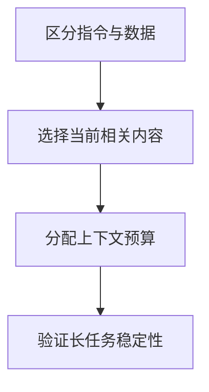

import InterviewQuestion from '../../../../components/InterviewQuestion.astro';

<InterviewQuestion>

上下文拼装先区分可信指令、当前任务、历史状态和外部证据，再按任务需要分配预算。没有对所有模型都最优的固定顺序；权限与规则不能因为历史变长而被摘要丢弃。

## 信息相关性和可信度分别处理

稳定规则放在模型接口支持的高优先级角色，当前任务与关键状态明确表达，工具及检索结果保留出处并作为数据。历史保留影响当前决策的内容，大结果使用引用。为输出和后续工具结果预留 Token，而不是填满窗口。

### 把最重要内容放最后就能保证遵守吗？

位置会影响效果，但不能构成安全边界。用不同长度、位置和冲突指令测试任务成功率；授权检查由执行层完成，不能依赖模型记住某一句话。

资料

核对于 2026-10-14。[LangChain Middleware](https://docs.langchain.com/oss/python/langchain/middleware/built-in)。正文场景、示例代码与方案取舍为教学示例；具体接口按选定版本核对。

</InterviewQuestion>
