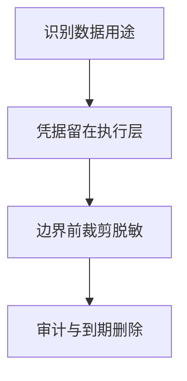

import InterviewQuestion from '../../../../components/InterviewQuestion.astro';

<InterviewQuestion>

密钥由受控执行层持有，模型只得到业务所需数据。Prompt、Trace、工具输出和产物都是潜在泄露路径，应按数据用途控制字段、保留时间及访问范围。

## 身份授权与内容脱敏同时落实

工具通过凭据引用获取短期授权，避免把 Token 注入模型上下文。日志对敏感字段脱敏，原始调试数据使用更严格访问权限与期限。按用户和任务分区存储，删除或撤权覆盖缓存、记忆和历史附件。

### 只对最终回复脱敏为什么不够？

原始内容可能已发给模型、写入日志或被子 Agent 读取。应在跨边界传输前裁剪必要字段，并保留可审计的访问记录；脱敏不是对象权限检查的替代品。

资料

核对于 2026-10-14。[MCP Authorization 2025-11-25](https://modelcontextprotocol.io/specification/2025-11-25/basic/authorization)、[OpenTelemetry Traces](https://opentelemetry.io/docs/concepts/signals/traces/)。正文场景、示例代码与方案取舍为教学示例；具体接口按选定版本核对。

</InterviewQuestion>
