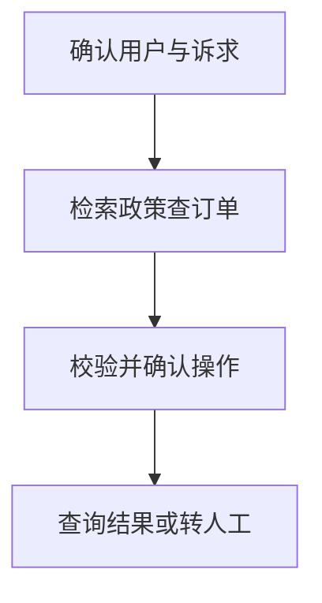

import InterviewQuestion from '../../../../components/InterviewQuestion.astro';

<InterviewQuestion>

客服 Agent 把政策问答与真实订单操作分开。知识检索回答规则，业务工具查询当前订单；涉及退款时由确定性流程核对身份、状态、金额和审批，Agent 负责理解与解释。

## 模糊需求先澄清

用户说“这个不想要了”时先确认订单和诉求，不能直接取消所有订单。检索政策带版本和引用，关键操作生成可核对的确认信息；幂等提交后查询实际结果。失败、投诉与复杂争议转人工并携带已核实上下文。

### 客服成功率怎样定义？

按问题解决、业务操作正确、转人工、重复联系和满意度分别计量，检查错误退款与越权等严重错误。平均回复满意不能掩盖少量高损失操作。

资料

核对于 2026-10-14。[Spring AI 工具调用](https://docs.spring.io/spring-ai/reference/api/tools.html)、[LangChain 检索架构](https://docs.langchain.com/oss/python/deepagents/retrieval)。正文场景、示例代码与方案取舍为教学示例；具体接口按选定版本核对。

</InterviewQuestion>
