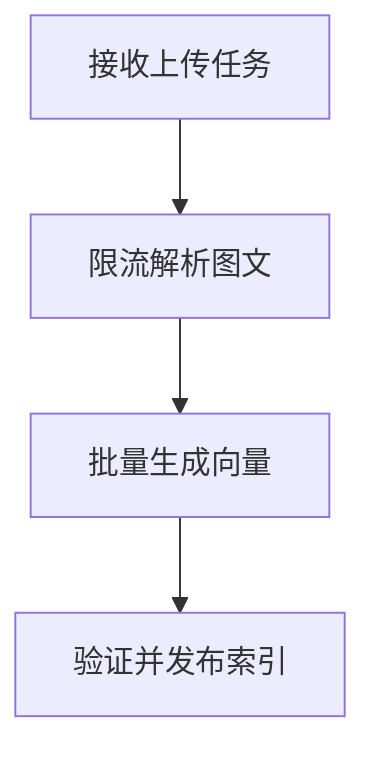

import InterviewQuestion from '../../../../components/InterviewQuestion.astro';

<InterviewQuestion>

大规模入库应把上传、解析、切片、Embedding 和索引发布拆成可恢复的阶段。上传先返回任务标识，后台按资源限额处理；用户看到明确进度，不能把上传成功显示为可检索。

## 每个阶段都能查状态和重试

任务保存文档版本、解析器版本和内容哈希。OCR 与图像模型限制并发，Embedding 批量执行并处理限流，索引阶段验证切片数量。只有全部必要阶段成功才发布版本；坏页允许隔离，但需标明覆盖缺口。

### 同一文档重复上传会不会重复收费和建索引？

按租户、内容哈希和处理版本识别重复任务。重试沿用阶段操作标识；处理器版本变更时可以重建，不能永久复用旧解析结果。

资料

核对于 2026-10-14。[LangChain 检索架构](https://docs.langchain.com/oss/python/deepagents/retrieval)。正文场景、示例代码与方案取舍为教学示例；具体接口按选定版本核对。

</InterviewQuestion>
