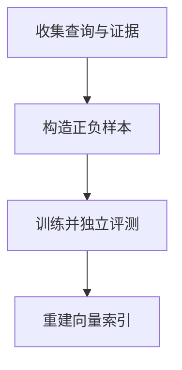

import InterviewQuestion from '../../../../components/InterviewQuestion.astro';

<InterviewQuestion>

先排查分块、查询表达、索引和重排，再判断 Embedding 是否不适应领域。若业务词义与通用语料明显不同，可用真实查询与相关片段构造正样本，并加入容易混淆但不相关的难负样本。

## 防止训练集与评测集泄漏

按文档来源、时间或业务对象划分数据，避免同一文档的相邻切片同时进入训练与测试。负样本需确认不是遗漏的相关证据。对比微调前后的召回、跨领域退化、向量成本；更新模型后重新生成库内向量。

### 模型训练好了，旧向量还可以保留吗？

通常不能把新查询向量直接与旧模型文档向量混检。除非经过专门的兼容性验证，应建立新索引并完整重嵌入，再评测和切换版本。

资料

核对于 2026-10-14。[LangChain 检索架构](https://docs.langchain.com/oss/python/deepagents/retrieval)。正文场景、示例代码与方案取舍为教学示例；具体接口按选定版本核对。

</InterviewQuestion>
