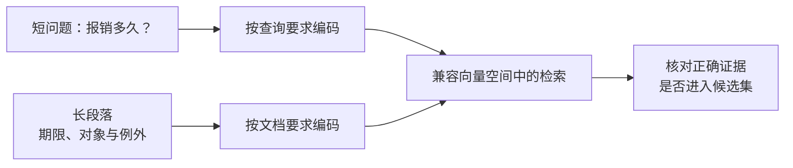

import InterviewQuestion from '../../../../components/InterviewQuestion.astro';

<InterviewQuestion>

Embedding 把不同长度的文本映射到固定维度的向量。能计算距离，不代表适合检索；检索模型需要学会让问题靠近支持答案的段落。短问题与长文档属于非对称检索，查询和文档的编码指令可能不同，应遵循模型要求。

## 文本长度相同，不是匹配的前提

长度差可能使问题被长段落的其他主题稀释；超过编码器上限还可能截掉答案。可以改善分块、带上标题，或在意图明确时补充查询上下文。不能为了凑长度，把短问题扩写成模型编造的结论。

选型时覆盖中文术语、英文缩写、型号和错误码，固定文档、分块、K 值与正确证据标注，比较 Recall@k、延迟和建库成本。向量维度更大或模型更新，都不直接保证业务检索更好。

### 余弦、内积和 L2 能随便换吗？

不能。按模型推荐设置距离和归一化；单位向量的内积等于余弦，但没有归一化时二者可能排序不同。换模型时通常需要重建文档向量和索引，即使维度相同，也不能假定新旧空间兼容。

资料

核对于 2026-10-14。[BGE 编码说明](https://bge-model.com/tutorial/1_Embedding/1.2.1.html)、[Milvus 距离度量](https://milvus.io/docs/metric.md)。报销问题和业务评测方案为本站示例。

</InterviewQuestion>
